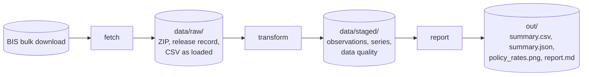
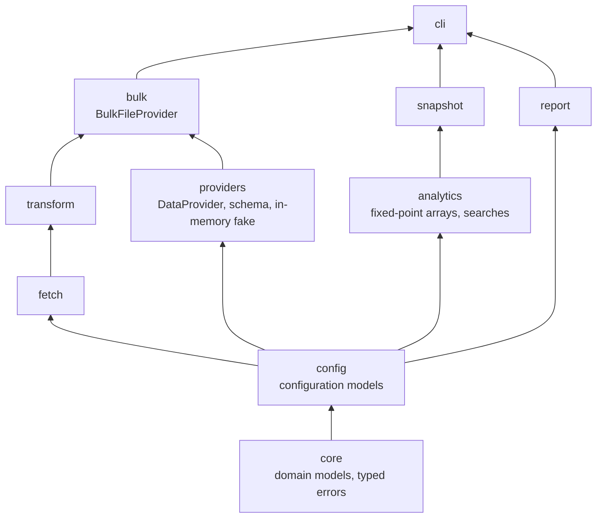

# BIS Policy Rate Monitor

<div align="center">
    <p align="center">
        <a href="https://github.com/andrea-dm/policy-rate-monitor/actions/workflows/ci.yml" target="_blank">
            
        </a>
        <a href="https://github.com/andrea-dm/policy-rate-monitor/releases" target="_blank">
            
        </a>
        <a href="pyproject.toml" target="_blank">
            
        </a>
        <a href="https://github.com/gauge-sh/tach" target="_blank">
            
        </a>
        <a href="https://microsoft.github.io/pyright/" target="_blank">
            
        </a>
        <a href="https://github.com/astral-sh/ruff" target="_blank">
            
        </a>
        <a href="https://github.com/astral-sh/uv" target="_blank">
            
        </a>
        <a href="https://squidfunk.github.io/mkdocs-material/" target="_blank">
            
        </a>
    </p>
</div>

A command-line tool that downloads the central-bank **policy rates** published by the Bank for
International Settlements (BIS), turns them into a clean daily dataset, and reports, for a list of
countries or economic areas, the latest rate, the rate 12 months earlier and the change in basis
points.

`bis-prates fetch`, `bis-prates transform` and `bis-prates report` each do one step and write files
the next step reads. Everything specific to the dataset (where the file is, its columns, which
series to keep, the data-quality rules, the output fields) is declared in
[`configs/bis_cbpol.json`](configs/bis_cbpol.json), not in the code.

---

## Table of Contents

- [Key Features](#key-features)
- [Architecture](#architecture)
- [Getting Started](#getting-started)
  - [Prerequisites](#prerequisites)
  - [Installation](#installation)
  - [Usage](#usage)
  - [Using the package in a notebook](#using-the-package-in-a-notebook)
  - [Reproducing `out/` from a clean clone](#reproducing-out-from-a-clean-clone)
  - [Development Workflow](#development-workflow)
- [Data Model](#data-model)
- [Assumptions](#assumptions)
- [Known Issues of the BIS Data](#known-issues-of-the-bis-data)
- [Limitations and Next Steps](#limitations-and-next-steps)
- [Project Structure](#project-structure)
- [Testing](#testing)
- [Contributing](#contributing)
- [Change Log](#change-log)
- [Credits](#credits)
  - [AI Usage](#ai-usage)
- [Security](#security)
- [License](#license)

---

## Key Features

- **Configuration-driven**: the BIS file's location, columns, codes, series selection,
  data-quality rules and output fields come from one JSON file, validated when it is loaded
  ([docs/configuration.md](docs/configuration.md)). A second dataset of the same shape needs a
  second configuration, not new code.
- **Exact arithmetic**: rates are read as text and kept as decimals end to end; the change in
  basis points is computed in decimal arithmetic, never through floating point.
- **Extract, load, transform (ELT)**: the CSV is first stored exactly as loaded, then staged as
  tidy daily observations and series metadata, so the source as received is kept next to the
  staged data; a staged value is found in the raw file by its series and date.
- **Cache and failure handling**: a second download within 24 hours (`cache_ttl_hours` in the
  configuration) makes no request; a broken
  download never replaces a good cached copy; with the network down, the cached copy is used with
  a warning.
- **Data quality reported, not hidden**: missing values are kept and marked invalid, duplicates are
  dropped or resolved as configured, and every finding is written to `data_quality.json` and shown
  in the report.
- **One exit code per kind of failure**: each failure ends the command with its own number, so a
  script or scheduler running the commands knows what to do from the number alone: try again later
  when the BIS site cannot be reached (6), stop until someone fixes the configuration (4), or run
  the earlier step when its output is missing (5). The full list is under Usage.
- **Strict static analysis**: ruff with a strict rule set, pyright in strict mode, deptry, and
  tach for the module layering.

---

## Architecture

The three commands form a pipeline. Each writes files the next one reads, so a step can be rerun
on its own.



The modules are layered. Here an arrow means "is imported by", not "runs before": the `report`
module only writes the output files from the figures it is given, and the `report` command in
`cli` is what reads the staged data, through the provider, and passes it on. tach checks that no
import goes against the arrows:



The CLI reads data only through a `DataProvider`: `fetch` and `transform` prepare it, and five
read-only queries serve the series, their metadata, the observations, the data-quality findings
and the source release. `BulkFileProvider` is the one over the BIS bulk download; another source
(a query engine, an SDMX API) would be another provider, with no change to the snapshot or the
report. Every provider returns the observations in one canonical form, built from the
configuration, and passes the same contract tests.

`snapshot` is a pure function over the observations: it does no I/O, so it is tested on small
hand-made tables.

---

## Getting Started

### Prerequisites

| Requirement | Version |
|---|---|
| Python | 3.12, 3.13 or 3.14 (the versions CI tests) |
| [uv](https://docs.astral.sh/uv/) | latest |

### Installation

```bash
git clone https://github.com/andrea-dm/policy-rate-monitor.git
cd policy-rate-monitor
uv sync --no-dev        # to run the tool: the package and its runtime dependencies only
```

To work on the code, install the dependency groups as well:

```bash
uv sync --all-groups
```

| Group | Content |
|---|---|
| `lint` | ruff, pyright, deptry, tach and the pandas and pyarrow type stubs |
| `test` | pytest, pytest-mock, pytest-cov, hypothesis |
| `dev` | `lint` and `test` together; plain `uv sync` installs it by default |
| `docs` | MkDocs and its plugins, for `mkdocs serve` and `mkdocs build` |
| `jupyter` | JupyterLab and a kernel, for the example notebooks in `examples/` |

One optional extra, `fast`, installs Numba, which compiles the analytics search loops; without it they
run on NumPy with the same results:

```bash
uv sync --no-dev --extra fast
```

The planned web service and interactive chart will also come as extras, so a plain install stays
small.

### Usage

```bash
uv run bis-prates fetch                 # download the BIS ZIP, or reuse the cached copy
uv run bis-prates transform             # parse, validate and stage the daily data
uv run bis-prates report --countries "US,EA,GB,JP,CH" --start "2015-01-01"
```

With the virtual environment activated, `bis-prates` works without `uv run`.
`bis-prates config validate` checks the configuration, and `bis-prates config schema` prints its
JSON Schema.

| Command | Reads | Writes |
|---|---|---|
| `fetch` | the BIS bulk-download page | `data/raw/WS_CBPOL_csv_flat.zip` and its release record (`.json`) |
| `transform` | the cached ZIP | `data/raw/WS_CBPOL_csv_flat.parquet` (the file as loaded), `data/staged/observations.parquet`, `series.json`, `data_quality.json` |
| `report` | the staged data | `out/summary.csv`, `out/summary.json`, `out/policy_rates.png`, `out/report.md` |

Options, after the command:

| Option | Commands | Default |
|---|---|---|
| `--config PATH` | all | `$BIS_PRATES_CONFIG`, else `configs/bis_cbpol.json` |
| `--data-dir PATH` | `fetch`, `transform`, `report` | `$BIS_PRATES_DATA_DIR`, else `data` (`dataset.data_dir` in the configuration) |
| `--debug` | all | off; shows the full traceback of an error |
| `--countries "US,EA"` | `report` | required; codes are matched without regard to case and spaces, de-duplicated, and written as typed next to the code used |
| `--start YYYY-MM-DD` | `report` | the whole history; first date of the chart |
| `--out DIR` | `report` | `out` |

Exit codes:

| Code | Meaning | What to do |
|---|---|---|
| 0 | success | - |
| 1 | no requested country or area has a complete result (status `ok`); the outputs are still written | check the codes and the statuses in the summary |
| 2 | invalid arguments | fix the command line |
| 3 | an unexpected error, i.e. a bug; the traceback is logged | report it |
| 4 | invalid configuration | fix the configuration file |
| 5 | a step's input is missing | run the previous step (e.g. `transform` before `report`) |
| 6 | source unavailable | retry later |
| 7 | unexpected source format | check the BIS file; the configuration may need updating |
| 8 | a file cannot be read or written | check the data and output folders |

### Using the package in a notebook

Two notebooks in `examples/` go through the three commands from Python, run in this order:

1. [fetch_and_transform.ipynb](examples/fetch_and_transform.ipynb) downloads the BIS file and
   stages it, as `fetch` and `transform` do;
2. [policy_rates.ipynb](examples/policy_rates.ipynb) loads the staged data through the provider,
   computes the 12-month change for five countries or areas and plots their rates, as `report` does.

They need the `jupyter` group:

```bash
uv sync --all-groups --all-extras
uv run jupyter lab examples/
```

The same steps in any Python session started at the repository root. Download and stage the
data:

```python
from pathlib import Path

from policy_rate_monitor.bulk import BulkFileProvider
from policy_rate_monitor.config import FileConfigSource

config = FileConfigSource("configs/bis_cbpol.json").load()
provider = BulkFileProvider(config, Path(config.dataset.data_dir))
provider.fetch()      # downloads the BIS file, unless the cached copy is recent
provider.transform()  # stages it
```

Compute the 12-month change:

```python
import pandas as pd

from policy_rate_monitor.snapshot import SnapshotArgs, compute_snapshots

observations = provider.observations().to_pandas(types_mapper=pd.ArrowDtype)
series = [provider.series_metadata(key) for key in provider.list_series()]
snapshots = compute_snapshots(
    SnapshotArgs(
        observations=observations,
        series=series,
        requested=["US", "EA", "GB", "JP", "CH"],
        settings=config.snapshot,
        ref_area_aliases=config.ref_area_aliases,
    )
)
pd.DataFrame([snapshot.model_dump(exclude={"series"}) for snapshot in snapshots])
```

Plot the rates since 2015:

```python
from datetime import date

import matplotlib.pyplot as plt

figure, axes = plt.subplots(figsize=(10, 5.5), layout="constrained")
for snapshot in snapshots:
    if snapshot.series is None:
        continue
    rows = observations[
        (observations["series_key"] == snapshot.series.series_key)
        & observations["is_valid"]
        & (observations["date"] >= date(2015, 1, 1))
    ]
    axes.step(
        rows["date"],
        rows["value"].astype(float),
        where="post",
        label=snapshot.series.ref_area_name,
    )
axes.set_ylabel("Per cent")
axes.legend()
```

### Reproducing `out/` from a clean clone

The installation commands and then the three usage commands, in that order, rebuild `out/` from
the latest BIS file; no other step is needed. The committed `out/` was produced from the release
recorded in `out/summary.json` (`source`: URL, retrieval time and SHA-256 of the file). The BIS
updates the file regularly, so a later run gives later dates.

### Development Workflow

Fix what can be fixed automatically:

```bash
uv run ruff check --fix
uv run ruff format
```

Then run the checks in order. Each one stops the chain when it fails: the module layering first,
since a wrong import changes the code anyway, and the two slowest checks, pyright and pytest, last.

```bash
uv run tach check && \
uv run ruff check && \
uv run ruff format --check && \
uv run deptry src/ tests/ && \
uv run pyright src/ tests/ && \
uv run pytest && \
uv run mkdocs build --strict
```

| Check | What it checks |
|---|---|
| `tach check` | module layering: each module imports only the ones below it |
| `ruff check` | lint |
| `ruff format --check` | format |
| `deptry` | declared dependencies match the imports |
| `pyright` | types, strict |
| `pytest` | tests and docstring examples |
| `mkdocs build --strict` | the docs site, with every link and anchor |

Preview the docs with `uv run mkdocs serve`. Each GitHub release also carries the built site,
`policy-rate-monitor-docs-<tag>.zip`: unzip it and open `index.html`. The diagrams need an
internet connection; the rest works offline.

```bash
OFFLINE=true uv run mkdocs build --strict   # the same site, into site/
```

---

## Data Model

`data/staged/observations.parquet` holds one row per series and date, sorted by series and date:

| Column | Type | Content |
|---|---|---|
| `series_key` | string | the dimension codes joined with `.`, e.g. `D.US` |
| `freq`, `ref_area` | string | the dimension codes (the code part of `US: United States`) |
| `date` | date | the observation date |
| `value` | decimal(15, 6) | the rate, exact, with the unit multiplier applied (value × 10^UNIT_MULT); empty when it is not a number |
| `obs_status` | string | the BIS observation status code |
| `is_valid` | bool | false for a missing or non-numeric value or the status `M` |

`data/staged/series.json` holds one record per series: key, reference-area code and name, frequency, title,
unit, decimals and the other series attributes (for example the compilation note and the
publication source). `out/summary.csv` carries the metadata fields chosen in the configuration;
`out/summary.json` carries the full series record of each country or area and the source release.

Each step validates its input: the configuration when it is loaded, the required columns when the
CSV is read, and the data-quality rules listed in the configuration when the data is staged
(findings in `data/staged/data_quality.json` and in the report).

---

## Assumptions

- Only daily series (`FREQ = D`) are used. Each series keeps its own latest date: series are not
  forced to a common date.
- An observation is valid when its value is a number and its status is not `M` (missing). Missing
  values are kept in the data, marked invalid, and never filled in.
- The prior rate is the most recent valid observation on or before the same calendar date 12
  months before the latest date (29 February → 28 February), so weekends, holidays and gaps fall
  back to the last published rate.
- The change in basis points is `(latest − prior) × 100`, computed exactly.
- `EA` (euro area) is read as the BIS code `XM` (configured in `ref_area_aliases`).
- Exact duplicate rows are dropped; for two different values on the same date the last one in the
  file is kept (configurable).
- An unknown code, a series with no valid data and a series too short for the look-back each get
  their own status in the outputs and do not stop the others. A latest rate more than 30 days
  behind the newest date in the data, or a prior rate more than 7 days before the target date, is
  flagged as stale (thresholds in the configuration).

---

## Known Issues of the BIS Data

What the BIS file looks like, where it may surprise a reader, and what the tool does about it.
Figures are from the release recorded in `out/summary.json`.

### Missing observations published as rows

**KNOWN ISSUE**: about one daily row in ten (70,058 of 709,984) has the status `M` (missing) and
no value (`NaN`). **Handled:** the rows are kept in the staged data, marked invalid, and skipped
when the latest and prior rates are looked up; no value is filled in.

**What you need to do:** nothing. To count them, filter `is_valid == False` in
`observations.parquet`.

### Series that stopped

**KNOWN ISSUE**: the series of ten euro-area national central banks end when their country
joined the euro: AT, BE, DE, ES, FR, IT, NL and PT at the end of 1998, Greece on 31 December 2000
and Croatia in 2022. Argentina's ends on 10 July 2025 (no policy rate adopted since, per the
series' compilation note). **Handled:** such a series gets its last
rate and the change over the 12 months before it, flagged `stale_latest`.

**What you need to do:** read the flag; for the euro-area countries, request `EA`.

### Countries and economic areas published to different dates

**KNOWN ISSUE**: the series do not end on the same day. On the recorded release, 16 series end on
17 November 2026, 6 on 16 November and 11 more within the week before; Korea, Israel, Saudi
Arabia, India and Morocco lag by two weeks to two and a half months; the discontinued series end
years earlier. They also cover weekends differently: most include some weekend rows, Australia
and Switzerland none. **Handled:** each one is reported
at its own latest date, and the look-back takes the last valid rate on or before the target date.

**What you need to do:** compare the dates in the summary table before comparing two countries or areas.

### Codes and labels in one cell

**KNOWN ISSUE**: the CSV headers carry a code and a label (`REF_AREA:Reference area`), and so do
coded values (`US: United States`). **Handled:** the separator is configured; the staged data
keeps the code, and the series metadata keeps the label as the reference-area name.

**What you need to do:** nothing.

### The euro area is `XM`, not `EA`

**KNOWN ISSUE**: the brief and most readers say `EA`; the BIS file uses `XM`. **Handled:** `EA` is
an alias for `XM` in the configuration; `summary.csv` and `summary.json` show both the
requested and the BIS code, `report.md` shows the BIS code. A code the data does not have (for
example `UK` instead of `GB`) gets the status `unknown_ref_area`, and `report` prints a warning that
lists every code in the data with its name, so the right one can be found.

**What you need to do:** add an alias to `ref_area_aliases` for any other code you want to request
under a different name.

---

## Limitations and Next Steps

- The data is as of the retrieval time; the BIS publishes it with a delay.
- Some data-quality rules named in the configuration (more decimals than declared, plausible
  ranges, attributes constant within a series) are not implemented yet; `transform` logs them.
- The chart is drawn from floating-point values; the tables and summary files carry exact values.
- The report is Markdown only; an HTML version with an interactive chart is planned.
- Planned extensions: an HTTP API and a web front end, and the validation of reference-area codes against
  the BIS SDMX metadata. The fast analytics for interactive use are in place (`analytics`, with
  Numba as the optional `fast` extra). See [docs/milestones.md](docs/milestones.md).

The main technical decisions, with their alternatives and costs, are recorded in
[docs/adr/](docs/adr/index.md).

---

## Project Structure

```
configs/
├── bis_cbpol.json          # The dataset configuration
└── config.schema.json      # Its JSON Schema, generated from the models
src/policy_rate_monitor/
├── core/                   # Foundation layer
│   ├── errors.py           # Typed errors, one per kind of failure
│   └── models.py           # Domain models: SeriesMetadata, DataSnapshot, DataQualityIssue, SourceRelease
├── config/                 # Configuration contracts (depends only on core)
│   ├── models.py           # The configuration of one dataset, frozen and validated
│   ├── parsing.py          # The one parser every configuration source calls
│   ├── schema.py           # The JSON Schema, in its committed text form
│   ├── source.py           # ConfigSource interface and the file source
│   └── _problems.py        # Message templates of the configuration checks
├── providers/              # The data interface (depends only on core and config)
│   ├── base.py             # DataProvider: fetch, transform and five read-only queries
│   ├── schema.py           # The canonical observations schema, built from the configuration
│   └── memory.py           # InMemoryProvider, a fake for tests
├── bulk.py                 # BulkFileProvider: the provider over the bulk-download file
├── cli/                    # The bis-prates command
│   ├── main.py             # Argument parsing, the pipeline and config commands
│   ├── exit_codes.py       # ExitCode and the mapping from the typed errors
│   └── __main__.py         # python -m policy_rate_monitor.cli
├── fetch.py                # Download the source ZIP and keep a cached copy
├── transform.py            # Raw and staged tables from the cached ZIP
├── analytics.py            # Fixed-point arrays and the searches on them (pure; Numba optional)
├── snapshot.py             # Latest rate, prior rate and change per country or area (pure)
├── report.py               # summary.csv, summary.json, policy_rates.png, report.md
├── settings.py             # Where the configuration and data directory come from
└── py.typed                # PEP 561 marker
tests/                      # pytest suite (see Testing)
diagnostics/                # Spikes and benchmarks behind the technical choices
examples/                   # Notebooks that use the package
docs/                       # MkDocs site: how it works, architecture, data model, CLI, decisions
out/                        # The generated outputs of the recorded release
```

---

## Testing

The test suite is in `tests/` and runs without the network:

```bash
uv run pytest
```

**Filter by marker:**

```bash
uv run pytest -m unit          # fast, isolated unit tests only
uv run pytest -m contract      # tests at a boundary, with temp files and a fake web server
```

| Marker | Description |
|---|---|
| `unit` | Quick tests, no I/O, no external dependencies. |
| `contract` | Tests at a boundary, using local stand-ins (temp files, a fake web). |
| `integration` | Tests that talk to real external services (none yet). |
| `whitebox` | Tests that inspect internal state (use sparingly). |
| `slow` | Long-running tests. |

What the tests cover:

| File | Behaviour |
|---|---|
| `tests/test_transform.py` | missing values kept and marked invalid; exact and conflicting duplicates; the `FREQ = D` selection; the unit multiplier applied exactly; unparseable dates; the series metadata kept; missing columns and inputs named |
| `tests/test_analytics.py` | the search against the plain `bisect` method at every date of a fixture; the NumPy and plain-loop versions of the searches agree, with and without Numba; the target date 12 months back; the change history and the rate moves against exact values; the arrays are read-only |
| `tests/test_snapshot.py` | the 12-month change exactly in basis points; a target date on a weekend; 29 February; negative rates; invalid observations skipped; a different latest date per country or area; unknown code, insufficient history and no valid data; the `EA` alias; messy requested codes; the stale flags |
| `tests/test_fetch.py` | the cache; the fallback URL; a download that is not a ZIP or holds two CSV files; the network down with and without a cached copy |
| `tests/test_report.py` | the four files written from hand-made inputs, with the expected CSV and JSON values |
| `tests/test_cli.py` | the help lists the commands and `--version`; errors map to their exit codes; `report` before `transform` gives a one-line error; `config validate` and `config schema`; a bad configuration says where its path came from |
| `tests/test_settings.py` | the order of the layers (flag, environment variable, configuration or default) for the configuration file and the data directory; an empty variable counts as unset |
| `tests/providers/` | the provider contract (canonical schema, one row per series and date, sorted dates, validity, metadata for every series), run on both providers; the row checks fail on tables built to break them; a provider missing a method cannot be created; the schema follows the configuration |
| `tests/config/`, `tests/core/` | the configuration checks and the domain models |

Docstring examples under `src/` run as part of the suite. The five headline figures were also
checked against an independent calculation on the raw CSV.

---

## Contributing

See [CONTRIBUTING.md](CONTRIBUTING.md) for the workflow, code standards, quality gates and release
procedure.

---

## Change Log

See [CHANGELOG.md](CHANGELOG.md) for the release history.

---

## Credits

See [CREDITS.md](CREDITS.md) for the author and the key dependencies.

### AI Usage

This project was developed with Claude Code as a coding assistant. I set the design and took every
technical decision: the configuration-driven design, the extract-load-transform approach, exact
decimal arithmetic, the data-quality rules and the test strategy. On my prompts and suggestions,
the assistant laid out options and their trade-offs, and I chose among them. The assistant then
wrote most of the code, the critical tests and the documentation, following the design principles
and code style I set. I reviewed every change, asked for changes where needed, and committed every
change myself.

Validation went beyond reading the code: ruff and pyright in strict mode, a test suite that runs
without the network, a real end-to-end run on the BIS file, and an independent recomputation of
the five headline figures from the raw CSV with separate code (plain Python, no pandas), which
matches `out/summary.csv` exactly. Review caught real issues, for example:

- a date-format check that accepted a two-digit year (`%y`), which would have read 1950 as 2050;
- basis points computed with floats (`(4.10 − 3.85) × 100 = 24.999999999999957`), replaced by
  exact decimals;
- a pandas version (2.3.3) that silently rounded decimals when casting. Values are now parsed
  exactly, and one with more decimals than the data type holds is marked invalid and reported,
  never rounded; a regression test pins this (see [diagnostics/README.md](diagnostics/README.md)).

**Lessons.** AI coding assistants are great tools for turning one's ideas into working code. They
speed up the drafting, but the generated code comes at a cost that largely cancels out that gain:
it needs stricter type checking, well-designed test suites, extra diagnostic checks and a cold
human review. To take real advantage of it, the developer has to give precise, detailed
instructions and challenge the assistant's proposals with counter-arguments, which takes solid
skills and deep knowledge of the subject.

---

## Security

See [SECURITY.md](SECURITY.md) for how to report a vulnerability.

---

## License

The code is licensed under the Apache License 2.0 (see [LICENSE](LICENSE)). The policy-rate data
and the outputs derived from it in `out/` come from the Bank for International Settlements and are
subject to the BIS [terms of permitted use of BIS statistics](https://www.bis.org/terms_statistics.htm);
the BIS is the source of the statistics. This project is not affiliated with or endorsed by the
BIS.
