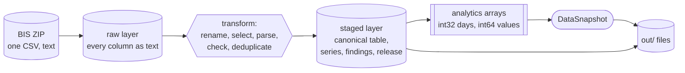

# Data model

The layers the data passes through, the canonical table, the domain models, the invariants the code
enforces and how exactness is kept from the source text to the output. The files and columns of the
BIS data, and the facts about the BIS file that shaped the design, are in
[Data model and assumptions](../../data-model.md); this page does not repeat them.

## Layers

The raw layer is the source as loaded, so a change of rule or configuration can be rerun from it
without a new download ([decision 0012](../../adr/0012-elt-raw-and-staged-layers.md)). The staged
layer is the only data the rest of the system reads. The analytics arrays and the snapshots are
built in memory per request or run and are not stored.

Not built: row lineage from a staged row back to the raw row, and a history of releases (the
status of decision 0012 says so). The staged layer holds one release at a time.

## The canonical observations table

`providers.schema.observation_schema(structure)` builds the schema from the configuration. For the
shipped configuration it is:

| Column | Arrow type | Nullable | Source |
|---|---|---|---|
| `series_key` | `string` | no | the dimension codes joined with `.` |
| `freq` | `string` | no | dimension `FREQ`, the code only |
| `ref_area` | `string` | no | dimension `REF_AREA`, the code only |
| `date` | `date32` | no | `TIME_PERIOD`, parsed with the configured date format |
| `value` | `decimal128(15, 6)` | yes | `OBS_VALUE` times 10 to the power `UNIT_MULT` |
| `obs_status` | `string` | yes | attribute `OBS_STATUS`, the code only |
| `is_valid` | `bool` | no | derived |

The order is fixed: `series_key`, the dimensions, `date`, `value`, the kept observation
attributes, `is_valid`. The names `series_key`, `date`, `value` and `is_valid` are fixed
(`CANONICAL_COLUMNS` in `config/models.py`); the others come from the configuration (`column`,
`keep_as`). Series attributes are not columns: they travel in `SeriesMetadata`.

## Domain models

All in `core/models.py`. Every model is frozen, forbids unknown fields and strips whitespace
(`_FrozenModel`).

| Model | Fields | Produced by | Consumed by |
|---|---|---|---|
| `SourceRelease` | `location`, `version_id`, `checksum_sha256`, `retrieved_at` | `fetch` | `transform`, outputs |
| `SeriesMetadata` | `series_key`, `ref_area`, `ref_area_name`, `frequency`, `title`, `unit`, `decimals`, `attributes` | `transform` | snapshot, report, API |
| `DataQualityIssue` | `rule`, `severity`, `series_key`, `detail`, `count` | `transform` | report |
| `TransformSummary` | `rows_read`, `observations`, `series`, `issues` | `transform` | CLI (the transform job of the API counts the staged data it reads back instead) |
| `DataSnapshot` | the request, the series, latest and prior date and value, `target_date`, `change_bps`, `status`, `flags` | `snapshot` | report, API |

Enumerations: `SnapshotStatus` (`ok`, `unknown_ref_area`, `no_valid_data`,
`insufficient_history`), `SnapshotFlag` (`stale_latest`, `stale_prior`) and `DataQualitySeverity`
(`info`, `warning`, `error`). The vocabulary is in the [Glossary](../../glossary.md) and
[decision 0004](../../adr/0004-domain-model.md).

## Invariants

Each invariant names where it is enforced and the test that covers it.

| # | Invariant | Enforced in | Covered by |
|---|---|---|---|
| 1 | At most one row per series and date; sorted by series and date | `transform._drop_conflicting`, the final sort; provider contract | `tests/test_transform.py`, `tests/providers/contract.py` |
| 2 | `is_valid` is true only when `value` is not null and the status is not one of the attribute's `invalid_codes` | `transform._stage_observations` | `tests/test_transform.py` |
| 3 | A value is never rounded: text whose value cannot be held at the configured scale without rounding (more non-zero decimals than the scale), more digits than the precision, or a non-number leaves `value` null; trailing zeros beyond the scale are accepted, since they change nothing | `transform._to_decimal` (rounding trapped), `_values` | `tests/test_transform.py` |
| 4 | A rate has at most 15 digits, as pydantic's `max_digits` counts them (the zeros after the decimal point count too), is a `Decimal`, and is not `NaN` or infinite | `Rate`, `BasisPoints` (`strict`, `max_digits=15`, `allow_inf_nan=False`); `Measure.precision` at most 15 | `tests/core/test_models.py`, `tests/config/test_models.py` |
| 5 | An `ok` snapshot has `prior_date <= target_date <= latest_date` and `change_bps == (latest_value - prior_value) * 100` | `DataSnapshot._check_dates`, `_check_change` | `tests/core/test_models.py` |
| 6 | An `unknown_ref_area` snapshot has no series, no values and no flags; a `no_valid_data` one has no values; an `insufficient_history` one has a latest value and no prior | `DataSnapshot._check_consistency` | `tests/core/test_models.py` |
| 7 | `flags` are sorted and without duplicates, so outputs are byte-for-byte reproducible | `DataSnapshot._sorted_unique_flags` | `tests/core/test_models.py` |
| 8 | `checksum_sha256` is 64 lowercase hexadecimal digits or null | `SourceRelease` | `tests/core/test_models.py` |
| 9 | `attributes` of a series cannot be changed after the model is built | `ReadOnlyAttributes` | `tests/core/test_models.py` |
| 10 | The staged `release.json` exists only when its checksum is that of the ZIP `transform` read | `transform._release_of` | `tests/test_transform.py` |
| 11 | The arrays of a `RateHistory` are read-only | `analytics.rate_history` | `tests/test_analytics.py` |
| 12 | The requested codes that reach an output match `CODE_PATTERN` | `config.requested_codes`, called by `cli` and `web` | `tests/test_cli.py`, `tests/web/test_app.py` |

Invariants 5 to 7 are checked when an object is built, through the constructor, `model_validate`
and `model_validate_json`. pydantic's `model_copy(update=...)` and `model_construct` skip
validation by design, and the code does not use them to derive a snapshot (module docstring of
`core/models.py`).

## Exact decimals

The path of a rate, and where its type changes:

| Step | Representation | Exact |
|---|---|---|
| Source CSV | text, e.g. `3.75` | yes |
| Raw layer | text | yes |
| Staged `value` | `decimal128(15, 6)` | yes: the text is read as `Decimal` with rounding trapped, then stored |
| `StagedData.observations` | pandas with Arrow decimals (`ArrowDtype`) | yes |
| `RateHistory.values` | int64, in units of 10^-6 percent | yes: a change is an integer subtraction |
| `DataSnapshot` | `Decimal` | yes: `RateHistory.value_at` turns each integer back into a `Decimal` with `scaleb`, and `change_bps` is `(latest_value - prior_value) * 100` in `Decimal` (`snapshot._ref_area_snapshot`) (`bps()` converts the arrays' integer changes the same way; no output uses it today) |
| `summary.csv` | decimal text, trailing zeros removed (`plain`) | yes |
| `summary.json`, the API | JSON number, written from a `float` | yes in the text: at most 15 digits (as pydantic's `max_digits` counts them), which a double carries exactly; a reader that parses the number as a float computes with binary values |
| Charts | `float` | no; the charts draw, they do not compute |

Three points make the chain hold:

- The text is read only when it is a plain ASCII number (`[+-]?digits[.digits][e+-digits]`);
  `Decimal` alone would also read `1_5` as 15, digits of other scripts and `Infinity`
  ([decision 0017](../../adr/0017-bad-input-failures-and-writes.md)). Spaces around the text are
  ignored; a non-breaking space is not.
- The 15-digit cap is the limit of a double, so a rate written to JSON reads back as an equal
  value and a value outside the double range cannot be written as `null`. It is also why
  `precision` is limited to 15 in the configuration.
- A JSON reader that returns floats brings back the rounding the system avoids. The documented way
  to read the outputs exactly is `json.load(file, parse_float=Decimal)`.

[`diagnostics/check_record_figures.py`](https://github.com/andrea-dm/policy-rate-monitor/blob/develop/diagnostics/check_record_figures.py)
reproduces the figure in decision [0005](../../adr/0005-exact-decimal-rates.md) about the countries
or areas whose 12-month change is not exact in floating point.

## Data-quality findings as data

A finding is a record, not a log line: `data_quality.json` holds one `DataQualityIssue` per rule
and series, with the number of rows and what was done about them, and the report lists them.
`unexpected_column` gives one finding for the whole file, `unexpected_value` one per series and
column, and `non_numeric_value` and `status_value_mismatch` one per series and case. With its rule
enabled, a row is never changed silently: it is kept and marked invalid, or dropped and counted.
Rows with no date, exact copies and conflicting duplicates are dropped even when their rule is
disabled, and then nothing counts them (`transform._stage_observations`, `_drop_conflicting`).
The rules, the counting and the severities are described in
[Data quality](../../data-quality.md), and the choice in decision
[0011](../../adr/0011-data-quality-rules.md).
