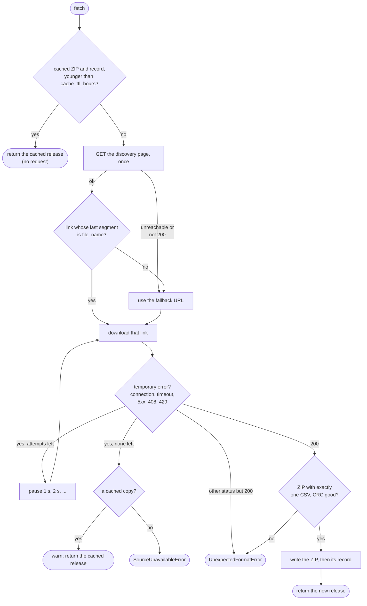
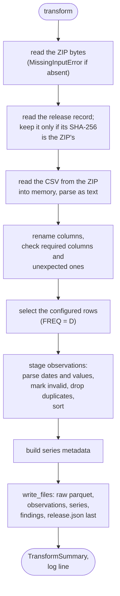
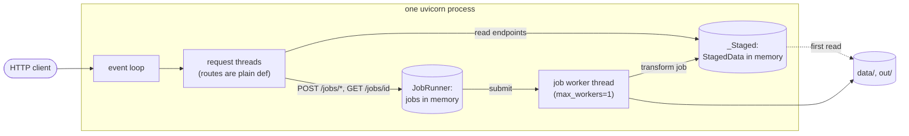

# Runtime behaviour

What happens at run time: the three pipeline steps, how a set of files is written, how the API
process holds state and threads, and the retries and timeouts of the download. The user-level
description of the steps is [How it works](../../how-it-works.md); the call chains of the public
entry points are in [Operations](../operations/index.md).

## The pipeline steps

On the command line each step is a separate process that communicates with the next only through
files, so a step can be rerun alone ([decision 0010](../../adr/0010-cli-and-exit-codes.md)). Under
`serve` the jobs write the same files, and the transform job also hands the staged data to the read
endpoints and the report job in memory ([below](#the-api-process)).

### `fetch`

The flow of `fetch.fetch`, from the age check to the stored release. Only the ZIP download is
retried; the discovery page is requested once, and any failure of it means the fallback URL.

### `transform`

Every typed error of `transform` is raised before anything is written, so a run that fails with one
changes no file. An `OSError` while writing can leave `release.json` already removed (no release to
stage) or, if a rename fails, part of the set replaced ([below](#writing-a-set-of-files);
`transform.transform`, `core/files.py` `write_files`;
[Failure modes](failure_modes.md#what-a-failure-leaves-on-disk)).

### `report`

`load_staged` reads the four staged sources through the provider; `summary` computes the
snapshots; `write_report` builds the five files in memory and writes them with one `write_files`
call. The sequence is drawn in [Architecture](../../architecture.md#one-run-of-report). The files
exist only if every one was built: a failure in a chart or a template is raised before any file is
written.

## Writing a set of files

`core.files.write_files(files)` ([`core.files`](../../reference.md#policy_rate_monitor.core.files)) is used by `fetch` (two files), `transform` (five, or four when
there is no release to stage) and `report` (five):

1. For each target, create its folder and write the content to `.<name>.tmp` beside it.
2. If any write raises (a full disk, a permission), remove the temporary files written so far and
   re-raise. No target has been touched.
3. Rename each temporary file over its target with `os.replace`, in the order given.

`os.replace` replaces one file in one step on one file system, so a reader that opens a file sees the old content or the new,
never a half-written file. Consequences, each visible in the code:

- **The order carries meaning.** `transform` puts `release.json` last, and `fetch` puts the record
  after the ZIP. A crash between the renames of `fetch` leaves the new ZIP with the old record,
  whose age makes the next run download again (comment of `fetch._store`); `transform` then
  refuses a record whose checksum is not the ZIP's (`_release_of`).
- **With no release to stage**, `transform` deletes the old `release.json` before the writes. If
  the writes then fail, the previous files stay with no release record, so the release is unknown,
  not wrong.
- **The known gap.** The renames are not one step. A reader in another process that reads the set
  while they run can pair files of two runs (for example the new observations with the old series
  list). It is recorded in the code (`# TODO` in `write_files`, issue 35) and in decision
  [0017](../../adr/0017-bad-input-failures-and-writes.md); versioned folders behind one pointer
  file would close it. Inside one `serve` process the gap does not arise for the read endpoints,
  because they read from memory and a transform job replaces that memory after the files are
  written ([below](#the-api-process)).
- **Loaders read each file once.** `load_observations` reads the parquet file as bytes and parses
  the bytes, because `read_parquet` on a path opens the file twice and a rename in between would
  pair the footer of one file with the pages of another (comment in `transform.py`).
- **No lock between processes.** The temporary name is fixed (`.<name>.tmp`), so two writers of the
  same file at the same time share it. The code takes no lock; the design assumes one writer.
- **A rename failure is not rolled back.** If `os.replace` raises (it is outside the `try`), the
  files already renamed stay replaced and the remaining temporary files stay on disk, as the
  docstrings of `transform` and `Report.export` say
  ([Failure modes](failure_modes.md#what-a-failure-leaves-on-disk)).

## The API process

`bis-prates serve` runs one process: the uvicorn event loop, the request threads FastAPI uses for
the plain `def` routes, and one worker thread for the jobs.

State and threads of the API. The read endpoints use the cache; the jobs write the disk, and only a
transform job refreshes the cache.

### The staged-data cache

`web.app._Staged` holds the `StagedData` (observations, series, findings, release). `StagedData` is
a frozen dataclass: the series and findings are tuples, and the observations table is never
changed after it is read (the calculations filter or copy it), so request threads share one
safely.

| Event | Behaviour |
|---|---|
| First read endpoint | Reads the four staged sources through the provider under a lock, keeps the result |
| Later reads | Return the kept object with no lock and no disk access |
| `POST /jobs/transform` | Sets an event, takes the lock, runs `provider.transform()`, reads the staged data again, replaces the kept object, clears the event |
| A read during a transform, data already kept | Returns the previous data |
| A read during the first transform, nothing kept | Fails at once with `missing_input` (409), saying a transform is running |
| A `transform` that fails | The previous kept object stays; the job is `failed` |

Nothing else refreshes the cache. A `bis-prates transform` run in another process, or a `fetch`
job, does not change what a running `serve` returns until a transform job runs or the process is
restarted. The analytics arrays are not cached: each `summary` or `chart` request builds them for
the requested series ([Performance](performance.md#the-api)).

### The job runner

[`web.jobs.JobRunner`](../../reference.md#policy_rate_monitor.web.jobs):

- one `ThreadPoolExecutor(max_workers=1)`, thread name prefix `job`, so jobs run one at a time and
  in order of acceptance;
- one `threading.Condition` guards the table of jobs; `submit` checks for a queued or running job
  and queues the new one under it, so two simultaneous `POST`s cannot both be accepted;
- a job is `queued`, `running`, then `succeeded` or `failed`; a job's record is replaced by a new
  frozen `Job` on each change, with `created_at`, `started_at`, `finished_at` as time zone aware
  timestamps;
- only the 100 most recent finished jobs are kept (`KEEP_FINISHED`); queued and running jobs are
  never dropped; ids are `uuid4().hex`;
- `_run` catches `BaseException`, including `KeyboardInterrupt`, and marks the job `failed`, so a
  stop of any kind cannot leave the runner refusing every later job as busy; if even the error
  text cannot be read, the body is `internal_error` with the type name
  (`tests/web/test_jobs.py`);
- jobs are in memory only: a restart forgets them and their ids, not the files they wrote.

### Start and stop

`serve` binds the socket itself before uvicorn starts, so a port in use is a `ListenError` (exit
2), not uvicorn's own exit code. Ctrl+C (SIGINT) and `kill <pid>` (SIGTERM) both start the same
shutdown, since uvicorn handles the two signals alike (its `HANDLED_SIGNALS`; `web.app.serve`
runs `uvicorn.Server.run`). uvicorn first closes the listening socket and the open connections and
waits for the running requests (`uvicorn/server.py`, `Server.shutdown`); only then does the
application's lifespan call `JobRunner.shutdown()` through `asyncio.to_thread`, which waits for
the running job and cancels a job not yet started. Once the stop has begun, uvicorn no longer
accepts connections, so a new request is refused at the TCP level; the `503 shutting_down` answer
of `JobRunner.submit` (`web/jobs.py`) is reached only when the application runs under another
server or a test client.

After a graceful stop, uvicorn raises the signal again (`uvicorn/server.py`, `capture_signals`),
so `cli/main.py` `_serve` never returns: Ctrl+C ends with a `KeyboardInterrupt` traceback on
standard error and exit status 130, and SIGTERM with status 143, not 0. SIGKILL (`kill -9`) stops the
process at once and can interrupt a write: before the renames it leaves `.<name>.tmp` files and the targets as
they were; during them, part of the set replaced. Several uvicorn processes would each have their own jobs and cache, so
the API is meant to run as one.

## Retries and timeouts

All from the `source` section of the configuration (shipped values in brackets):

| Setting | Effect | Where |
|---|---|---|
| `cache_ttl_hours` (24) | A copy younger than this is used with no request; 0 downloads again on every run | `fetch.fetch` |
| `max_attempts` (3) | Attempts per ZIP download, the first included; pauses of 1 s then 2 s between them, so 3 s of waiting in all at the default | `fetch._download` |
| `connect_timeout_seconds` (10) | Time to open the connection | `fetch._get_once` |
| `read_timeout_seconds` (60) | Set on the socket after connecting, so it applies to each wait for data, not to the whole download | `fetch._get_once` |

Fixed in code: up to five redirects (`MAX_REDIRECTS`); a redirect to an address that is not HTTP(S)
is refused; the temporary statuses are every 5xx, 408 and 429, and a connection error or a timeout;
every other status but 200 fails at once. The pauses use `time.sleep`, which blocks the job's
worker thread (the API) or the process (the CLI).

The functions take their clock, their sleep and their download as arguments, so the tests
(`tests/test_fetch.py`) run the retries without waiting and without a network.
