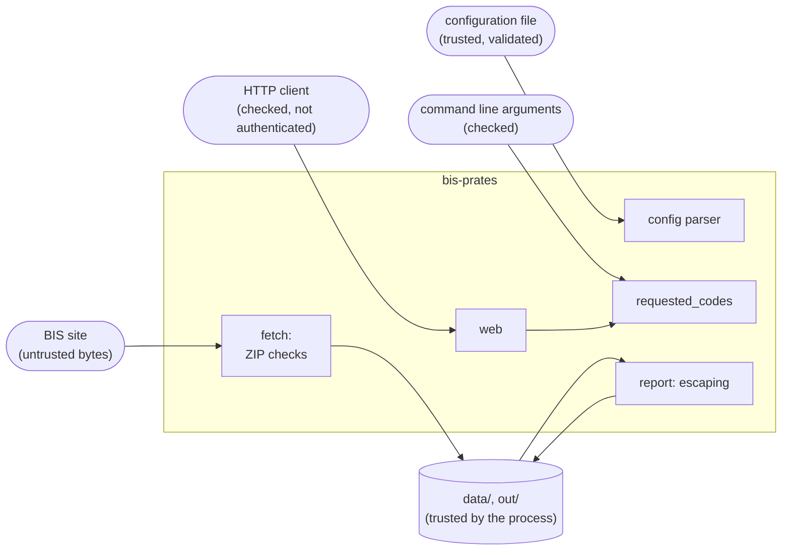

# Security

The inputs the system trusts and the checks it makes on each, the outputs and what protects them,
and the exposure of the API. The system handles no secret: it needs no credential to download the
BIS file, stores none, and sends none. The policy for reporting a vulnerability is
[`SECURITY.md`](https://github.com/andrea-dm/policy-rate-monitor/blob/develop/SECURITY.md).

This page is an inventory of what the code does, not a certification. Where the code leaves a
gap, the page says so under "Known limits".

## Trust boundaries

The BIS download is the only untrusted data. The configuration and the data and output folders are
trusted as the operator's; the API's requests are checked but not authenticated.

## The source download

| Input | Check | Where |
|---|---|---|
| The address | The configuration's `discovery_url` and `fallback_url` must be HTTP or HTTPS URLs (pydantic `HttpUrl`); `fetch` refuses any other scheme, also after a redirect; `fallback_url` must end in `file_name`. The shipped values are HTTPS | `config.models.SourceSection`, `fetch._get_once` |
| The link on the page | Only a link whose last path segment equals `file_name` exactly is used; otherwise the fallback URL | `fetch._find_download_url` |
| The transport | `http.client` with the standard library's defaults: no TLS context is passed, no host is pinned, the only header the code sets is `User-Agent: policy-rate-monitor`; `http.client` adds `Host` and `Accept-Encoding: identity`; no cookie or credential is sent | `fetch._get_once` |
| Redirects | At most five, to any host over HTTP(S) | `fetch.http_get` |
| The status | Only 200 is accepted; the temporary statuses are retried; the rest fail at once | `fetch.http_get` |
| The content | It must be a ZIP with exactly one `.csv` entry and a valid CRC-32; an encrypted, corrupt or unsupported archive is an `UnexpectedFormatError`. The entry is read into memory; its name is never used as a file path, so an entry name cannot choose where a file is written | `fetch.read_zip_csv` |
| The release | The SHA-256 of the download is recorded next to it and compared with the ZIP `transform` reads; a record that does not match is not staged | `fetch.fetch`, `transform._release_of` |
| The rows | Parsed as text; dates and numbers are accepted only in the configured format; anything else becomes a finding or an error, never a rounded or guessed value | `transform` |

What the checks do not do: the SHA-256 is a provenance record, not an expected digest. The code has
no value to compare the download against, so a changed file from the BIS is accepted as long as it
has the expected shape. The checksum detects a ZIP replaced on disk without its record; it does not
detect both being replaced.

## The configuration

The configuration file is the operator's. Its contents decide which address is downloaded and which
columns are read, so whoever can change it can make the tool download from any HTTP(S) address and
write under any folder the process may write to (`dataset.data_dir`, `--data-dir`). The
code therefore checks that the file is well-formed, not that it is harmless:

- the JSON is parsed strictly: a duplicate key, `NaN`, `Infinity`, an invalid byte sequence or a
  document nested too deeply is a `ConfigError` (`config/parsing.py`);
- every model forbids unknown keys and is strict about types (`_ConfigModel`), except a rule's
  `params`, whose unknown names are accepted (`RuleSpec.params`);
- `file_name` cannot contain `/` or `\`, so the cached file always lies in `raw/`; `data_dir`
  cannot start with `~` or contain `$`, which the system does not expand;
- a date format must round-trip two known dates, an encoding must be a text encoding, and rules,
  aliases, selections and output fields must refer to declared concepts;
- a validation error quotes at most 60 characters of the offending value; a syntax error quotes up
  to 40 characters either side of the error, with non-printable characters replaced
  (`config/parsing.py`, `_describe`, `_syntax_message`).

The file is read whole, with no size limit (a TODO in `FileConfigSource.load` records it, issue
8). The JSON Schema (`configs/config.schema.json`) is generated from the same models and checked
by a test.

## Requested codes

A code a user asks for is echoed into the outputs: the CSV, the JSON, the Markdown and HTML pages
and the API's responses. It is never used as a file name or a path.
`config.requested_codes` strips the codes,
drops empty ones and refuses any that does not match `^[A-Za-z0-9_@$-]+$`. The CLI (`--countries`)
and the API (`countries`, `country` and the body of `POST /jobs/report`) both call it, so
`=HYPERLINK("x")` and `` are refused with exit 2 or `422`
(`tests/test_cli.py`, `tests/web/test_app.py`, `tests/web/test_jobs.py`). A code may start with `-`
or `@`, as codes of the configuration may.

## The outputs

| Output | What protects it | Limit |
|---|---|---|
| `report.html` | Jinja autoescaping is on for the HTML template; a test shows that a dataset title and a finding's text holding `<script>` appear escaped, and that no raw `<script>alert` is left anywhere in the page, the chart included. The page loads nothing from the network: the chart's script is inline, and a test checks that the page has no external `script` or `link` | The Plotly output is inserted as is (`chart_html \| safe`); control characters HTML forbids are replaced by their escapes |
| `report.md` | Only `\|` is escaped in a table cell; a test records that Markdown has no escaping and the text is written as it is | Text from the source or the configuration appears in the Markdown unchanged |
| `summary.csv` | The requested codes are checked (above); numbers are written as plain decimal text | The series fields chosen in `output.metadata_fields` (for example `title`) are written as the source gave them, with no neutralising of a leading `=`, `+`, `-` or `@` |
| `summary.json`, API bodies | Built from the models, serialised by `json`/pydantic | Rates are numbers: a reader that parses them as floats loses exactness (not a security matter) |
| Files on disk | Written to temporary names and renamed, so a reader does not see a half-written file | No permissions are set by the code: the files get the process's umask |

## The API's exposure

The HTTP API is the system's only network listener. Its properties, from `web/app.py` and
[HTTP API](../../api.md):

- **No authentication and no authorisation.** Anyone who can reach the port can read the data and
  start a `fetch`, a `transform` or a `report` job. The default listen address is `127.0.0.1`; with
  `--host 0.0.0.0` the API is open to the network. Put it behind a proxy that checks who calls.
- **No TLS.** uvicorn is started with the host and the port only.
- **No CORS headers.** A page from another origin cannot read the API's answers in a browser. The
  browser still sends it a simple request, one that needs no preflight: `POST /jobs/fetch` and
  `POST /jobs/transform` take no body, so a page the user opens can start those jobs on an API that
  listens on `127.0.0.1` (the routes in `web/app.py`, `_job_routes`).
- **A request cannot choose a path.** The output folder and the data directory are fixed when
  `serve` starts; a `report` job's body carries only `countries` and `start`.
- **One job at a time.** A second `POST` is refused with 409, which bounds the work a client can
  start. Read endpoints are not rate limited, and the analytics for a request are built on demand
  (67 to 220 ms per `summary` request, [Performance](performance.md#the-api)).
- **Request validation.** Query parameters and the body are validated by FastAPI and pydantic; a
  failure is a `422` with the error body.
- **Error bodies carry no traceback.** A bug's body names only its type. The messages of
  `missing_input`, `unexpected_format` and `file_error` (and so a failed job's `error`) do name
  server paths: the missing file (for example `data/staged/observations.parquet`), as the examples
  in the API page show, the ZIP that cannot be read (`transform._read_csv`, `fetch.read_zip_csv`),
  or the file of an `OSError`, whose text names it. `web/errors.py` `error_body` returns
  `str(error)` for every typed error, so a client learns the server's folder layout.
- **Job ids** are `uuid4().hex`. They are identifiers, not secrets: access control is the
  proxy's job.
- **Interactive documentation.** `/docs`, `/redoc` and `/openapi.json` are on by default
  (`create_app` keeps FastAPI's defaults).

## Secrets and personal data

The package reads no credential and no token, and the download needs none. The environment variables
it reads are the two paths `BIS_PRATES_CONFIG` and `BIS_PRATES_DATA_DIR`. The data is public
central bank policy rates and holds no personal data. The log carries addresses, paths, series keys,
codes and counts ([Observability](observability.md)).

## Dependencies and supply chain

| Control | Where |
|---|---|
| Versions locked in `uv.lock`; CI installs with `--locked` | `pyproject.toml`, `ci.yml` |
| `pip-audit` on the runtime dependencies (job `audit`) and on every group (job `audit-dev`): informational on a pull request, blocking on a push to `main` and `develop` | `ci.yml`, `SECURITY.md` |
| `deptry` checks that declared dependencies match the imports | pre-push hook, `deptry` job |
| A CycloneDX SBOM of the runtime dependencies, attached to a release | `sbom` job (does not block a release) |
| Secret scanning with gitleaks on pushes and pull requests (`continue-on-error`), and the `detect-private-key` pre-commit hook | `secret-detection` job, `.pre-commit-config.yaml` |
| Dependabot for the GitHub Actions used by the workflows | `.github/dependabot.yml`; Python security updates come from a repository setting, not from the file |

The code runs no code from the download: it uses no `pickle`, `eval`, `exec` or subprocess. The
data files it reads back are parquet and JSON that it wrote itself.

## Known limits

Collected from the sections above, so a reviewer sees them in one place:

1. **No size limit on the download or its decompression.** `fetch` reads the whole response and
   `read_zip_csv` the whole CSV into memory. A hostile or faulty source could exhaust memory. The
   BIS file is 4.1 MB compressed and 477 MB as CSV.
2. **No expected digest.** A changed but well-formed source file is accepted
   ([The source download](#the-source-download)).
3. **The configuration is trusted.** It can point the download at any HTTP(S) address and the
   data directory at any writable folder.
4. **The CSV does not neutralise formulas in text from the source**, and a requested code may start
   with `-` or `@`; only the characters of the code pattern are allowed. A spreadsheet that opens
   `summary.csv` evaluates what its own settings say.
5. **The Markdown report does not escape text** from the source or the configuration.
6. **The API has no authentication, TLS or rate limit**, and the messages of `missing_input`,
   `unexpected_format` and `file_error` (and so a failed job's `error`) name server paths
   (`web/errors.py` `error_body` returns `str(error)`). Without CORS headers a page from another origin cannot read the answers, but it can
   start a `fetch` or `transform` job ([The API's exposure](#the-apis-exposure)).
7. **Files of two runs can be paired by a reader in another process** while a set is renamed (issue
   35, [Runtime behaviour](runtime_behavior.md#writing-a-set-of-files)); a `transform` and a
   `report` run at the same time can therefore read an inconsistent set.
8. **The configuration file has no size limit** (issue 8).
