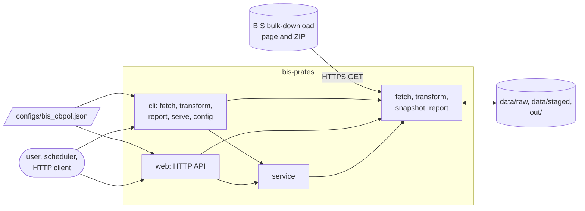

# System overview

The architecture, the layering rule that guards it, and the bounded parts the system divides into.
[Architecture](../../architecture.md) gives the module table and one run of `report`; this page
adds the rule as it is enforced, the allowed imports of each module, and the properties the design
relies on.

## Context

The only external system is the BIS site, reached by `fetch` over HTTP(S). There is no database,
queue or other network service: the state of the system is the files in `data/raw/`, `data/staged/`
and `out/`, and, while `serve` runs, the staged data and the jobs held in memory
([Runtime behaviour](runtime_behavior.md#the-api-process)). The diagram is coarse: `cli` and `web`
reach `fetch`, `transform` and `report` through the provider and `service`.

## The bounded parts

| Part | Modules | Responsibility | Touches the disk |
|---|---|---|---|
| Foundation | `core`, `config` | The domain models and typed errors; the validated configuration and where it is read from | `config` reads the configuration file |
| Source side | `fetch`, `transform`, `providers`, `bulk` | Getting the source file, staging it, and serving the staged data through one interface | `data/raw/`, `data/staged/` |
| Calculation | `analytics`, `snapshot` | The latest rate, the prior rate and the change, from tables and arrays | no, except Numba's compiled-code cache (`njit(cache=True)`, `analytics.py`) when the `fast` extra is installed |
| Presentation | `chart`, `report` | The charts and the five output files | `out/` (`report`) |
| Adapters | `service`, `web`, `cli`, `settings` | The steps both adapters share, the HTTP API, the command line, and where the options come from | through the parts above |

Three properties follow from this division and are relied on by the rest of the report:

- **The calculation is pure.** `analytics` and `snapshot` take tables and settings and return
  values; they open no data file and make no request (module docstring of `snapshot.py`). The one
  write is Numba's compiled-code cache, with the `fast` extra.
- **Only three modules write data files**, and all three write through `core.files.write_files`:
  `fetch` (the ZIP and its record), `transform` (the raw parquet and the four staged files) and
  `report` (the five outputs). `config` and the loaders in `transform` only read.
- **Everything above the source side reads the data through `DataProvider`.** `service` never opens
  `data/staged/` itself ([decision 0008](../../adr/0008-provider-interface.md)).

## The layering rule

`tach.toml` declares, for each top-level module of `policy_rate_monitor`, the modules it may
import. `uv run tach check` runs before every commit and every push (the `tach-check`
hook in `.pre-commit-config.yaml`) and in the `tach` job of `.github/workflows/ci.yml`. An import not in
the table fails the check. The table, copied from `tach.toml`:

| Module | May import |
|---|---|
| `core` | nothing |
| `config` | `core` |
| `fetch` | `config`, `core` |
| `transform` | `config`, `core`, `fetch` |
| `analytics` | `config`, `core` |
| `snapshot` | `analytics`, `config`, `core` |
| `chart` | `core` |
| `report` | `chart`, `config`, `core` |
| `providers` | `config`, `core` |
| `bulk` | `config`, `core`, `fetch`, `providers`, `transform` |
| `settings` | `config` |
| `service` | `chart`, `config`, `core`, `providers`, `report`, `snapshot` |
| `web` | `chart`, `config`, `core`, `providers`, `report`, `service` |
| `cli` | `bulk`, `config`, `core`, `service`, `settings`, `web` |

What the rule gives: `core` can be read without any other module; the models of the configuration
are in `config` alone; a provider (`providers`, `bulk`) cannot import the calculation or the
report; `analytics` and `snapshot` cannot import `fetch`, `transform` or any provider; and `web`
cannot import `cli`, which is the one that starts it.

The rule is about imports, not about run-time cost. Two imports are made lazily, and tach allows
them like any other:

- `cli` imports `service` (and with it matplotlib and Jinja) only inside `report`, and `web` only
  inside `serve` (`cli/main.py`). `--version`, `fetch` and `transform` therefore start without
  them. `tests/test_cli.py` checks that the base commands load neither the web extra nor the
  report steps.
- `report` imports `chart.interactive` (Plotly) only inside the function that draws the HTML chart,
  and only when Plotly is installed (`report/export.py`, `_interactive_chart`).

## Design properties

| Property | How it is achieved | Where it is checked |
|---|---|---|
| Config-driven | Column names, codes, the selection, the rules, the thresholds and the output fields come from the configuration; the code names none of the BIS columns ([decision 0007](../../adr/0007-config-driven-design.md)) | `tests/config/`, `tests/test_transform.py` |
| Exact rates | `Decimal` in the models, `decimal128` in the tables, fixed-point integers in `analytics`; no float in the calculation ([decision 0005](../../adr/0005-exact-decimal-rates.md)) | `tests/test_analytics.py`, `tests/test_snapshot.py` |
| Replaceable source | `DataProvider` with a contract test every provider must pass ([decision 0008](../../adr/0008-provider-interface.md)) | `tests/providers/contract.py` |
| Same numbers on both adapters | `cli` and `web` call the same `service` functions ([decision 0014](../../adr/0014-http-api.md)) | `tests/test_service.py`, `tests/web/test_app.py` |
| Typed failures | Errors raised on purpose derive from `PolicyRateMonitorError`; each adapter maps them to its own code ([decision 0010](../../adr/0010-cli-and-exit-codes.md)) | `tests/test_cli.py`, `tests/core/test_errors.py` |
| Files replaced whole | `write_files`: temporary names first, then renames ([decision 0017](../../adr/0017-bad-input-failures-and-writes.md)) | `tests/core/test_files.py`, `tests/test_transform.py`, `tests/test_report.py` |
| Optional parts stay optional | Extras are imported only where used. A missing `web` extra makes `serve` exit 2 with a message naming it; without `interactive`, `report.html` embeds the PNG; without `fast`, the NumPy versions run. No message is shown in the last two cases (`cli/main.py` `_serve`, `report/export.py` `_interactive_chart`, `analytics.NUMBA_AVAILABLE`) | `tests/test_cli.py` |

## Known limits of the design

- The system has one data source today, the BIS bulk file. `DataProvider` is the seam for a second
  one; no second real provider exists (`InMemoryProvider` is for tests).
- There is no front end. The API is built; the React front end is milestone M8
  ([Milestones](../../milestones.md)).
- The validation of the file against the BIS structural metadata is planned (decision
  [0009](../../adr/0009-sdmx-validation.md), M7) and not built.
