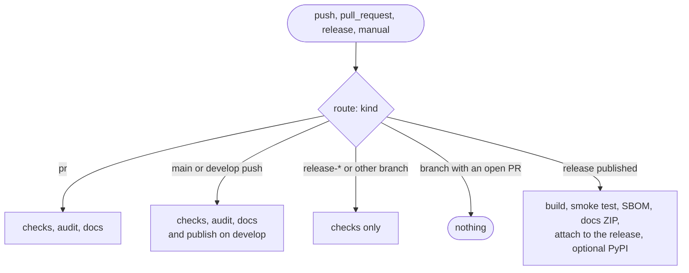
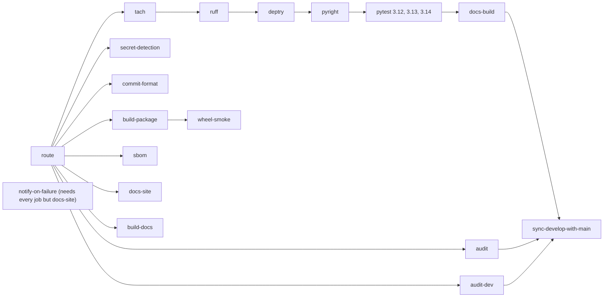
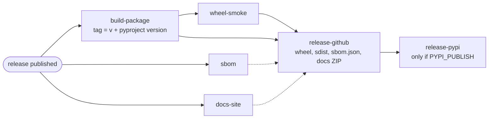

# CI/CD

How a change is checked and a release is built: the GitHub Actions workflow
`.github/workflows/ci.yml`, its jobs and their order, the caches, the checks a merge needs, and
the local hooks that run the same checks first. The steps of a release are in
[Release engineering](release_engineering.md).

Every statement below is read from `.github/workflows/ci.yml`, `.github/actions/setup-uv/action.yml`,
`.github/dependabot.yml`, `.pre-commit-config.yaml` and `CONTRIBUTING.md`. What the repository
settings enforce (branch protection, which checks are marked required) is not in those files, so it
is not stated here.

## One workflow, one router

There is one workflow, `CI`, with the triggers `pull_request`, `push` (every branch), `release`
(type `published`) and `workflow_dispatch`. The first job, `route`, decides what a run does, so
every other job's `if` reads one output instead of repeating event and branch tests.

| `kind` | When | `checks` | `audit` and `docs` | `publish` |
|---|---|---|---|---|
| `pr` | a `pull_request` event | yes | yes | no |
| `integration` | a push (or a manual run) on `main` or `develop` | yes | yes | only on `develop` |
| `long` | a push on `release-*` | yes | no | no |
| `branch` | a push on another branch with no open pull request (a manual run on another branch is also `branch`) | yes | no | no |
| `release` | a GitHub release was published | no | no | yes |
| `skip` | a push on a branch that has an open pull request | no | no | no |

`skip` avoids running twice: the pull request's own run checks that branch. If `route` cannot list
the open pull requests it warns and runs anyway ("a duplicate run beats an unchecked push").

Which groups of jobs a run starts, by the `kind` that `route` outputs.

## The jobs and their order

The code checks are a chain: each starts only when the one before it passed, so the slow jobs do
not run on code that already failed a cheap check. The order is the one of the local checks
(`tach`, `ruff`, `deptry`, `pyright`, `pytest`, then the docs build).

The job graph (`needs`). The chain is on the first row; everything else needs only `route` and
starts in parallel, subject to its `if`, except the release jobs (graph below),
`sync-develop-with-main` (the chain and the audits) and `notify-on-failure`.

| Job | Runs when | What it does | Blocking |
|---|---|---|---|
| `route` | always | picks the `kind` and the flags | - |
| `tach` | `checks` | `uv sync --locked --only-group lint --no-install-project`, then `uv run tach check` (module layering) | yes |
| `ruff` | `checks`, after `tach` | `ruff check --output-format github`, then `ruff format --check` | yes |
| `deptry` | `checks`, after `ruff` | `uv sync --locked --all-extras --no-default-groups --group lint`, then `deptry src/ tests/`; the project and every extra are installed because deptry maps imports to distributions through installed metadata | yes |
| `pyright` | `checks`, after `deptry` | `uv sync --locked --all-groups --all-extras`, then `pyright src/ tests/ diagnostics/` | yes |
| `pytest (3.12 / 3.13 / 3.14)` | `checks`, after `pyright` | a matrix over every minor version the classifiers declare (`fail-fast: false`); checks the interpreter version, then `pytest -W error::FutureWarning` with coverage and a JUnit report; the docstring examples run too (`testpaths` is `tests/` and `src/`) | yes |
| `docs-build` | `docs`, after `pytest` | `uv sync --locked --only-group docs`, then `mkdocs build --strict` | yes |
| `commit-format` | pull requests | every non-merge commit header between the base and the head must match the Conventional Commits pattern; refuses an empty range | yes |
| `secret-detection` | `checks` | gitleaks over the pushed or pull-request commits | no (`continue-on-error`) |
| `audit` | `audit` | `uv export --locked --no-dev --all-extras`, then `pip-audit --strict --disable-pip` on the runtime dependencies; uploads the requirements file for 7 days | informational on pull requests, failing on `main` and `develop` |
| `audit-dev` | `audit` | the same with `--all-groups` (every group and extra) | as `audit` |
| `notify-on-failure` | any needed job failed | on a pull request, comments on it with a link to the run | - |

Every job has a `timeout-minutes` (5 to 20) and the workflow's default permission is
`contents: read`; the jobs that need more declare it (`pull-requests: read` for `route`, to list the open pull
requests; `pull-requests: write` for gitleaks and the failure comment; `contents: write` for
`release-github`, `build-docs` (mike pushes to `gh-pages`) and the `develop` sync; `id-token: write`
for PyPI).

### What the pull-request checks must pass

[CONTRIBUTING](https://github.com/andrea-dm/policy-rate-monitor/blob/develop/CONTRIBUTING.md#quality-gates) lists the quality gates: on pull requests the security
audits and the secret detection are informational and the other checks must pass before a merge.
In the workflow terms: `tach`, `ruff`, `deptry`, `pyright`, `pytest` (all three versions),
`docs-build` and `commit-format` fail the run; `audit`, `audit-dev` and `secret-detection` carry
`continue-on-error` on a pull request. The `package` check (`build-package`, `wheel-smoke`) runs
on pushes to `develop` and on releases, not on pull requests.

## Concurrency, caches and artefacts

- **Concurrency.** The group is the pull-request number or the ref. A newer run cancels an older
  one on pull requests and on feature-branch pushes; runs on `main`, `develop`, `release-*` and
  releases are never cancelled, because they publish and a cancelled run would stop halfway.
- **`UV_NO_SYNC=1`.** `uv run` uses exactly the environment the job synced; without it, `uv run`
  after a partial sync would install the project and the `dev` group.
- **The uv cache.** Every job that runs uv sets it up through the composite action
  `.github/actions/setup-uv` (`astral-sh/setup-uv`, uv at least 0.13.5, with `enable-cache: auto`:
  on every event except `release` and tag pushes, so the release run never restores a cache
  another run could have written; `build-docs` on a push to `develop` does restore one). The jobs
  `route`, `secret-detection`, `commit-format`, `release-github`, `sync-develop-with-main` and
  `notify-on-failure` do not use uv. Only the jobs with the widest installation, `pyright` and
  `pytest`, set `save-cache: "true"`; the others only restore, so a narrow installation cannot
  overwrite a wide one.
- **Artefacts.** `requirements-audit` and `requirements-audit-dev` (7 days), the coverage and
  JUnit files of each `pytest` run (1 day), `dist` (1 day), `sbom` (90 days), `docs-site`.
- **Python.** `PY_VERSION` (3.12) is the Python of every job that sets up uv, except the `pytest`
  matrix.

## Jobs that build and publish

`build-package`, `wheel-smoke` and `sbom` run when `publish` is true (a push or manual run on
`develop`, or a published release); `build-docs` does too, but only when `DOCS_PUBLISH` is `true`.
`docs-site`, `release-github` and `release-pypi` run only on a published release.
`sync-develop-with-main` runs after a push on `main`.

| Job | What it does |
|---|---|
| `build-package` | reads the version from `pyproject.toml`. On a release it fails unless the tag is `v` plus that version. Otherwise it sets the version to `<base>.dev<run number>` in the checkout (not committed) so dev versions rise. Runs `uv build` and uploads `dist/` |
| `wheel-smoke` | installs the wheel in an isolated environment outside the checkout, imports it, and asserts that the installed version is the expected one and `__version__` is the base version |
| `sbom` | exports the runtime dependencies and writes a CycloneDX `sbom.json` (`continue-on-error`: never blocks a release) |
| `docs-site` | on a release only: `OFFLINE=true mkdocs build --strict --site-dir site`, zipped as `policy-rate-monitor-docs-<tag>.zip` (`continue-on-error`) |
| `release-github` | on a release, after `build-package` and `wheel-smoke` succeeded: downloads `dist`, `sbom.json` and the docs ZIP (the last two optional) and uploads them to the release with `gh release upload` |
| `release-pypi` | on a release, after `release-github` succeeded, and only if the repository variable `PYPI_PUBLISH` is `true`: `uv publish --trusted-publishing always`, in the `pypi` environment |
| `build-docs` | versioned docs with `mike` on `gh-pages`, only if the variable `DOCS_PUBLISH` is `true` |
| `sync-develop-with-main` | after a green push run on `main`: fast-forwards `develop` to `main` ([Release engineering](release_engineering.md#syncing-develop-with-main)) |

The optional parts stay off until the repository is configured for them. `build-docs` also needs
`mike`, which is not listed in the `docs` dependency group of `pyproject.toml`, and GitHub Pages
serving `gh-pages`; none of that is set up in the repository.

The release run. The dotted edges are optional: the SBOM and the docs ZIP never block a release.

## Dependabot

`.github/dependabot.yml` updates the GitHub Actions only (the workflows and the composite action),
monthly, against `develop`, with the commit prefix `ci`, all grouped in one pull request.
Python dependency security updates come from a repository setting, and version bumps are manual.

## Local hooks

`.pre-commit-config.yaml` installs hooks for both stages (`default_install_hook_types:
[pre-commit, pre-push]`) with `fail_fast: true`, so the first failing hook stops the rest. The
`builtin` repo is a feature of prek, a pre-commit-compatible runner, so install the hooks once with
`uvx prek install`; pre-commit itself refuses the `builtin` entry, which has no `rev`.

| Order | Hook | Command | Stage |
|---|---|---|---|
| 1 | `tach-check` | `uv run --no-sync tach check` (always runs) | commit and push |
| 2 | file hooks (`builtin` repo) | trailing whitespace (not `.tsv` or `out/report.html`), end-of-file, mixed line endings, byte-order marker, large files over 2000 KB (not `out/report.html`, which carries Plotly's JavaScript), case conflict, merge conflict, private key, JSON, TOML, YAML (not `mkdocs.yml`, whose `!!python/name` tags `mkdocs build` validates) | commit and push |
| 3 | `ruff-check` | `ruff check --fix --exit-non-zero-on-fix` on Python files | commit and push |
| 4 | `ruff-format` | `ruff format` on Python files | commit and push |
| 5 | `deptry` | `deptry src/ tests/` | `pre-push` only |
| 6 | `pyright` | `uv run --no-sync pyright` | `pre-push` only |

A hook with no `stages` runs at every hook type installed (pre-commit's default), so the first
four run before a commit and again before a push; `deptry` and `pyright` run only before a push.
`CONTRIBUTING.md` names tach and ruff as the commit-time checks and deptry and pyright as the
push-time ones. It does not mention the file hooks. `pytest` and the docs build are not hooks: they run in CI.

## The order of the checks

The same order is used everywhere: the module layering first, since a wrong import changes the
code anyway; the cheap checks next; the slowest, `pyright` and `pytest`, last.

| Step | Local command (`CONTRIBUTING.md`) | CI job |
|---|---|---|
| 1 | `uv run tach check` | `tach` |
| 2 | `uv run ruff check` | `ruff` |
| 3 | `uv run ruff format --check` | `ruff` |
| 4 | `uv run deptry src/ tests/` | `deptry` |
| 5 | `uv run pyright src/ tests/ diagnostics/` | `pyright` |
| 6 | `uv run pytest` | `pytest` |
| 7 | `uv run mkdocs build --strict` | `docs-build` |

`ruff` lints and formats `src/`, `tests/` and `diagnostics/` among other folders (`include` in
`pyproject.toml`); the markers `unit`, `contract`, `integration`, `whitebox` and `slow` select
tests locally ([CONTRIBUTING, Testing](https://github.com/andrea-dm/policy-rate-monitor/blob/develop/CONTRIBUTING.md#testing)). Chained with `&&`, the
local commands stop at the first failure, as the CI chain does.

## See also

- [Release engineering](release_engineering.md) for what a release adds to this pipeline.
- [CONTRIBUTING.md](https://github.com/andrea-dm/policy-rate-monitor/blob/develop/CONTRIBUTING.md) for the workflow around the checks.
- [Runbooks](runbooks.md) for operating the tool itself.
