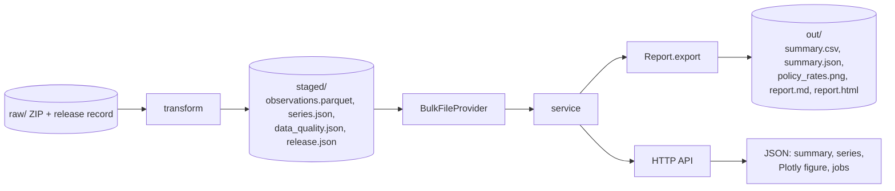

# Downstreams: everything the pipeline feeds

What leaves the pipeline: the staged layer that every reader uses, the five report files, the
formats of `summary.csv` and `summary.json`, the HTTP API's responses and the chart's JSON.
[Upstreams](upstreams.md) covers what goes in; [Workflows](workflows.md) follows the code that
produces each output.

The file layout and the columns of the staged data are in [Data model](../../data-model.md); the
endpoints with examples are in the [HTTP API](../../api.md). This page adds what an operator or a
consumer needs to rely on: who writes each file and when, what is exact and what is not, and what
a reader can and cannot assume.



The consumers of the staged layer. The command line and the HTTP API both read it through the
provider and the `service` module, so they give the same numbers.

## The staged layer

`transform` writes `<data_dir>/staged/` and, beside it, the raw parquet
`raw/WS_CBPOL_csv_flat.parquet`. The staged files are the one place every consumer reads
([decision 0012](../../adr/0012-elt-raw-and-staged-layers.md)):

| File | Content | Read back by |
|---|---|---|
| `observations.parquet` | one row per series and date, sorted by series and date; `value` is `decimal128(15, 6)`, `date` is `date32` | `transform.load_observations`, through `DataProvider.observations()` |
| `series.json` | one `SeriesMetadata` record per series | `transform.load_series`, cached by `BulkFileProvider` until the file's modification time or size changes |
| `data_quality.json` | one `DataQualityIssue` per finding: `rule`, `severity`, `series_key`, `count`, `detail` | `transform.load_data_quality` |
| `release.json` | the `SourceRelease` the files were built from; absent when unknown | `transform.load_release`, through `source_release()` |

The columns and types are described in [Data model, staged](../../data-model.md#staged). Four
properties matter to a consumer:

- **Written together, `release.json` last.** All files of a run, the raw parquet included, go
  through `core.files.write_files`: each is written beside its target as `.<name>.tmp`, and only
  when all are written are they renamed into place, in order. A run that fails while writing
  leaves the previous files as they were, and removes its temporary files.
- **Not one atomic step.** The renames run one after the other, so a reader in another process
  that reads the set while they run can pair files of two runs. This is a known limit recorded in
  `core/files.py` (a TODO with issue 35) and in
  [decision 0017](../../adr/0017-bad-input-failures-and-writes.md). Inside one `serve` process,
  data already loaded is served from memory and replaced only after a `transform` job ends; the
  limit remains for a `transform` run by another process.
- **Read once.** `load_observations` reads the whole file into memory before parsing, so a rename
  in between cannot pair the footer of one file with the pages of another.
- **A different configuration is refused, not misread.** `BulkFileProvider.observations()` casts
  the table to the schema built from the current configuration; if that fails, it raises
  `MissingInputError` naming `transform` (staged data of another configuration).

The staged data is an internal interface of the package. The documented consumers are the
provider, `report` and the API; no other process is promised a stable file format.

## The five report files

`bis-prates report` and the API's `report` job call `service.write_report`, which calls
`Report(config).export(ReportArgs(...))` (`policy_rate_monitor.report.export`). `export` builds all
five files in memory, then writes them together with `write_files` in this order:

| File | Format | Content |
|---|---|---|
| `summary.csv` | UTF-8 CSV, one row per requested country or economic area | the summary table (below) |
| `summary.json` | UTF-8 JSON, 2-space indent, trailing newline | the summary document (below) |
| `policy_rates.png` | PNG, 1200 x 660 px (10 x 5.5 in at 120 dpi) | the step chart, drawn by matplotlib; its title and text alternative are in the PNG metadata (`Title`, `Description`) |
| `report.md` | Markdown, from `report.md.j2` | the summary table, the chart (a link to `policy_rates.png`), "About the data", "Method and assumptions" with the status legend, "Data quality", "Limitations" |
| `report.html` | one self-contained HTML page, from `report.html.j2` | the same sections as `report.md`; the chart is the Plotly figure with its JavaScript inline (about 5 MB) when the `interactive` extra is installed, else the PNG as a data URI |

All five go to `--out` (default `out`) for `report`, and to `serve`'s `--out` for `report` jobs. The
folder is created if needed. If a file cannot be written the files already there are left as they
were and the command ends with exit code 8; nothing is half-written. A command that finds no
requested country or economic area with a complete result still writes all five files and ends
with exit code 1 ([CLI reference](../../cli.md#exit-codes)).

Both pages are filled from one context (`report.pages.Pages.context`), so they cannot disagree;
the HTML page escapes its data, loads nothing from the network, and follows WCAG 2.2 level AA
([decision 0015](../../adr/0015-report-templates-and-html.md)). Each status, flag and finding
severity has an emoji beside its name, never instead of it (`report.pages.ICONS`).

The summary table in the pages pads a rate to its series' `decimals` and never rounds it
(`_rate` in `report/pages.py`), so the rates of a row always add up to its change; with unknown
decimals it shows only the digits the rate needs.

### `summary.csv`

The header is, in order: `requested_ref_area`, `ref_area`, the series fields chosen in
`output.metadata_fields` (in the configuration's order: `series_key`, `ref_area_name`, `title`,
`unit`, `decimals` in `bis_cbpol.json`), then `latest_date`, `latest_value`, `prior_date`,
`prior_value`, `change_bps`, `status` and `flags` (`report.summary.summary_csv`).

- Dates are `YYYY-MM-DD`; rates and the change are written exactly, as plain decimals with no
  trailing zeros and no exponent (`plain`: `4.000000` is `4`, `0.50` is `0.5`).
- A value that does not exist is an empty cell: the metadata cells of a code the data does not
  have, and the fields a status leaves out.
- `flags` joins the flags with `;` (`stale_latest;stale_prior`).
- The rows follow the order requested; the file is written with the `csv` module's defaults, so
  the lines end with CRLF.

### `summary.json`

`report.summary.summary_document` returns the document; the file and the API's `GET /summary` hold
the same one:

```json
{
  "generated_at": "2026-11-22T13:19:10+00:00",
  "source": {"location": "...", "version_id": null, "checksum_sha256": "...", "retrieved_at": "..."},
  "dataset": {"id": "bis_cbpol", "title": "Central bank policy rates"},
  "snapshots": [ {"requested_ref_area": "US", "ref_area": "US", "series": {"...": "..."},
                  "latest_date": "...", "latest_value": 3.875, "target_date": "...",
                  "prior_date": "...", "prior_value": 3.875, "change_bps": 0.0,
                  "status": "ok", "flags": []} ]
}
```

| Key | Content |
|---|---|
| `generated_at` | when the summary was made, ISO 8601 with offset, without microseconds |
| `source` | the release the staged data was built from; `null` when it is unknown |
| `dataset` | `id` and `title` from the configuration |
| `snapshots` | one `DataSnapshot` per requested code, in request order, with the full `SeriesMetadata` nested (`series`, `null` for an unknown code). Fields that do not apply are `null` |

`status` is `ok`, `unknown_ref_area`, `no_valid_data` or `insufficient_history`; `flags` hold
`stale_latest` and `stale_prior` (`core.models.SnapshotStatus`, `SnapshotFlag`).

**Rates are JSON numbers, not strings.** pydantic writes a `Decimal` as a number, and a rate is
limited to 15 significant digits, which a double carries exactly, so reading the JSON back gives
an equal object (`core/models.py`, [decision 0004](../../adr/0004-domain-model.md)). A consumer
that wants exact decimals should parse floats as `Decimal`
([Data model, outputs](../../data-model.md#outputs)).

## The HTTP API's responses

`create_app` (`policy_rate_monitor.web.app`) builds the routes over `service`; the full list, with
examples, is in the [HTTP API](../../api.md#endpoints). What each one sends:

| Route | Success | Built by | Exactness |
|---|---|---|---|
| `GET /ref-areas` | `200`, a list of `{ref_area, ref_area_name, aliases}` sorted by code | `service.ref_areas` | text only |
| `GET /summary` | `200`, the summary document, with `generated_at` the time of the request | `service.summary`, `report.summary_document` | as `summary.json` |
| `GET /timeseries` | `200`, `{requested_ref_area, series, observations: [{date, value}]}`; only valid observations, oldest first | `service.timeseries` | exact decimals as JSON numbers |
| `GET /chart` | `200`, the Plotly figure as JSON | `chart.interactive.rate_figure`, `figure.to_json()` | floats, for drawing |
| `POST /jobs/fetch`, `/jobs/transform`, `/jobs/report` | `202`, the job, with a `Location: /jobs/<id>` header | `web.jobs.JobRunner.submit` | - |
| `GET /jobs/{id}` | `200`, the job: `id`, `kind`, `status`, `created_at`, `started_at`, `finished_at`, `result`, `error` | `JobRunner.get` | - |

`result` of a finished job: `fetch` gives `{"release": {...}}` (the release as JSON), `transform`
gives `{"observations", "series", "findings"}` (counts), and `report` gives `{"files": [...]}`
(the five paths, as strings). A failed job holds the same error body as a failed request.

Every failure, for a request or a job, has one body, `{"error": kind, "message": text}`, never a
traceback; the kind-to-status table is in the [HTTP API](../../api.md#errors) and is implemented
by `web.errors` (`_KINDS`, `error_body`, `status_for`). An error that is not one of the package's
own is a bug: its traceback goes to the log and the body names only its type. The API sends no CORS
headers and has no authentication ([HTTP API, CORS](../../api.md#the-front-end-and-cors)).

The read routes serve the staged data held in memory (`_Staged` in `web/app.py`); a `transform`
job replaces it once the new files are written. The analytics arrays are not cached: each request
builds them for the requested codes only.

## The chart JSON

`GET /chart` returns `rate_figure(...)` as Plotly JSON; the same figure is embedded in
`report.html`. Its structure, from `chart/interactive.py` and `chart/style.py`:

| Part | Content |
|---|---|
| `data` | one `scatter` trace per drawn line, in request order: `mode: "lines"`, `line.shape: "hv"` (a step), `x` the dates, `y` the rates as floats, `name` the series' name, a `hovertemplate` showing the date and the rate with the series' `decimals` (`%{y}` when they are unknown) |
| `data[n].line` | `color`, `width: 2` and `dash` of the n-th line: `PALETTE` (matplotlib's `tableau-colorblind10`, four colours at 3:1 or more on white) in turn, with the next of six dash patterns each time the colours run out, so the first 24 lines all differ |
| `layout.title`, `layout.yaxis.title` | the dataset's title and "Per cent" |
| `layout.annotations` | each line named at its right end, in the line's label colour (4.5:1 on white), moved up where two labels would overlap |
| `layout.legend` | horizontal, below the plot |
| `layout.meta.description` | the text alternative, for the page that shows the chart |

A line is drawn for each requested country or economic area that has a latest rate (status `ok` or
`insufficient_history`) and a valid observation from `start` on (`chart.lines.chart_lines`); the
legend and the text alternative name only the lines drawn. With no line the figure has no trace and
one annotation, "No data to plot". The PNG uses the same lines and the same styles
([decision 0016](../../adr/0016-accessible-charts.md)). The chart is the one place a rate becomes
a float.

## Exact and not exact

| Output | Rate representation |
|---|---|
| `staged/observations.parquet` | `decimal128(15, 6)` |
| `summary.csv` | plain decimal text, exact |
| `summary.json`, `GET /summary`, `GET /timeseries` | JSON number from a `Decimal` of at most 15 significant digits |
| `report.md`, `report.html` tables | text padded to the series' decimals, never rounded |
| `policy_rates.png`, `GET /chart`, the chart in `report.html` | floats, for drawing only |

## Tests

`tests/test_report.py` writes the five files from hand-made inputs and checks the CSV and JSON
values, a failed report leaving the previous files, the padded rates and the pages;
`tests/web/test_app.py` compares `/summary` with the `summary.json` of the command line for every
status, and checks the error bodies; `tests/chart/` the lines, the styles and the text
alternative; `tests/core/test_files.py` that a failed write replaces nothing.

## See also

- [Upstreams](upstreams.md) for the inputs, and [Runbooks](runbooks.md#read-data_qualityjson) for
  reading `data_quality.json`.
- [Workflows: `report`](workflows.md#bis-prates-report) and
  [`bis-prates serve`](workflows.md#bis-prates-serve).
- [API reference: `policy_rate_monitor.report`](../../reference.md#policy_rate_monitor.report) and
  [`policy_rate_monitor.web.app`](../../reference.md#policy_rate_monitor.web.app).
