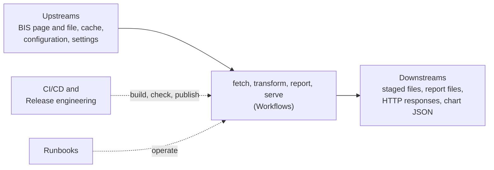

# Operations

How the pipeline behaves at runtime and how it is operated: what feeds it, what it feeds, the
call chain of every entry point, the checks and the release that surround the code, and the
routine tasks of someone who runs it. The pages are written for skilled users, reviewers and
operators; the plain-language version of the same behaviour is in
[How it works](../../how-it-works.md), and the user-level reference is the
[CLI reference](../../cli.md) and the [HTTP API](../../api.md).

Every claim on these pages is read from the code, the configuration, a workflow file or a test,
and names the function or file it comes from.

## What this section covers

The runtime path runs left to right; the development and operating pages surround it.

| Page | Capability | Read it to |
|---|---|---|
| [Upstreams](upstreams.md) | everything that feeds the pipeline | know where the data comes from, how it is found, cached, retried and recorded, and how the configuration and the settings are chosen |
| [Downstreams](downstreams.md) | everything the pipeline feeds | know the staged files, the five report files, the formats of `summary.csv` and `summary.json`, the HTTP responses and the chart JSON, and which numbers are exact |
| [Workflows](workflows.md) | the call chain of every public entry point | follow each CLI command and each HTTP route down through the code, and look up a public function or class with its inputs, effect and errors |
| [CI/CD](ci_cd.md) | the checks around the code | understand the GitHub Actions workflow, the order of the checks, the caches, and the local hooks |
| [Release engineering](release_engineering.md) | versions and releases | know how a version is numbered, recorded, tagged, published and synchronised |
| [Runbooks](runbooks.md) | routine tasks | run a daily refresh, serve the API, re-stage after a change, clear the cache, read `data_quality.json` |

## Which page to start from

| If you want to | Start with |
|---|---|
| schedule the tool and react to its exit codes | [Runbooks, a daily refresh](runbooks.md#run-a-daily-refresh) |
| know why a `fetch` ended with 6 or 7 | [Upstreams, how an upstream failure ends](upstreams.md#how-an-upstream-failure-ends) |
| consume `summary.json`, `summary.csv` or the API | [Downstreams](downstreams.md) |
| review how a command is implemented | [Workflows](workflows.md) |
| find which check a pull request must pass | [CI/CD](ci_cd.md#what-the-pull-request-checks-must-pass) |
| cut a release | [Release engineering, the release procedure](release_engineering.md#the-release-procedure) |
| see where a setting is read from | [Upstreams, settings precedence](upstreams.md#settings-precedence) |

## Pages not written, and why

The repository has no material for these, so no page states anything about them:

- **Infrastructure.** There is no infrastructure-as-code, no environment definition and no
  deployment target in the repository: the tool is a command-line program and an HTTP service
  started by the user. How to start it is in the [runbooks](runbooks.md#serve-the-http-api).
- **Incident response and monitoring and alerting.** There is no on-call arrangement, alert
  configuration or dashboard. What an operator can observe (exit codes, the log on standard
  error, the findings, the release named in each report) is in the runbooks.
- **Failure recovery and backpressure.** Failure handling is part of the pipeline's behaviour and
  is documented where it happens: the retries and fallbacks in [Upstreams](upstreams.md), the
  writes of a set (temporary files first, then the renames, and their known gap) in
  [Downstreams](downstreams.md#the-staged-layer), and the jobs of the HTTP API
  in [Workflows](workflows.md#jobs-post-jobsfetch-jobstransform-jobsreport-get-jobsid).

## Where to go next

- Starting out: the [README](https://github.com/andrea-dm/policy-rate-monitor#getting-started) and
  [How it works](../../how-it-works.md).
- The structure of the code and the reasons for it: [Architecture](../../architecture.md) and the
  [decision records](../../adr/index.md).
- Every public name with its docstring: the [API reference](../../reference.md).
