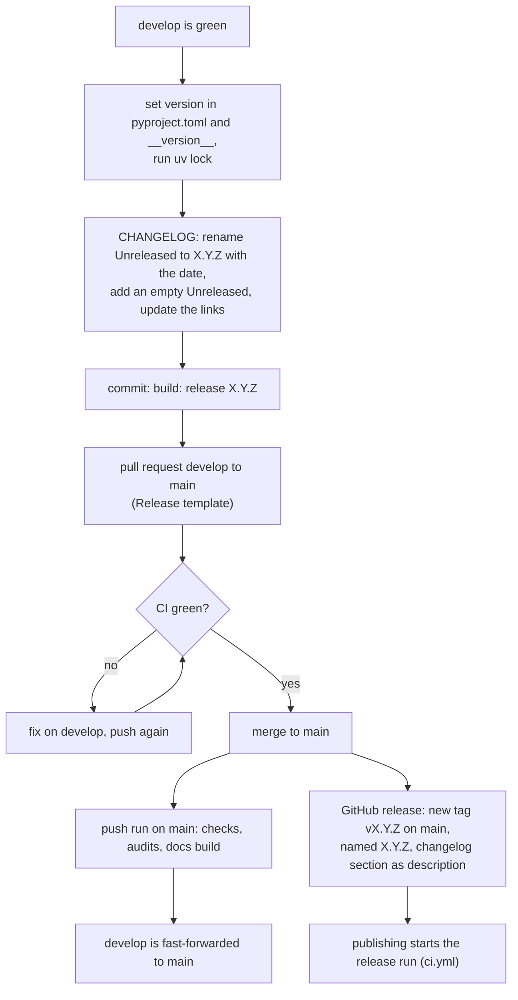

# Release engineering

How a version is numbered, recorded in the changelog, built, tagged and published, and how
`develop` is kept level with `main`. Everything here is what the repository does today, read from
`CONTRIBUTING.md`, `CHANGELOG.md`, `README.md`, `.github/workflows/ci.yml`,
`.github/PULL_REQUEST_TEMPLATE/Release.md` and `pyproject.toml`; steps that the repository does not
describe are listed at the end as not documented, not guessed. The pipeline's jobs are in
[CI/CD](ci_cd.md).

## Versioning

The project follows [Semantic Versioning](https://semver.org/spec/v2.0.0.html)
(`CONTRIBUTING.md`, `CHANGELOG.md`). The version is written in two places that must agree:
`version` in `pyproject.toml` and `__version__` in `src/policy_rate_monitor/__init__.py`.

Both stay at the last released version until the release commit sets the new one, and the lock
file is refreshed with `uv lock`. Each released version is a section of the changelog, with its
date, and a tag `vX.Y.Z`; the changes not released yet are collected under `## [Unreleased]`.

Two checks in CI keep the numbers honest:

- on a release, `build-package` fails unless the tag is `v` followed by the version in
  `pyproject.toml`, so a forgotten bump cannot publish a wheel whose version is not the tagged one
  (`build-package` in `.github/workflows/ci.yml`; the "placeholder" in its comment is the last
  released version);
- `wheel-smoke` installs the built wheel outside the checkout and asserts that the installed
  version is the one built and that `__version__` is the base version.

A push to `develop` builds a development version, `<base>.dev<run number>`, by editing
`pyproject.toml` inside the CI checkout only; nothing is committed, and the build is kept as a
one-day artefact, not published.

## The changelog policy

`CHANGELOG.md` follows [Keep a Changelog 1.1.0](https://keepachangelog.com/en/1.1.0/).

- **Every pull request adds its entry** under `## [Unreleased]` (`CONTRIBUTING.md`, workflow step
  6). Entries sit under `### Added`, `### Changed` or `### Fixed`, and end with the issue or pull
  request number, for example `(#34)`.
- **A breaking change** is written with the bold prefix `**Breaking:**`, with what to do about it.
  A change that needs an action after upgrading says so, for example "Run `bis-prates transform`
  once after upgrading".
- **A release renames the section.** `## [Unreleased]` becomes `## [X.Y.Z] — YYYY-MM-DD`, a new
  empty `## [Unreleased]` is added above it, and the comparison links at the bottom are updated
  (`[Unreleased]: .../compare/vX.Y.Z...HEAD`, `[X.Y.Z]: .../compare/vPREVIOUS...vX.Y.Z`; the first
  release links to its tag).
- **A released section opens with one sentence** saying what the release is about, as `0.1.0` and
  `0.2.0` do.
- **The changelog section is the release description** on GitHub (step 6 of the procedure below).

## The release procedure

`CONTRIBUTING.md`, "Releasing a New Version", gives the steps. Work happens on branches
named `<issue number>-<description>` off `develop`, which are merged into `develop` by pull
request; a release is a pull request from `develop` to `main`.

The path from a green `develop` to a published release. The release run is detailed in
[CI/CD](ci_cd.md#jobs-that-build-and-publish).

1. **Make sure `develop` is green.**
2. **Set the version** in `pyproject.toml` and `__version__` to `X.Y.Z`, and run `uv lock`.
3. **Update the changelog** as above.
4. **Commit** as `build: release X.Y.Z`, push, and open a pull request from `develop` to `main`.
   The `commit-format` check applies to every non-merge commit of the pull request, so each
   header must be `<type>: <lowercase summary>` or `<type>(<scope>): <lowercase summary>`, where
   the type is one of build, chore, ci, docs, feat, fix, perf, refactor, test, with no final period
   (an optional `!` before the colon flags a breaking change; reverts are `revert: <header>`).
5. **Merge once CI is green.** On `main`, the push run runs the same checks, audits and docs build.
6. **Create the GitHub release** with a new tag `vX.Y.Z` on `main`, named `X.Y.Z`, with the
   changelog section as its description. Publishing the release starts the CI release run, because
   the workflow runs on `release: published` and not on a tag push: the tag and the notes exist
   before any file is attached.

### What the release run does

| Step | Job | Result |
|---|---|---|
| tag check, build | `build-package` | `dist/` with the wheel and the sdist; fails if the tag does not match `pyproject.toml` |
| install test | `wheel-smoke` | the wheel imports in a clean environment and reports the right version |
| supply chain | `sbom` | `sbom.json`, a CycloneDX file of the runtime dependencies (never blocks the release) |
| documentation | `docs-site` | the site built offline and zipped (never blocks the release) |
| attach | `release-github` | the wheel, the sdist, `sbom.json` and `policy-rate-monitor-docs-vX.Y.Z.zip` uploaded to the release with `gh release upload`, only if the build and the smoke test succeeded |
| registry | `release-pypi` | `uv publish` with trusted publishing, only if the variable `PYPI_PUBLISH` is `true` and the GitHub upload succeeded |

PyPI goes last because it cannot be undone (a comment in `ci.yml`). It stays off until the
repository variable is set and a PyPI trusted publisher exists for the workflow and the `pypi`
environment.

### The documentation ZIP

Each release carries the built site as `policy-rate-monitor-docs-<tag>.zip`. It is built with
`OFFLINE=true mkdocs build --strict --site-dir site`, which turns on the `offline` plugin of
`mkdocs.yml`, so the pages open from the disk. Unzip it and open `index.html`; the Mermaid
diagrams need an internet connection, the rest works offline (`README.md`). To build the same site
locally: `OFFLINE=true uv run mkdocs build --strict`.

A second route, versioned documentation with `mike` on the `gh-pages` branch (`dev` follows
`develop`, `stable` follows the latest release), exists in the workflow but is off: it needs the
repository variable `DOCS_PUBLISH`, GitHub Pages, and `mike` in the `docs` dependency group, which
is not there.

## The release pull request template

`.github/PULL_REQUEST_TEMPLATE/Release.md` is the body of a release pull request. It asks for the
previous and new version and the bump type, a short description, the changelog excerpt,
deprecations, breaking changes with a migration guide, security fixes, a risk assessment, the
result of each check with its evidence, the compatibility (`requires-python`, the CI Python
versions), and a pre-merge checklist: version bumped, changelog updated, README and CONTRIBUTING
checked, `docs/` scanned for stale versions, lock file consistent, CI green on the source branch.

The template's "Post-merge actions" and one row of its compatibility table still refer to GitLab
(`.gitlab-ci.yml`, a GitLab Release) and to a versioned-docs deployment, and its quality table has
a SonarQube row that the GitHub workflow does not run. The steps of this page are those of
`CONTRIBUTING.md` and `ci.yml`; the template's wording is out of date on those points.

## Syncing `develop` with `main`

After a push to `main` whose checks all passed (no failed job among `tach`, `ruff`, `deptry`,
`pyright`, `pytest`, `docs-build`, `audit` and `audit-dev`), the job `sync-develop-with-main`
checks out `develop`, runs `git merge --ff-only origin/main` and pushes. It is non-blocking
(`continue-on-error`): if `develop` has diverged from `main`, the merge is refused with "develop
has diverged from main; open a pull request to reconcile", and someone must reconcile the two
branches by hand. A push made with the workflow's token starts no new run, so `develop` is not
checked again after the fast-forward.

## Dependency updates

Dependabot proposes updates to the GitHub Actions monthly, against `develop`, with the commit
prefix `ci`. Python dependency versions are bumped by hand (`.github/dependabot.yml`); the
dependency audits run on every pull request and on `main` and `develop`
([CI/CD](ci_cd.md#the-jobs-and-their-order)).

## Not documented in the repository

- **A rollback or yank procedure.** No file describes one. The release template only has a
  "rollback complexity" field, and `ci.yml` notes that PyPI cannot be undone.
- **Which checks branch protection requires.** CONTRIBUTING says the checks other than the
  informational ones must pass before a merge; the setting that enforces it is not in the
  repository.
- **A schedule or a criterion for cutting a release.** The procedure starts from "make sure
  `develop` is green".

## See also

- [CI/CD](ci_cd.md) for the pipeline and the local hooks.
- [Runbooks](runbooks.md#re-stage-after-a-configuration-change-or-an-upgrade) for what an operator
  does after upgrading.
- [Changelog](https://github.com/andrea-dm/policy-rate-monitor/blob/develop/CHANGELOG.md) and
  [CONTRIBUTING.md](https://github.com/andrea-dm/policy-rate-monitor/blob/develop/CONTRIBUTING.md).
