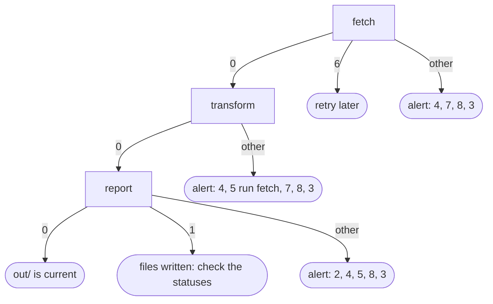

# Runbooks

Routine tasks for whoever runs the tool: a daily refresh from a scheduler, serving the HTTP API,
re-staging the data after a configuration change or an upgrade, clearing the cache, and reading
`data_quality.json`. Each runbook says when to use it, the steps, how to tell it worked, and what
the failures mean. The commands are `bis-prates` commands; for a clone, run them through
`uv run` or an activated environment ([README](https://github.com/andrea-dm/policy-rate-monitor#getting-started)).

The reasons behind each behaviour are in [Upstreams](upstreams.md), [Downstreams](downstreams.md)
and [Workflows](workflows.md); the options and exit codes are in the
[CLI reference](../../cli.md).

## Set up the environment once

A deployment is set up through its environment, so no command needs options
([CLI reference](../../cli.md#where-the-options-come-from)):

```bash
export BIS_PRATES_CONFIG=/etc/bis-prates/config.json   # else configs/bis_cbpol.json
export BIS_PRATES_DATA_DIR=/var/lib/bis-prates         # else dataset.data_dir ("data")
bis-prates config validate                              # prints the path and where it came from
```

`config validate` loads the configuration exactly as the other commands do; it prints
`<path>: valid (given with BIS_PRATES_CONFIG)` and ends with exit code 0, or lists the problems and
ends with 4. An empty variable counts as unset. A relative path is relative to the folder the
command runs in, so a scheduler should use absolute paths or set the working folder.

## Run a daily refresh

**When:** to keep `out/` current from a scheduler (cron, a CI schedule, a job runner).

**Steps:** the three commands, in order. Each writes files the next one reads.

```bash
bis-prates fetch                                   # the BIS ZIP, or the cached copy
bis-prates transform                               # stage the daily series
bis-prates report --countries "US,EA,GB,JP,CH"     # the five files in out/
```

A `fetch` less than `cache_ttl_hours` (24 in `bis_cbpol.json`) after the last download reuses the
cached copy and makes no request, so a schedule shorter than a day does not load the BIS site
more.

**What each exit code tells the scheduler:**

| Command | Code | Meaning | Scheduler action |
|---|---|---|---|
| any | 0 | success | go on |
| `fetch` | 6 | the BIS site cannot be reached after the attempts, and nothing is cached | retry later; the only code that means "try again" |
| `fetch` | 7 | the source is not what the configuration describes: HTTP 404 or another status, a corrupt ZIP, not exactly one CSV | alert a person; retrying does not help |
| `transform` | 5 | no cached ZIP | run `fetch` first |
| `transform` | 7 | the cached ZIP or its CSV cannot be read, a required column is missing, no daily row, or an invalid series row (the message names the file or series) | alert; the previous staged files are kept |
| `report` | 5 | nothing staged, or staged with another configuration | run `transform` |
| `report` | 1 | no requested country or economic area has a complete result (status `ok`); the five files are still written | check the codes and statuses in `summary.csv` |
| `report` | 2 | an invalid code, a malformed `--start` | fix the command line |
| any | 4 | the configuration is missing or invalid | alert; `bis-prates config validate` |
| any | 8 | a file cannot be read or written (permissions, a full disk) | check the folders |
| any | 3 | an unexpected error, a bug; the traceback is in the log | report it |

```bash
#!/usr/bin/env bash
# nightly refresh: retry later only when the BIS site is unreachable
bis-prates fetch
case $? in
  0) ;;
  6) echo "BIS unreachable, retry later" >&2; exit 75 ;;
  *) echo "fetch failed, see the log" >&2; exit 1 ;;
esac
bis-prates transform || exit 1
bis-prates report --countries "US,EA,GB,JP,CH" --out /var/www/rates
test $? -le 1 || exit 1    # 1 = no complete result: files written, worth a look
```



The decision at each step of the refresh. Only `fetch` with code 6 is worth retrying.

**What exit code 0 does not tell:**

- A `fetch` that could not reach the BIS site but found an older cached copy **ends with 0** and
  logs a warning that names the copy's retrieval time. The log goes to standard error; the report
  names the release (retrieval time and SHA-256) in "About the data" and in `summary.json`
  (`source`), so a stale copy is visible there.
- `transform` ends with 0 whatever it finds in the data. It prints the number of data-quality
  findings; to alert on them, read that number or `data_quality.json` (see
  [Read `data_quality.json`](#read-data_qualityjson)).
- A country or economic area may be flagged `stale_latest` or `stale_prior`, or have the status
  `unknown_ref_area`, `no_valid_data` or `insufficient_history`; the command still ends with 0 as
  long as one requested code is `ok`.

**Do not run two steps at once.** The files of a run are renamed into place one after another, so
a `report` that reads while a `transform` renames can pair files of two runs (a known limit,
[Downstreams](downstreams.md#the-staged-layer)). Run the steps one after the other.

## Serve the HTTP API

**When:** another program or a web page needs the figures over HTTP.

**Prerequisite:** the `web` extra (`uv sync --extra web` in a clone, or
`pip install './policy_rate_monitor-<version>-py3-none-any.whl[web]'` with the wheel of a GitHub release). Without it `bis-prates serve` prints a message naming the extra and
ends with code 2.

**Steps:**

```bash
bis-prates serve --host 127.0.0.1 --port 8000 --out /var/www/rates
```

1. `serve` loads the configuration (exit 4 if invalid), binds the address, and runs until stopped.
   A port that is in use, or an address that cannot be bound, ends with code 2 and a message
   naming them. `--port` must be a whole number from 1 to 65535.
2. The staged data is read when the first request needs it. On a new install, stage it first with
   the commands, or with the jobs:

   ```bash
   curl -X POST http://127.0.0.1:8000/jobs/fetch       # 202, poll the Location header
   curl -X POST http://127.0.0.1:8000/jobs/transform
   ```

   The polling loop is in the [HTTP API](../../api.md#jobs). Jobs run one at a time; a second
   `POST` while one is queued or running gets `409` `job_running`.
3. Check it: `GET /ref-areas` answers `200` once data is staged and `409` `missing_input`
   (naming `POST /jobs/transform`) before. There is no separate health route. `/docs` shows every
   endpoint.

**Operating rules:**

- **One process.** Run one uvicorn process: several would each have their own jobs and their own
  copy of the data. `serve` starts exactly one.
- **No authentication, no CORS headers.** Listen on `127.0.0.1` (the default), or put it behind a
  proxy that checks who calls. `--host 0.0.0.0` exposes it on every interface.
- **Jobs live in memory.** A restart loses the job list and the ids; the files they wrote stay. Only
  the last 100 finished jobs are kept.
- **New data without a restart.** A `transform` job replaces the data the API serves once its files
  are written. A configuration change, however, needs a restart: the configuration is loaded once
  when `serve` starts.
- **Stopping.** Ctrl+C (SIGINT) or `kill <pid>` (SIGTERM) stops accepting requests and waits for a
  running job to finish, so a transform never stops halfway; new connections are refused while it
  waits. The process then ends with status 130 after Ctrl+C (with a `KeyboardInterrupt`
  traceback) or 143 after SIGTERM, not 0, because uvicorn raises the signal again
  ([Runtime behaviour](../implementation_design/runtime_behavior.md#start-and-stop)). SIGKILL
  (`kill -9`) stops at once, at the risk of stopping a job partway through writing its files.
- **Logs** of the package (INFO level, set up by `bis-prates`) go to standard error.

**Failures:** a `409` `missing_input` on a read says which job to run; `422` is a bad code or
parameter; `500` `internal_error` is a bug, with the traceback in the log. The kinds and statuses
are in [Downstreams](downstreams.md#the-http-apis-responses).

## Re-stage after a configuration change or an upgrade

**When:**

- the configuration changed in a way that changes the staged table: a dimension, a column name or
  the kept observation attributes. Commands that read the data then end with **exit code 5**,
  saying the data "was staged with another configuration" and naming `transform`; the API answers
  `409` `missing_input` (`bulk.py` `BulkFileProvider.observations`);
- the measure's precision or scale changed. The staged values are cast to the new type without
  error when they fit, so nothing fails, but the `non_numeric_value` check of the new precision
  has not run on them. Re-stage anyway;
- the package was upgraded from a version that did not write `staged/release.json`
  (`CHANGELOG.md`, "Run `bis-prates transform` once after upgrading"). Nothing fails, but the
  release of the staged data shows as unknown ("No record of the source file's retrieval was
  found" in the report; `source: null` in `summary.json`) until then;
- a rule parameter changed that should apply to data already downloaded.

**Steps:**

1. Check the new configuration: `bis-prates config validate`.
2. Re-stage from the cached ZIP; no download is needed:

   ```bash
   bis-prates transform
   ```

   `transform` rebuilds `raw/*.parquet` and everything under `staged/` from `raw/<file_name>`
   and replaces them together, `release.json` last. It stages the release only if the record
   `raw/WS_CBPOL_csv_flat.json` is valid and its SHA-256 is that of the ZIP; otherwise it logs a
   warning and the release stays unknown. If the ZIP or its record is missing or damaged, run
   `bis-prates fetch` first (a missing or unreadable record needs nothing more. If `transform`
   warns that the record is not that of the ZIP, delete the record first:
   [Clear the cache](#clear-the-cache)).
3. Run `bis-prates report ...` again.
4. If `serve` is running: restart it after a configuration change or an upgrade of the package.
   A `POST /jobs/transform` reloads the data but not the configuration.

**How to tell it worked:** `transform` prints the counts and ends with 0; `summary.json` has a
non-null `source`; `bis-prates report` no longer ends with 5.

**If it fails:** exit 5 with step `fetch` means there is no cached ZIP: run `fetch`. Exit 7 names
what in the file does not match the new configuration (a missing required column, no row for
`structure.selection`). A previous successful run's staged files are kept when a run fails while
writing.

**A second dataset** needs its own configuration and its own `--data-dir`, so the two do not
overwrite each other's files ([Configuration](../../configuration.md#a-second-dataset)).

## Clear the cache

**What the cache is:** two files in `<data_dir>/raw/`: `WS_CBPOL_csv_flat.zip` and its release
record `WS_CBPOL_csv_flat.json`. The cache is *used* while its record's `retrieved_at` is less than
`cache_ttl_hours` old. Nothing else is cache: `staged/` and `out/` are outputs.

**When:** to force a new download before the lifetime ends, or to get out of a damaged cache.

**Options, from lightest to fullest:**

| Goal | How | Effect on the next `fetch` |
|---|---|---|
| Download once now | delete the record: `rm <data_dir>/raw/WS_CBPOL_csv_flat.json` | no usable record, so it downloads |
| Download every time | set `source.cache_ttl_hours` to `0` in the configuration | every `fetch` downloads, unless the record's `retrieved_at` is in the future (remember to set it back) |
| Remove the downloaded file too | delete the ZIP and the record | downloads; with the network down and no copy it ends with 6 |

`<data_dir>` is `--data-dir`, `BIS_PRATES_DATA_DIR`, else `dataset.data_dir` (`data`). With the
environment set up as above:

```bash
rm "${BIS_PRATES_DATA_DIR:-data}"/raw/WS_CBPOL_csv_flat.json         # force one new download
rm "${BIS_PRATES_DATA_DIR:-data}"/raw/WS_CBPOL_csv_flat.{zip,json}   # remove the cached copy
bis-prates fetch && bis-prates transform
```

**What clearing does not touch:** `raw/WS_CBPOL_csv_flat.parquet`, `staged/` and `out/` stay, and
`report` keeps working from `staged/` without any ZIP. A damaged `staged/` is rebuilt with
`transform`, which needs the ZIP.

**Cautions:**

- A **failed** download never replaces a good copy, and an expired copy is used as a fallback when
  the site cannot be reached. Deleting the cache removes that safety net.
- Deleting only the record leaves a ZIP that `transform` can still read, but with no valid record
  the release of the staged data is unknown (a warning is logged). Normally the next `fetch`
  rewrites both.
- A record that cannot be read is ignored automatically (a warning is logged), so a corrupt record
  needs no manual step: the next `fetch` downloads again.

## Read `data_quality.json`

**What it is:** `<data_dir>/staged/data_quality.json`, the findings of the last `transform`: a
JSON list with one record per rule and series (a few rules give one per case or per column;
[Data quality](../../data-quality.md#2-what-a-finding-is)). `[]` means no findings, and does not
mean that the three rules not built yet were checked. The same findings are in
the "Data quality" section of `report.md` and `report.html`, and `transform` prints how many there
are ("`... 0 data-quality findings`").

Each record is a `DataQualityIssue`:

| Field | Meaning |
|---|---|
| `rule` | the rule's name from the configuration, for example `exact_duplicate` |
| `severity` | `info` (expected and handled, e.g. duplicate rows dropped), `warning` (handled, worth a look, e.g. a value that is not a number kept as invalid) or `error`; set per rule in the configuration |
| `series_key` | the series affected, for example `D.US`; `null` for a finding about the whole file |
| `count` | the number of affected observations (for `unexpected_column`, the number of columns) |
| `detail` | what was found and what was done about it |

Shape of a record (illustrative values):

```json
{
  "rule": "exact_duplicate",
  "severity": "info",
  "series_key": "D.US",
  "detail": "3 rows repeated exactly; the copies were dropped",
  "count": 3
}
```

To list them from a shell, any JSON tool will do; with Python:

```bash
python -c "
import json, os
data_dir = os.environ.get('BIS_PRATES_DATA_DIR', 'data')
for issue in json.load(open(f'{data_dir}/staged/data_quality.json')):
    print(issue['severity'], issue['rule'], issue['series_key'] or 'all', issue['count'], issue['detail'])
"
```

**What each built rule means and what to do** ([Configuration, rules](../../configuration.md#the-data-quality-rules),
decision [0011](../../adr/0011-data-quality-rules.md)):

| Rule | The finding means | Action |
|---|---|---|
| `unexpected_column` | the file has columns the configuration does not name; they are ignored | the BIS added a column: decide whether to configure it |
| `unparseable_date` | observations whose date is not in the configured format were dropped | check `structure.time_dimension.date_format` against the file |
| `non_numeric_value` | a value is not a plain number within the configured precision and scale, or a row's unit multiplier is blank or not a whole number; the row is kept as invalid with no value | look at the raw rows of that series; never rounded |
| `status_value_mismatch` | an invalid status with a value, or a valid status with no value; kept as invalid | the source's flags and values disagree |
| `exact_duplicate` | rows repeated exactly; the copies were dropped | normally nothing (`info`) |
| `conflicting_duplicate` | a date has more than one different observation; one is kept, the configured `keep` (`first` or `last`) | check which value is right; the report says which row was kept |
| `unexpected_value` | a column holds another code than the configuration expects (e.g. `OBS_CONF`) | the source may have changed its conventions |

Three more rules are configured in `bis_cbpol.json` but have no code yet: `excess_decimals`,
`series_attribute_not_constant` and `plausible_range`. They never produce a finding; `transform`
logs "data-quality rule ... is not implemented yet" at INFO level
(`transform.IMPLEMENTED_RULES`).

**Reading it as an operator:**

- Findings never change an exit code. A run with findings and a run without both end with 0, so a
  scheduler that must act on them has to read the count `transform` prints, or the file.
- The numbers are per series: `count` adds up the affected observations, not the rows of the
  file. The count printed by `transform` is the number of records, not the sum of `count`.
- A finding does not remove an observation unless its rule says "dropped"; an invalid observation
  stays in `observations.parquet` with `is_valid = false`, and is left out of the latest and prior
  rates.
- A finding with `severity` `error` is possible by configuration (`DataQualitySeverity.ERROR`),
  but no built rule's behaviour depends on the severity: it is a label.

For the full picture of how the findings arise, their severities and what a reader of the report
should do with them, see [Data quality](../../data-quality.md).

## Troubleshooting by symptom

| Symptom | Likely cause | Runbook |
|---|---|---|
| `error: ... cannot read the configuration` (exit 4) | the path came from the default or a variable and is wrong; the message ends with where it came from | [Set up the environment](#set-up-the-environment-once) |
| ``error: ... does not exist: run `bis-prates transform` first`` (nothing staged) or ``error: ... was staged with another configuration (...): run `bis-prates transform` first`` (exit 5) | `report` before `transform`, or data staged with another configuration (`serve` does not exit: its read routes answer `409` `missing_input`) | [Re-stage](#re-stage-after-a-configuration-change-or-an-upgrade) |
| `WARNING policy_rate_monitor.fetch: ...; using the cached copy from ...` in the log, exit 0 | the BIS site could not be reached | wait for the next refresh; see [Run a daily refresh](#run-a-daily-refresh) |
| the report says "No record of the source file's retrieval" | staged by an older version, or the release record did not match the ZIP | [Re-stage](#re-stage-after-a-configuration-change-or-an-upgrade) |
| `bis-prates serve` exits 2 | the `web` extra is missing, or the port is in use | [Serve the HTTP API](#serve-the-http-api) |
| `409` `job_running` | a job is queued or running | wait for it; poll `GET /jobs/{id}` |

## See also

- [Upstreams](upstreams.md) and [Downstreams](downstreams.md) for what the runbooks rely on.
- [CI/CD](ci_cd.md) and [Release engineering](release_engineering.md) for the development side.
- [CLI reference](../../cli.md) and [HTTP API](../../api.md) for every option and endpoint.
