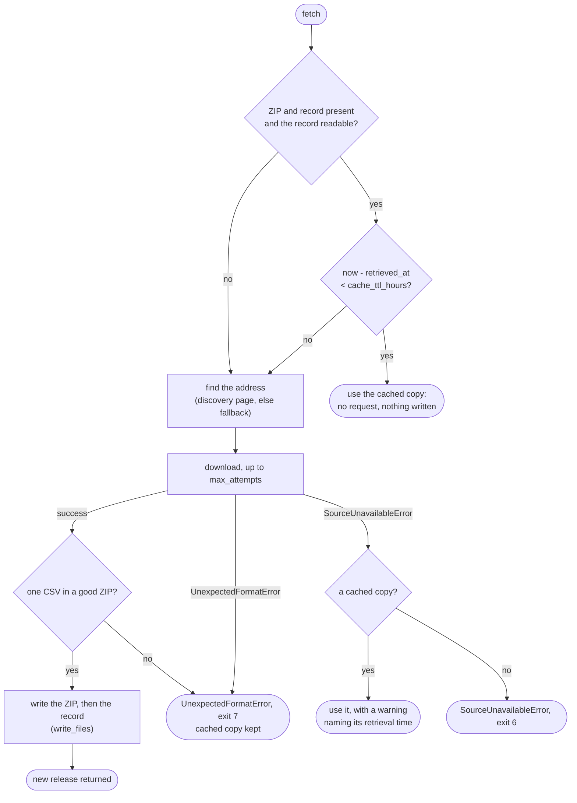
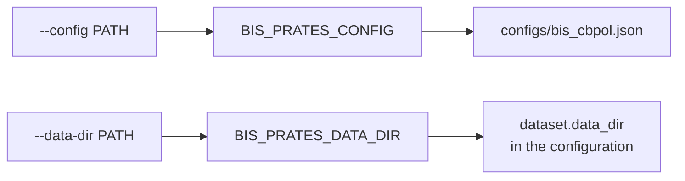

# Upstreams: everything that feeds the pipeline

What goes into `fetch`, `transform` and the readers behind them: the BIS discovery page and bulk
file, the cache and its lifetime, the release record, the retries and redirects, the
configuration, and the order in which the command line, the environment and the configuration
decide which file is read. [Downstreams](downstreams.md) covers what comes out;
[Workflows](workflows.md) follows each command through the code.

The same behaviour in plain language, with what can go wrong for a user, is in
[How it works, sections 1 and 2](../../how-it-works.md). This page is the operator's view: which
setting controls what, in which order things are tried, and how each failure ends.

## The inputs at a glance

| Input | Where it is named | Read by | If it is missing or wrong |
|---|---|---|---|
| The configuration file | `--config`, `BIS_PRATES_CONFIG`, else `configs/bis_cbpol.json` | every command but `config schema` | exit code 4, the message ends with where the path came from |
| The data directory | `--data-dir`, `BIS_PRATES_DATA_DIR`, else `dataset.data_dir` | `fetch`, `transform`, `report`, `serve` | files are looked for, or created, there |
| The BIS discovery page | `source.discovery_url` | `fetch` | the fallback address is used, with a warning |
| The BIS bulk file | the link found on that page, else `source.fallback_url` | `fetch` | retried, then exit code 6 or 7 (below) |
| The cached ZIP and its release record | `<data_dir>/raw/<file_name>` and the `.json` beside it | `fetch`, `transform` | `fetch` downloads again; `transform` ends with exit code 5 when the ZIP is absent |
| The staged files | `<data_dir>/staged/` | `report`, `serve` (through the provider) | `report`: exit code 5, naming `transform`; `serve`: the read routes answer 409 `missing_input`, naming `POST /jobs/transform` |

Nothing else is read: the package takes no credentials, and no other environment variable than the
two above (`policy_rate_monitor.settings`).

## The BIS discovery page

`fetch` first asks the page named by `source.discovery_url` (`https://data.bis.org/bulkdownload`
in `configs/bis_cbpol.json`) where the file is, because the file's address can change
(`_find_download_url` in `policy_rate_monitor.fetch`).

- The page is requested **once, with no retry**, with the configured timeouts. It is decoded as
  UTF-8, with undecodable bytes replaced.
- Every `<a href>` is collected and resolved against the page's address (`urljoin`). The **first**
  link whose last path segment equals `source.file_name` (`WS_CBPOL_csv_flat.zip`) is the download
  address. Similar files on the page, such as the column-oriented CSV, are skipped because the
  comparison is on the whole name.
- If the page cannot be fetched (any connection error, timeout, or HTTP error status), or has no
  such link, `source.fallback_url` is used, with a warning. The configuration check
  `source.fallback_url` must end with `source.file_name` keeps the two consistent.

## The bulk file

The download must be a ZIP that is not corrupt or encrypted and holds **exactly one** member whose
name ends in `.csv`, in any case (`read_zip_csv`). `fetch` runs this check before anything is
stored, and `transform` runs the same check on the cached copy, so both refuse the same files; a
bad file ends with exit code 7 and `fetch` keeps the previous good copy.

What `transform` then reads from the CSV is described by the `columns` and `structure` sections of
the configuration: the delimiter and encoding, the `CODE:Label` headers and `code: label` values,
the texts that mean "no value", and the rows to keep (`structure.selection`, `FREQ = D`). The CSV
is read whole, every column as text with no value turned into a missing one. The facts about the
current file that shaped these settings are in
[Data model, facts about the BIS file](../../data-model.md#facts-about-the-bis-file-that-shaped-the-design).

## Downloading: timeouts, retries and redirects

`http_get` (`policy_rate_monitor.fetch`) makes one GET at a time with the standard library's
`http.client`, sending `User-Agent: policy-rate-monitor`. Only `http` and `https` addresses are
accepted; any other scheme is an unexpected format.

| Answer | What `http_get` does | Retried by `fetch` |
|---|---|---|
| 200 | returns the whole body, held in memory | - |
| 301, 302, 303, 307, 308 with a `Location` header | follows it, resolved against the current address | - |
| a redirect with no `Location`, or a sixth redirect | `UnexpectedFormatError` (exit code 7) | no |
| 5xx, 408, 429 | `SourceUnavailableError` (exit code 6 once the attempts are used) | yes |
| a connection error, a timeout, any `OSError` or HTTP protocol error | `SourceUnavailableError` | yes |
| any other status (404, 403, ...) | `UnexpectedFormatError` (exit code 7) | no |

The timeouts come from `source.connect_timeout_seconds` (10 s in `bis_cbpol.json`), which covers
opening the connection, and `source.read_timeout_seconds` (60 s), which applies to each read once
connected, not to the whole download. At most five redirects are followed (`MAX_REDIRECTS`).

`_download` makes up to `source.max_attempts` attempts in all, the first included (3 in
`bis_cbpol.json`). After a failed attempt number *n* it waits *n* seconds (1 s, then 2 s) and
tries again; after the last attempt it raises the error. Only a `SourceUnavailableError` is
retried: an `UnexpectedFormatError` goes straight to the caller, because retrying a 404 does not
help. Each attempt follows its own redirects.

## The cache and its lifetime

The cache is two files in `<data_dir>/raw/`: the ZIP (`source.file_name`) and its release record,
the same name with `.json` (`WS_CBPOL_csv_flat.json`).

The decision flow of `fetch`, with the cache first and the network second. An expired copy is used
only when the network is unreachable, never when the source answers with something unexpected.

- **Freshness** is `now() - retrieved_at < cache_ttl_hours`, with `retrieved_at` from the record,
  not the file's date on disk. The comparison is strict, so with `cache_ttl_hours: 0` a record is
  fresh only if it is dated in the future (see the clock, below); otherwise every `fetch`
  downloads again (the field's description in `config.schema.json` says "0
  always revalidates").
- **A record that cannot be read** (not UTF-8, or not a valid record) is logged as a warning and
  treated as no cache at all (`read_release`). So is a ZIP with no record, or a record with no ZIP.
- **A cache hit writes nothing**: it returns the recorded release and logs the retrieval time.
- **A download replaces both files together.** `_store` hands the ZIP and the record to
  `core.files.write_files`, which writes both under temporary names and renames the ZIP first and
  the record second. A crash between the two renames leaves a new ZIP beside the old, expired
  record, so the next `fetch` downloads again; the cache is never fresh with the wrong file.
- **The clock** is `datetime.now(UTC)`. A record dated in the future counts as fresh.

## The release record

The record is a `SourceRelease` (`policy_rate_monitor.core.models`), written as JSON:

| Field | Value for the bulk download |
|---|---|
| `location` | the address that was downloaded: the link found on the page, or the fallback (before any redirect) |
| `version_id` | always `null`: the bulk download has no version identifier of its own |
| `checksum_sha256` | the SHA-256 of the ZIP's bytes, 64 lowercase hex digits |
| `retrieved_at` | when the download had finished and passed the ZIP check, timezone-aware (UTC) |

`transform` copies the record to `staged/release.json` only when the checksum is that of the ZIP
it read, so a `fetch` running at the same time cannot make a report name a release it was not
built from (`_release_of` in `policy_rate_monitor.transform`). With no valid record, or one for
another ZIP, it logs a warning, stages without a release and removes the old `release.json`:
the release of the staged data is then unknown, never wrong. Reports and the API read the release
from `staged/release.json` through `DataProvider.source_release()`.

Data staged by an earlier version has no `staged/release.json`; run `transform` once after
upgrading ([Runbooks](runbooks.md#re-stage-after-a-configuration-change-or-an-upgrade)).

## The configuration

One JSON file describes the dataset (`configs/bis_cbpol.json`); its sections and rules are in
[Configuration](../../configuration.md). A `ConfigSource` supplies it
(`policy_rate_monitor.config.source`):

| Piece | Role |
|---|---|
| `ConfigSource` | the interface: `load()` returns a validated `DatasetConfig` or raises `ConfigError` |
| `FileConfigSource(path)` | the only implementation: reads the file's bytes at `load()`; a missing or unreadable file is a `ConfigError` that starts with the path |
| `parse_config(document, origin=...)` | the one parser every source calls |

`parse_config` decodes UTF-8 (a byte-order mark is accepted), parses JSON, refuses a repeated key
in an object and the constants `NaN` and `Infinity`, then validates against `DatasetConfig`. Every
problem is reported on its own line, located the way the JSON is written, with the origin first.
The checks that compare several values (for example the fallback address ending with the file
name, or the rule parameters) run here, not in the JSON Schema; so `bis-prates config validate` is
the full check. The configuration is loaded once when a command starts: the HTTP API does not
reload it, so a change needs a restart of `serve`.

A source that is not a file (a configuration service, say) needs only a new `ConfigSource` that
fetches the text and calls `parse_config`
([Architecture](../../architecture.md#a-configuration-from-a-service)).

## Settings precedence

`policy_rate_monitor.settings` resolves the two paths the same way for the command line and the
HTTP API. Each is taken from the first layer that gives one:

The two orders, each read from left to right, highest priority first. The configuration cannot name itself, so the
configuration file has no configuration layer.

| Setting | 1. Command line | 2. Environment | 3. Fallback |
|---|---|---|---|
| configuration file (`config_path`) | `--config` | `BIS_PRATES_CONFIG` | `configs/bis_cbpol.json` (`DEFAULT_CONFIG`) |
| data directory (`data_dir`) | `--data-dir` | `BIS_PRATES_DATA_DIR` | `dataset.data_dir` (`data` in `bis_cbpol.json`) |

- An **empty** variable counts as unset (`export BIS_PRATES_CONFIG=` clears it).
- A relative path is relative to the **current folder**, not to the configuration file.
- `~` and `$` are not expanded in `dataset.data_dir`.
- The result is a `Setting`: the path and its `Origin` (`flag`, `environment`, `configuration` or
  `default`). The origin appears only in the messages: `config validate` prints it, and a
  configuration that cannot be loaded ends with the path and where it came from.
- Not settings in this sense: `--out` (default `out`), `--host`, `--port`, `--start` and
  `--countries` have no environment variable and no configuration key.

The options of each command are in the [CLI reference](../../cli.md#options).

## How an upstream failure ends

| What fails | Error raised | Exit code | HTTP API kind | Next step |
|---|---|---|---|---|
| configuration missing, not UTF-8 JSON, or invalid | `ConfigError` | 4 | `config_error`, 500 | fix the file; `bis-prates config validate` |
| no connection, timeout, 5xx, 408 or 429 after the attempts, nothing cached | `SourceUnavailableError` | 6 | `source_unavailable`, 503 | try again later |
| 404 or another status, more than five redirects, not a ZIP, corrupt or encrypted ZIP, not exactly one CSV | `UnexpectedFormatError` | 7 | `unexpected_format`, 500 | check the BIS file and its address; the configuration may need updating |
| the cached ZIP is absent when `transform` runs | `MissingInputError` (step `fetch`) | 5 | `missing_input`, 409 | run `bis-prates fetch` |
| a file cannot be read or written | `OSError` | 8 | `file_error`, 500 | check the data folder |

The first three rows come from `core.errors` and `cli.exit_codes`; the HTTP kinds from
`web.errors`. The full tables are in the [CLI reference](../../cli.md#exit-codes) and the
[HTTP API](../../api.md#errors).

## Tests

`tests/test_fetch.py` runs `fetch` against a fake web server (no test uses the network): the
cache, the fallback address, the retries and their pauses, a 404 failing at once and a 503
retried, up to five redirects, an unreadable release record. `tests/test_settings.py` covers the
order of the layers and the empty variable; `tests/config/` the loading and the messages;
`tests/test_transform.py` the checks of the ZIP and the release written last.

## See also

- [Downstreams](downstreams.md) for the files and responses that leave the pipeline.
- [Workflows: `fetch`](workflows.md#bis-prates-fetch) and
  [`policy_rate_monitor.fetch`](workflows.md#policy_rate_monitorfetch) for the call chain.
- [API reference: `policy_rate_monitor.fetch`](../../reference.md#policy_rate_monitor.fetch) and
  [`policy_rate_monitor.settings`](../../reference.md#policy_rate_monitor.settings).
- Decisions [0010](../../adr/0010-cli-and-exit-codes.md), [0012](../../adr/0012-elt-raw-and-staged-layers.md)
  and [0017](../../adr/0017-bad-input-failures-and-writes.md).
