# Workflows

A walkthrough of every public entry point of the package, from the call the user makes down to the
lowest-level function involved: each `bis-prates` command, each HTTP route, then the public
functions and classes of each module. Each section gives the inputs, what the code does, what it
returns or writes, and the errors it raises, with a diagram of the call chain.

The names are those of the [API reference](../../reference.md), generated from the docstrings; each
module section links to its entry. The user-level description of the commands is in the
[CLI reference](../../cli.md) and the [HTTP API](../../api.md); the shorter picture of one run is
in [Architecture](../../architecture.md#one-run-of-report). What goes in and out of these
workflows is in [Upstreams](upstreams.md) and [Downstreams](downstreams.md).

| Entry point | Section |
|---|---|
| `bis-prates fetch`, `transform`, `report`, `serve`, `config validate`, `config schema` | [Command line](#the-command-line) |
| `GET /ref-areas`, `/summary`, `/timeseries`, `/chart`; `POST /jobs/...`; `GET /jobs/{id}` | [HTTP routes](#http-routes) |
| The public functions and classes of each module | [Modules](#the-public-functions-and-classes-by-module) |

## The command line

### How every command runs

`cli.main.main(argv, environ)` ([API reference](../../reference.md#policy_rate_monitor.cli.main))
is the console script `bis-prates` (`[project.scripts]` in `pyproject.toml`) and the target of
`python -m policy_rate_monitor.cli`.

- **Inputs:** the arguments after the program name (default `sys.argv`) and the environment
  (default `os.environ`).
- **What it does:** builds the parser, parses the arguments (an invalid argument, `--help` and
  `--version` end in `SystemExit`: code 2 for an invalid argument, 0 for the others), sets up
  logging (INFO level, to standard error, format `%(asctime)s %(levelname)s %(name)s: %(message)s`),
  then runs the command's function and maps what it raises to an exit code.
- **Returns:** the exit code, an `ExitCode` (`cli.exit_codes`).
- Results go to standard output; warnings, errors and the log go to standard error.

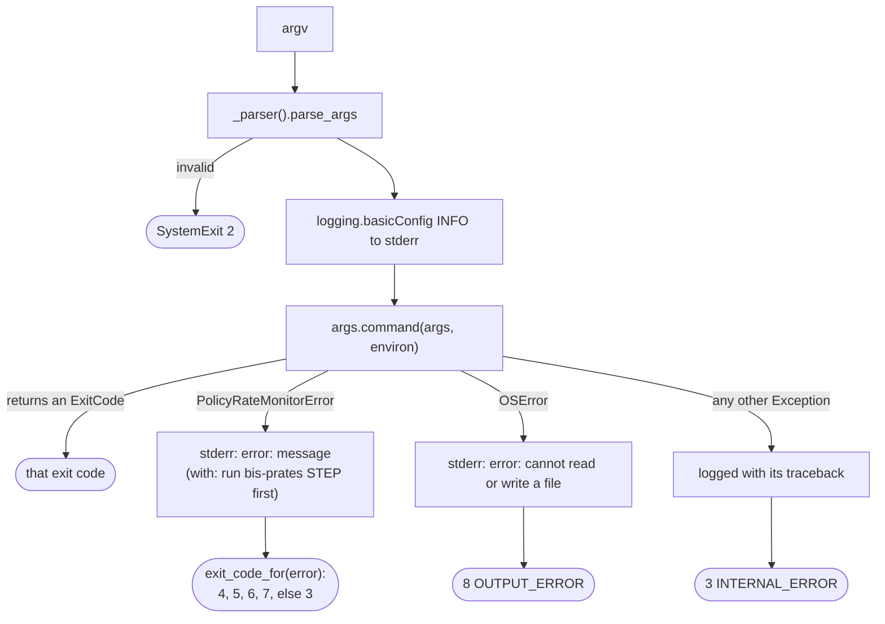

How `main` turns what a command raises into an exit code. `--debug` adds the traceback to the first
two error paths; an unexpected error always logs it.

`exit_code_for` walks the error's class hierarchy and returns the code of the first class it
finds: `ConfigError` 4, `MissingInputError` 5, `SourceUnavailableError` 6,
`UnexpectedFormatError` 7, anything else 3. A `MissingInputError` with a `step` gets the hint
``run `bis-prates <step>` first`` appended (`_message`).

`fetch`, `transform`, `report` and `serve` start the same way (`_open`): resolve the configuration
path (`settings.config_path`), load it with `FileConfigSource` (`_load`; a `ConfigError` gets the
path and where it came from appended), resolve the data directory (`settings.data_dir`) and build
a `BulkFileProvider(config, data_dir)`. `config validate` does only the first two steps
(`config_path`, `_load`), and `config schema` reads no configuration. See [Upstreams, settings precedence](upstreams.md#settings-precedence).

### `bis-prates fetch`

- **Inputs:** `--config`, `--data-dir`, `--debug`.
- **Does:** `_fetch` calls `BulkFileProvider.fetch()`, which calls `fetch.fetch(config.source,
  data_dir, get)`.
- **Prints:** `<location> (sha256 <checksum>)` of the release.
- **Writes:** `raw/WS_CBPOL_csv_flat.zip` and `raw/WS_CBPOL_csv_flat.json`, unless a copy younger
  than `cache_ttl_hours` is used (then nothing is requested or written).
- **Errors:** `ConfigError` (4); `SourceUnavailableError` (6) when nothing can be downloaded and
  nothing is cached; `UnexpectedFormatError` (7) for an unexpected HTTP answer or a bad ZIP;
  `OSError` (8).

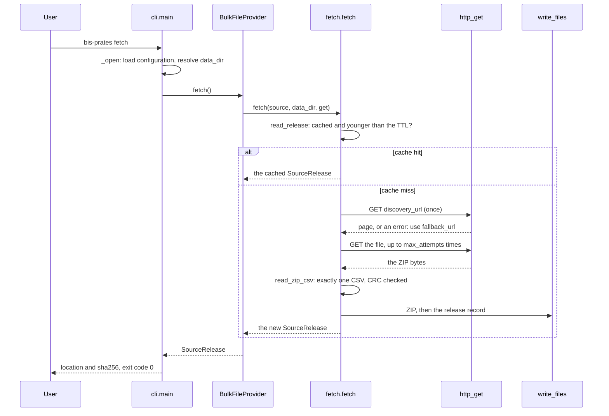

The call chain of `fetch`. On `SourceUnavailableError` with a cached copy, `fetch.fetch` returns
that copy with a warning instead of raising; the full decision flow is in
[Upstreams, the cache](upstreams.md#the-cache-and-its-lifetime).

### `bis-prates transform`

- **Inputs:** `--config`, `--data-dir`, `--debug`.
- **Does:** `_transform` calls `BulkFileProvider.transform()`, which calls
  `transform.transform(config, data_dir)`.
- **Prints:** `<n> observations of <n> series kept, <n> data-quality findings`.
- **Writes:** `raw/WS_CBPOL_csv_flat.parquet`, and `staged/observations.parquet`, `series.json`,
  `data_quality.json` and `release.json` (last, and only when the release is known), all through
  one `write_files` call.
- **Errors:** `MissingInputError` with step `fetch` (5) when the ZIP is absent;
  `UnexpectedFormatError` (7) for a corrupt ZIP, a CSV that cannot be parsed or decoded, a missing
  required column, no row of the configured selection, or a series row that is not valid
  metadata; `ConfigError` (4); `OSError` (8), with the previous staged files left as they were
  when a write fails (a failed rename is not rolled back:
  [Runtime behaviour](../implementation_design/runtime_behavior.md#writing-a-set-of-files)).

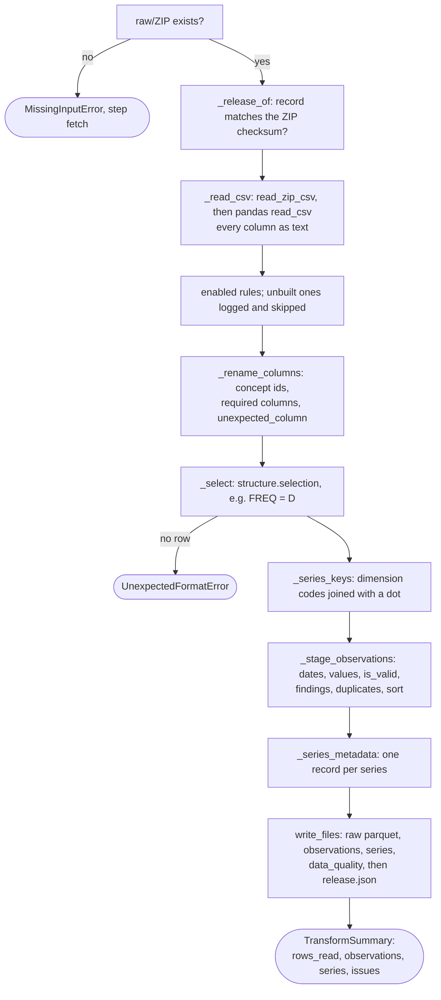

The steps of `transform.transform`. Findings collected on the way become `data_quality.json`.

`_stage_observations` is where the data-quality rules run: `unparseable_date` (the row is dropped),
`non_numeric_value` (kept as invalid, including a bad `UNIT_MULT`), `status_value_mismatch`,
`unexpected_value`, `exact_duplicate` (the copies are dropped) and `conflicting_duplicate` (one
row kept, `keep` first or last). The rows and the reasons are in [Data quality](../../data-quality.md#3-the-rules),
[How it works, section 4](../../how-it-works.md#4-missing-values-duplicates-and-inconsistent-data-12-33)
and [Configuration, the data-quality rules](../../configuration.md#the-data-quality-rules).

### `bis-prates report`

- **Inputs:** `--countries` (required; comma-separated codes), `--start` (`YYYY-MM-DD`), `--out`
  (default `out`), `--config`, `--data-dir`, `--debug`.
- **Argument checks, before anything runs:** `--countries` goes through
  `config.requested_codes` (strip, drop empty, match the code pattern), and `--start` through
  `date.fromisoformat`; a failure is an argparse error, exit code 2.
- **Does:** `_report` imports `service` (and with it matplotlib and Jinja) only now, then
  `load_staged(provider)`, `summary(config, data, countries)`, `write_report(...)`.
- **Prints:** the paths of the five files, to standard output; a warning listing every code the
  data has when a requested code is unknown, to standard error.
- **Writes:** `summary.csv`, `summary.json`, `policy_rates.png`, `report.md`, `report.html` in
  `--out`.
- **Exit code:** 0; 1 when no requested country or economic area has the status `ok` (the files
  are written all the same); 2 for a bad `--countries` or `--start`; 4 for a bad configuration; 5
  when nothing is staged or it was staged with another configuration; 8 when a file cannot be
  written (the previous files are kept when a write fails).

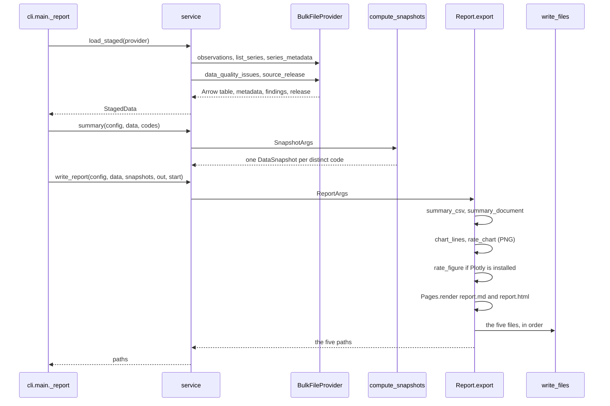

The call chain of `report` (the shorter version is in
[Architecture](../../architecture.md#one-run-of-report)). The calculation behind `compute_snapshots`
is in [`policy_rate_monitor.snapshot`](#policy_rate_monitorsnapshot).

### `bis-prates serve`

- **Inputs:** `--host` (default `127.0.0.1`), `--port` (default 8000, whole number 1 to 65535),
  `--out` (default `out`, where `report` jobs write), `--config`, `--data-dir`, `--debug`.
- **Does:** imports `policy_rate_monitor.web` (the `web` extra). An `ImportError` naming `fastapi`,
  `plotly`, `starlette` or `uvicorn` prints the message naming the extra and ends with code 2 (any
  other `ImportError` is re-raised: a bug, code 3). Then `_open`, then `web.serve(config, provider,
  host=, port=, out_dir=)`.
- **Runs until stopped.** Staged data is read when the first request needs it, not at start.
- **Errors:** `ConfigError` (4); `ListenError` (2) when the address and port cannot be bound.

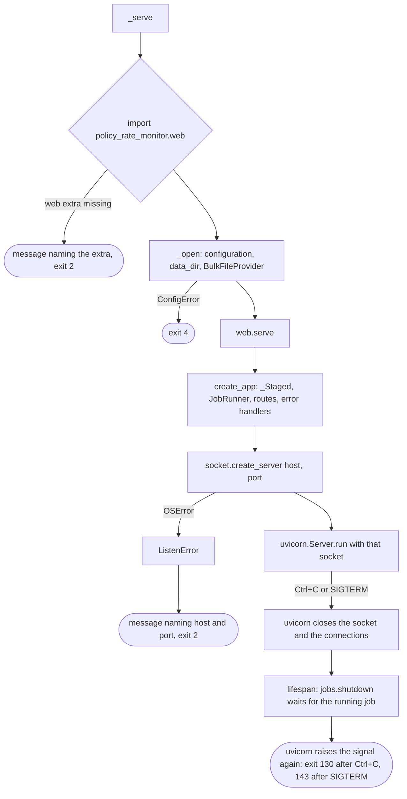

The start-up and stop of `serve`. The socket is bound before uvicorn starts, so a busy port is a
plain error instead of uvicorn's own exit. After a graceful stop, uvicorn raises the captured
signal again (`uvicorn/server.py`, `capture_signals`), so `_serve` never returns 0: Ctrl+C ends
with a `KeyboardInterrupt` traceback on standard error and status 130, SIGTERM with status 143
([Runtime behaviour](../implementation_design/runtime_behavior.md#start-and-stop)). The routes are in [HTTP routes](#http-routes).

### `bis-prates config validate`

- **Inputs:** `--config`, `--debug`.
- **Does:** `_validate` resolves the path (`config_path`) and loads it (`_load`), so the file is
  checked exactly as the other commands check it.
- **Prints:** `<path>: valid (<where it came from>)`, where it came from being `given with
  --config`, `given with BIS_PRATES_CONFIG` or `the default`.
- **Errors:** `ConfigError` (4), with one line per problem and the path's origin.

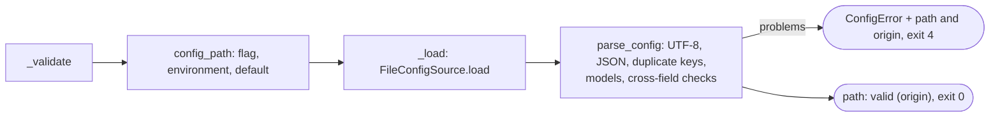

The checks behind `config validate`; they go further than the JSON Schema
([Configuration](../../configuration.md#what-it-does-not-check)).

### `bis-prates config schema`

- **Inputs:** `--debug`; needs no configuration file.
- **Does:** `_schema` prints `config.schema.render_json_schema()`: `DatasetConfig.model_json_schema`
  with the dialect key first, 2-space indent, non-ASCII escaped, one trailing newline.
- **Use:** `bis-prates config schema > configs/config.schema.json` regenerates the committed
  schema; a test compares the committed file with a fresh one.
- **Errors:** none expected.

## HTTP routes

FastAPI also serves `/docs`, `/redoc` and `/openapi.json` (its defaults, left on in `create_app`);
the OpenAPI document lists exactly the routes below (`tests/web/test_app.py`).

All routes are built by `web.app.create_app(config, provider, out_dir)` over the same `service`
functions the command line calls; they add the parameters, the statuses and the jobs. Every
failure has the body `{"error": kind, "message": text}`
([Downstreams](downstreams.md#the-http-apis-responses)).

### How every request runs

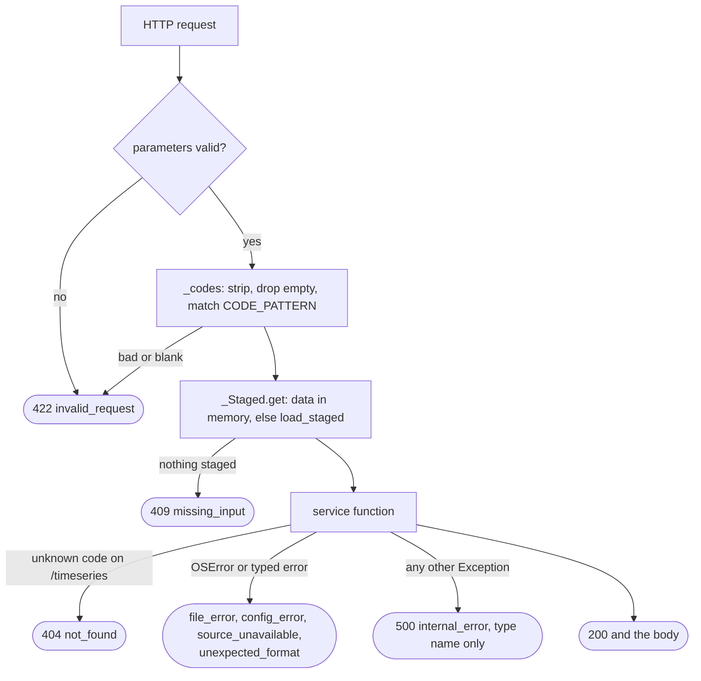

The shared path of the four read routes. The error handlers (`web.errors.add_error_handlers`)
turn an `ApiError`, a typed package error, an `OSError`, a request-validation error, an HTTP error
(`404` becomes `not_found`, others `http_error` with their headers) and any other exception into
the one body.

`_Staged` holds the staged data: the first read loads it under a lock; a `transform` job replaces
it only after the files are written, so a read during a transform gets the previous data. With
nothing loaded yet, a read during a transform is told at once (`409`) that a transform is
running, instead of waiting.

### `GET /ref-areas`

No parameters. `service.ref_areas(config, data)` returns one `RefArea` per series, sorted by
code, with the aliases of `ref_area_aliases` that stand for it. Errors: `409` `missing_input`.

### `GET /summary`

- **Parameters:** `countries` (required), comma-separated codes.
- **Does:** `_codes` checks them (before any data is read), `service.summary` computes one
  snapshot per distinct code, `report.summary_document` builds the document with `generated_at` =
  now (UTC, no microseconds) and the staged release.
- **Returns:** the document of `summary.json`. An unknown code is not an error: its snapshot has
  the status `unknown_ref_area`.
- **Errors:** `422` for a missing, blank or malformed code; `409` `missing_input`.

### `GET /timeseries`

- **Parameters:** `country` (required, one code), `start` (optional date).
- **Does:** `service.timeseries` finds the series (alias applied, case and spaces ignored) and
  keeps its valid observations from `start`, oldest first.
- **Returns:** `{requested_ref_area, series, observations: [{date, value}]}`.
- **Errors:** `404` `not_found` ("no series for X; GET /ref-areas lists the codes"); `422`;
  `409`.

### `GET /chart`

- **Parameters:** `countries` (required), `start` (optional date).
- **Does:** `service.summary`, then `chart.interactive.rate_figure(title, snapshots, observations,
  start)`; the response is `figure.to_json()` as `application/json`.
- **Returns:** the Plotly figure ([the chart JSON](downstreams.md#the-chart-json)).
- **Errors:** `422`, `409`.

### Jobs: `POST /jobs/fetch`, `/jobs/transform`, `/jobs/report`, `GET /jobs/{id}`

A `POST` answers `202 Accepted` at once with the job and a `Location: /jobs/<id>` header; the work
runs on the one worker thread of `web.jobs.JobRunner`.

| Route | The work | `result` on success |
|---|---|---|
| `POST /jobs/fetch` | `provider.fetch()` | `{"release": {...}}` |
| `POST /jobs/transform` | `_Staged.transform()`: `provider.transform()`, then `load_staged`, which replaces the data in memory | `{"observations", "series", "findings"}` |
| `POST /jobs/report` (body `{"countries": [...], "start": date or null}`) | `staged.get()`, `service.summary`, `service.write_report` into `--out` | `{"files": [...]}` |

For `report`, the body is validated first (`countries` needs at least one item; `422` otherwise)
and the codes are checked before the job is queued.

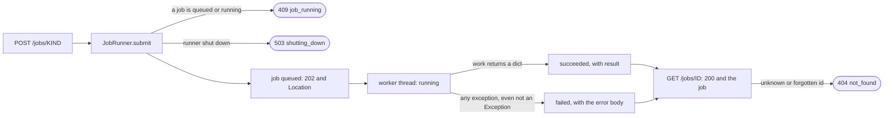

The life of a job. Failure is the job's, not the request's: `GET /jobs/{id}` answers `200` with
`status: failed`. At most `KEEP_FINISHED` (100) finished jobs are kept, oldest forgotten first; a
queued or running job is always kept.

Stopping: after Ctrl+C or SIGTERM, uvicorn closes the listening socket and the open connections,
then ends the lifespan, which calls `JobRunner.shutdown()` (waits for the running job, cancels
queued futures) in a thread, so a transform never stops halfway through writing. New connections
are refused while it waits. `JobRunner.submit` answers `503` `shutting_down` once the runner is
shut down (`web/jobs.py`), which an application that keeps serving after the stop would see; under
`bis-prates serve` it is not reached.

## The public functions and classes by module

Each section lists what a caller can use, with its inputs, effect, result and errors. The
docstring of each symbol, with examples that run as tests, is in the
[API reference](../../reference.md).

### `policy_rate_monitor.core`

[`core.errors`](../../reference.md#policy_rate_monitor.core.errors),
[`core.files`](../../reference.md#policy_rate_monitor.core.files) and
[`core.models`](../../reference.md#policy_rate_monitor.core.models) import nothing else from the
package.

| Symbol | Inputs | What it does | Returns or raises |
|---|---|---|---|
| `PolicyRateMonitorError` | - | base class of every error raised on purpose | anything else is a bug |
| `ConfigError`, `SourceUnavailableError`, `UnexpectedFormatError` | message | the typed errors; no exit code or HTTP status of their own | mapped by `cli.exit_codes` and `web.errors` |
| `MissingInputError(message, *, step=None)` | what is missing, the step that makes it | as above, with `step` for the hint | `.step` |
| `write_files(files)` | `Mapping[Path, bytes]` | creates the folders; writes each file as `.<name>.tmp` beside its target; once all are written, renames them in order | `None`; `OSError`: on a failed write no target is replaced and the temporary files are removed; on a failed rename the files renamed before it are new and the rest stay beside their `.tmp` files |
| `SeriesMetadata`, `SourceRelease`, `DataQualityIssue`, `TransformSummary`, `DataSnapshot` | field values | frozen pydantic models; invariants checked on construction and on `model_validate` | `ValidationError` when an invariant fails |
| `SnapshotStatus`, `SnapshotFlag`, `DataQualitySeverity` | - | the vocabularies of a snapshot and a finding | - |
| `ReadOnlyAttributes(mapping)` | the attributes of a series | a read-only, hashable mapping, sorted by name, for `SeriesMetadata.attributes` | item assignment raises `TypeError` |
| `Rate`, `BasisPoints`, `BASIS_POINTS_PER_PERCENT` | - | exact decimals of at most 15 digits (pydantic's `max_digits`, which counts the zeros after the decimal point), written to JSON as numbers; `Decimal(100)` | - |

A `DataSnapshot` refuses an inconsistent combination (for example an `ok` snapshot with no prior
rate, or a `change_bps` that is not `(latest - prior) * 100`), so a wrong figure cannot be
serialised.

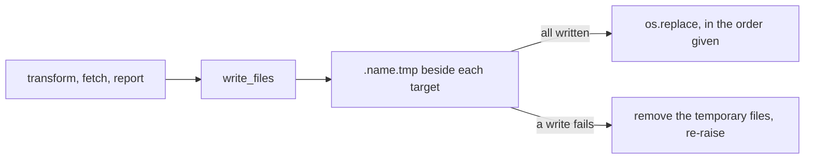

The two phases of `write_files`: nothing is replaced until every file is written.

### `policy_rate_monitor.config`

[API reference](../../reference.md#policy_rate_monitor.config.source). Detail:
[Upstreams, the configuration](upstreams.md#the-configuration).

| Symbol | Inputs | What it does | Returns or raises |
|---|---|---|---|
| `FileConfigSource(path)` | a path | stores it; `load()` reads the file | `DatasetConfig`; `ConfigError` starting with the path |
| `ConfigSource` | - | the interface: `load()` | `DatasetConfig` |
| `parse_config(document, *, origin)` | JSON text or bytes, where it came from | decode (UTF-8, BOM accepted), parse, refuse repeated keys and `NaN` / `Infinity`, validate | `DatasetConfig`; `ConfigError`, one line per problem |
| `DatasetConfig` and its sections (`DatasetSection`, `SourceSection`, `StructureSection`, `Concept`, `Dimension`, `TimeDimension`, `Measure`, `ObservationAttribute`, `ColumnsSection`, `RuleSpec`, `SnapshotSection`, `OutputSection`, `MetadataConcepts`, `MetadataField`) | - | the validated configuration, section by section as in [Configuration](../../configuration.md); `required_columns()`, `known_columns()`, `conflict_keep()` | - |
| `CANONICAL_COLUMNS`, `Role`, `Loc` | - | the fixed columns of the canonical table (`series_key`, `date`, `value`, `is_valid`); the role of a declared concept in `structure`; a location in the configuration document, as pydantic writes it | - |
| `requested_codes(texts)` | codes as typed | strip, drop empty ones, match `CODE_PATTERN` (`^[A-Za-z0-9_@$-]+$`) | the list; `ValueError` when none is left or one does not match |
| `render_json_schema()` | - | the schema of `DatasetConfig` in its committed text form | the text |
| `JSON_SCHEMA_DIALECT`, `REGENERATE_COMMAND` | - | the JSON Schema version pydantic generates (draft 2020-12); the command that rewrites `configs/config.schema.json` | - |

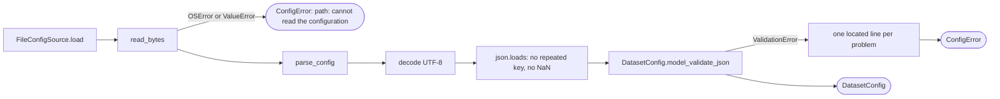

Loading a configuration. `requested_codes` is used by `report` and the HTTP routes alike, so a
formula or markup never reaches an output file.

### `policy_rate_monitor.settings`

[API reference](../../reference.md#policy_rate_monitor.settings).

| Symbol | Inputs | Returns |
|---|---|---|
| `config_path(flag, environ)` | the `--config` value or `None`, the environment | a `Setting`: flag, `BIS_PRATES_CONFIG`, else `DEFAULT_CONFIG` |
| `data_dir(flag, environ, config)` | the `--data-dir` value or `None`, the environment, the configuration | a `Setting`: flag, `BIS_PRATES_DATA_DIR`, else `dataset.data_dir` |
| `Setting`, `Origin` | - | the path and its origin (`flag`, `environment`, `configuration`, `default`) |
| `CONFIG_VARIABLE`, `DATA_DIR_VARIABLE`, `DEFAULT_CONFIG` | - | the constants |

Pure functions: no I/O, no errors. An empty variable counts as unset
([Upstreams](upstreams.md#settings-precedence)).

### `policy_rate_monitor.providers` and `policy_rate_monitor.bulk`

[API reference](../../reference.md#policy_rate_monitor.providers.base),
[`bulk`](../../reference.md#policy_rate_monitor.bulk). Decision
[0008](../../adr/0008-provider-interface.md).

| Symbol | Inputs | What it does | Returns or raises |
|---|---|---|---|
| `DataProvider` | - | the interface of seven methods: two lifecycle (`fetch`, `transform`) and five queries | - |
| `BulkFileProvider(config, data_dir, get=None)` | configuration, data directory, an optional download stand-in | `fetch()` calls `fetch.fetch`; `transform()` calls `transform.transform`; the queries read `staged/` | see below |
| `.list_series()` | - | the keys in `staged/series.json` | `list[str]`; `MissingInputError` (step `transform`) |
| `.series_metadata(key)` | a series key | one `SeriesMetadata` | `KeyError`; `MissingInputError` |
| `.observations(series_keys=None)` | optional keys | `staged/observations.parquet` cast to the canonical schema, filtered | an Arrow `Table`; `MissingInputError` when absent or staged with another configuration |
| `.data_quality_issues()` | - | `staged/data_quality.json` | `list[DataQualityIssue]`; `MissingInputError` |
| `.source_release()` | - | `staged/release.json` | the release, or `None` when absent or unreadable (a warning is logged) |
| `InMemoryProvider(structure, rows, series, issues=(), release=...)` | the rows and metadata as plain values | keeps a sorted canonical table; `fetch` and `transform` change nothing | the same query results; used by the tests of the snapshot, the report and the API |
| `observation_schema(structure)` | the `structure` section | the schema: `series_key`, the dimension columns, `date`, `value` (decimal), the kept observation attributes, `is_valid` | `pyarrow.Schema` |
| `select_series(table, keys)` | an observations table, keys or `None` | the rows of those series | `Table` |

`BulkFileProvider` re-reads `series.json` only when its modification time or size changes.

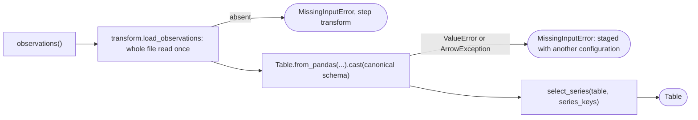

The read path of `BulkFileProvider.observations`; the contract tests
(`tests/providers/contract.py`) run on this provider and on `InMemoryProvider`.

### `policy_rate_monitor.fetch`

[API reference](../../reference.md#policy_rate_monitor.fetch). Detail:
[Upstreams](upstreams.md).

| Symbol | Inputs | What it does | Returns or raises |
|---|---|---|---|
| `fetch(source, data_dir, get=None, *, sleep, now)` | the `source` section, the data directory, optional stand-ins for the download, the pause and the clock | use a fresh cached copy, else find the address, download with retries, check the ZIP, store ZIP and record | the `SourceRelease`; `SourceUnavailableError`, `UnexpectedFormatError` |
| `http_get(url, connect_timeout, read_timeout)` | an address and two timeouts | one GET, up to `MAX_REDIRECTS` (5) redirects followed | the body; `SourceUnavailableError` (connection error, timeout, 5xx, 408, 429), `UnexpectedFormatError` (any other status, a redirect loop, a non-HTTP address) |
| `read_zip_csv(content, where)` | ZIP bytes, a name for the message | opens the ZIP, requires exactly one `.csv` member, reads it with its CRC checked | the CSV bytes; `UnexpectedFormatError` |
| `cached_zip(source, data_dir)` | as above | the path `<data_dir>/raw/<file_name>` | `Path` (it may not exist) |
| `read_release(source, data_dir)` | as above | the record beside the ZIP | `SourceRelease`, or `None` when the ZIP or its record is missing or the record is unreadable |

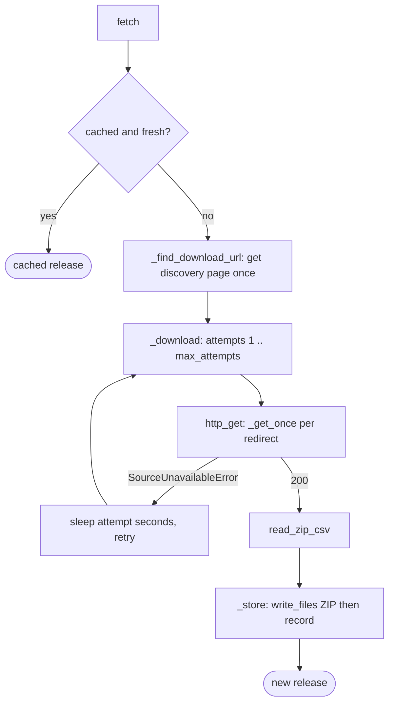

The functions behind `fetch.fetch`. `read_zip_csv`, `read_release` and `cached_zip` are also used
by `transform` (its imports in `transform.py`).

### `policy_rate_monitor.transform`

[API reference](../../reference.md#policy_rate_monitor.transform). The step-by-step is in
[`bis-prates transform`](#bis-prates-transform).

| Symbol | Inputs | What it does | Returns or raises |
|---|---|---|---|
| `transform(config, data_dir)` | configuration, data directory | the raw and staged layers from the cached ZIP | `TransformSummary`; `MissingInputError`, `UnexpectedFormatError`, `OSError` |
| `load_observations(data_dir)` | data directory | reads `staged/observations.parquet` in one read, Arrow types kept | `DataFrame`; `MissingInputError` |
| `load_series(data_dir)` | as above | reads `staged/series.json` | `list[SeriesMetadata]`; `MissingInputError` |
| `load_data_quality(data_dir)` | as above | reads `staged/data_quality.json` | `list[DataQualityIssue]`; `MissingInputError` |
| `load_release(data_dir)` | as above | reads `staged/release.json` | `SourceRelease` or `None` |
| `IMPLEMENTED_RULES` | - | the seven rule names that have code | tuple |

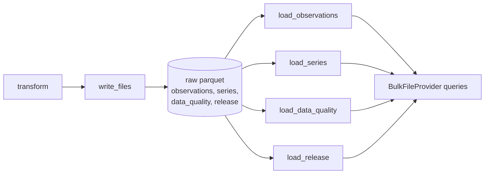

Write and read sides of the staged layer. The `load_*` functions each raise `MissingInputError`
naming `transform` when their file is absent. `load_release` returns `None` instead of raising:
silently when its file is absent, and with a warning in the log when it is not a valid UTF-8
record. An `OSError` while reading still propagates (`transform.load_release`).

### `policy_rate_monitor.analytics`

[API reference](../../reference.md#policy_rate_monitor.analytics). Decision
[0013](../../adr/0013-fast-analytics-numpy-numba.md). Pure functions: no I/O.

| Symbol | Inputs | What it does | Returns or raises |
|---|---|---|---|
| `rate_history(observations)` | staged observations, values as Arrow decimals | keeps the valid rows; dates become int32 days since 1970-01-01, values int64 in units of 10^-scale per cent; series sorted by key; arrays read-only | `RateHistory`; `TypeError` when the values are not Arrow decimals |
| `snapshot_at(history, as_of, months)` | the history, a day number, months | per series: the last observation on or before `as_of`, the target date `months` earlier, the last observation on or before it, and the exact change | `SnapshotArrays` |
| `change_history(history, months)` | as above | for every observation, its prior observation and change | `ChangeHistory` |
| `rate_moves(history)` | the history | every observation whose value differs from the series' previous one | `RateMoves` |
| `day_number(day)`, `months_back(days, months)`, `bps(change, scale)` | - | date to day number; the same calendar date earlier, clamped to the month end; a change to exact basis points | `int`, an array, `Decimal` |
| `RateHistory`, `ChangeHistory`, `SnapshotArrays`, `RateMoves` | - | frozen dataclasses over arrays; `RateHistory` has `position`, `date_at`, `value_at` | - |
| `NO_INDEX`, `EPOCH`, `NUMBA_AVAILABLE` | - | `-1`; the day 0; whether the kernels run compiled | - |

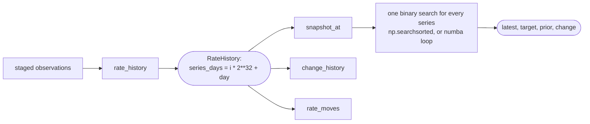

Why one search answers every series: packing the series position and the day into one rising
int64 lets a single binary search serve all series at once. With the `fast` extra the loops are
compiled by Numba on first use (about 0.7 s, cached on disk); without it NumPy gives the same
arrays.

### `policy_rate_monitor.snapshot`

[API reference](../../reference.md#policy_rate_monitor.snapshot). Decision
[0006](../../adr/0006-twelve-month-look-back.md).

| Symbol | Inputs | What it does | Returns or raises |
|---|---|---|---|
| `compute_snapshots(args)` | a `SnapshotArgs` | one `DataSnapshot` per distinct requested code, in request order | `list[DataSnapshot]`; `TypeError` for values that are not Arrow decimals |
| `SnapshotArgs` | `observations`, `series`, `requested`, `settings`, `ref_area_aliases` | the inputs, as a frozen dataclass | - |
| `months_before(day, months)` | a date, months | the same calendar date earlier; 29 February becomes 28 February | `date` |

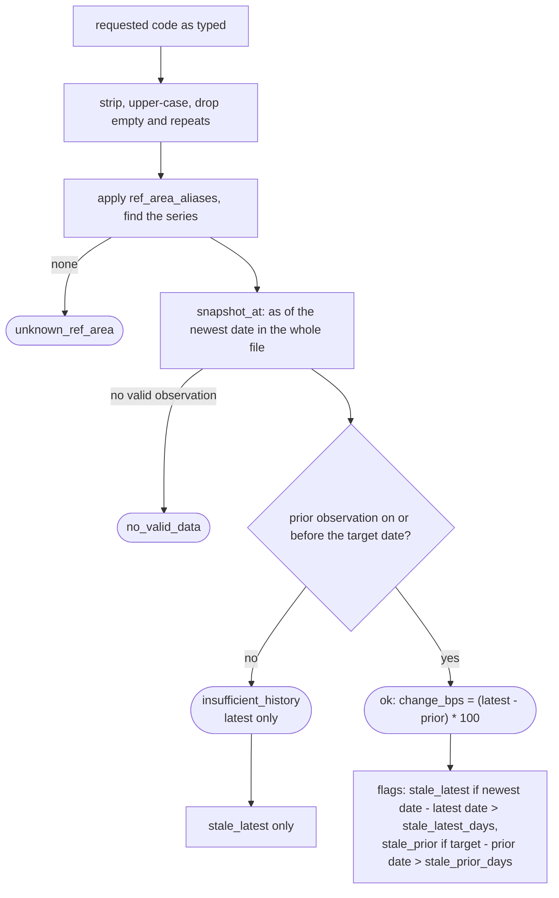

The decision tree of `compute_snapshots`. The arrays are built for the requested series only, and
staleness is measured from the last date in the whole file, valid or not.

### `policy_rate_monitor.service`

[API reference](../../reference.md#policy_rate_monitor.service). The steps both adapters share.

| Symbol | Inputs | What it does | Returns or raises |
|---|---|---|---|
| `load_staged(provider)` | a provider | observations as a pandas frame with Arrow types, series and findings as tuples, the release | `StagedData`; `MissingInputError` |
| `summary(config, data, countries)` | configuration, staged data, codes as typed | `compute_snapshots` with the configured settings and aliases | `list[DataSnapshot]` |
| `ref_areas(config, data)` | as above | one entry per series, sorted by code, with its aliases | `list[RefArea]` |
| `timeseries(config, data, country, start=None)` | a code, an optional first date | the valid observations of one series | `TimeSeries`, or `None` for an unknown code |
| `write_report(config, data, snapshots, out_dir, start=None)` | as above, the snapshots from `summary` | `Report(config).export(...)`; creates `out_dir` | the paths written; `OSError` |
| `StagedData`, `RefArea`, `Observation`, `TimeSeries` | - | frozen result types | - |

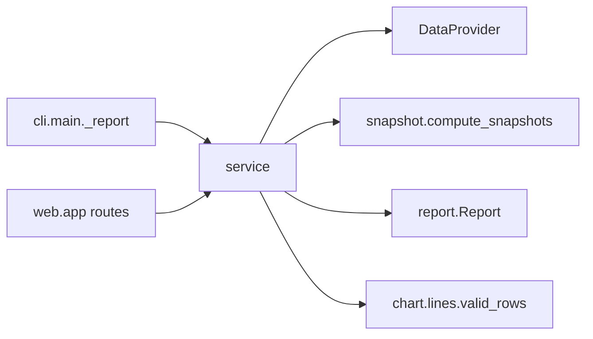

`service` is the one place the command line and the API meet, so `GET /summary` and `summary.json`
hold the same numbers ([HTTP API](../../api.md#same-numbers-as-the-cli)).

### `policy_rate_monitor.chart`

[API reference](../../reference.md#policy_rate_monitor.chart). Decisions
[0002](../../adr/0002-charting-and-report-format.md) and
[0016](../../adr/0016-accessible-charts.md). Pure functions over tables.

| Symbol | Inputs | What it does | Returns |
|---|---|---|---|
| `chart.lines.charted_series(snapshots)` | the snapshots | the series with a latest rate (`ok` or `insufficient_history`), once each, in request order | `list[SeriesMetadata]` |
| `chart.lines.valid_rows(observations, series_key, start=None)` | observations, a key, a first date | the valid rows of one series | `DataFrame` |
| `chart.lines.chart_lines(snapshots, observations, start=None)` | as above | the charted series that have a valid row from `start` on, with their rows | `list[tuple[SeriesMetadata, DataFrame]]` |
| `chart.style.LineStyle` | - | a frozen dataclass: `colour` (`#RRGGBB`), `dash` (on-off lengths in pixels, `()` solid), `label_colour` (`#RRGGBB`) | - |
| `chart.style.line_style(index)` | a line position | colour, dash and label colour of the n-th line | `LineStyle` |
| `chart.style.alt_text(title, names, start=None)` | the title, the line names | the text alternative, one sentence | `str` |
| `chart.style.label_positions(values, gap)` | the last values, a gap | label heights that keep the order and do not overlap | `list[float]` |
| `chart.style.PALETTE`, `LABEL_COLOURS`, `DASHES`, `LINE_WIDTH`, `NO_DATA`, `LABEL_GAP` | - | the four line colours; their label colours, darkened to 4.5:1; six dash patterns; a line width of 2 pixels; the text of a chart with no line ("No data to plot"); the smallest gap between two line-end labels (0.05) | - |
| `chart.static.rate_chart(title, snapshots, observations, start=None)` | as above | the matplotlib step chart, 10 x 5.5 in, meant to be saved at `DPI` (120); `Report.export` saves it | a `Figure` |
| `chart.interactive.rate_figure(...)` | as above | the Plotly step chart; needs the `interactive` extra | a Plotly `Figure` |

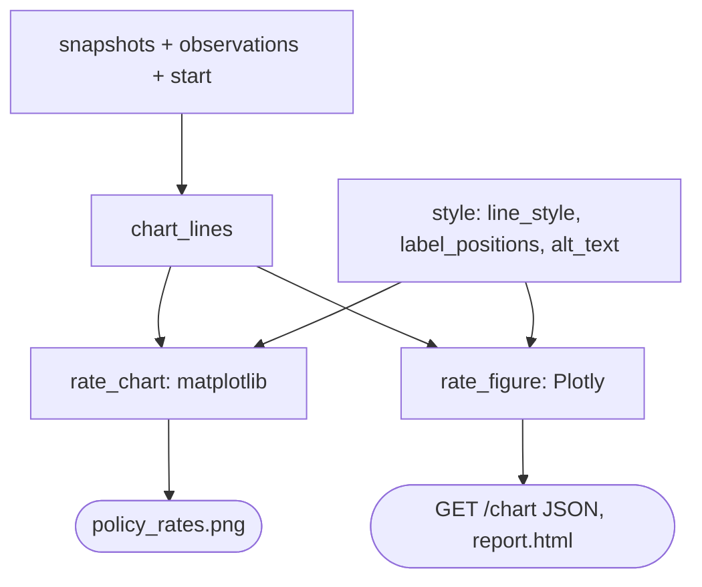

Both charts take their lines from `chart_lines` and their look from `style`, so the n-th line is
drawn the same way in both.

### `policy_rate_monitor.report`

[API reference](../../reference.md#policy_rate_monitor.report). Decisions
[0012](../../adr/0012-elt-raw-and-staged-layers.md) and
[0015](../../adr/0015-report-templates-and-html.md).

| Symbol | Inputs | What it does | Returns or raises |
|---|---|---|---|
| `Report(config).export(args)` | a `ReportArgs` (snapshots, observations, series, issues, release, `out_dir`, `start`) | builds the five files in memory, then writes them together | the five paths, in the order `summary.csv`, `summary.json`, the PNG, `report.md`, `report.html`; `OSError` |
| `summary_csv(snapshots, metadata_fields)` | snapshots, the configured fields | the text of `summary.csv` | `str` |
| `summary_document(config, snapshots, release, generated_at)` | as above | the dict of `summary.json` | `dict[str, object]` |
| `plain(value)` | a `Decimal` or `None` | the exact text with no trailing zeros; `""` for `None` | `str` |
| `Pages(config)` with `context(args, generated_at)` and `render(name, context)` | - | the Jinja templates `report.md.j2` and `report.html.j2` and the values they show | `dict`, `str` |
| `ICONS`, `CHART_FILE` | - | the emoji by status, flag and severity (read-only); `policy_rates.png` | - |

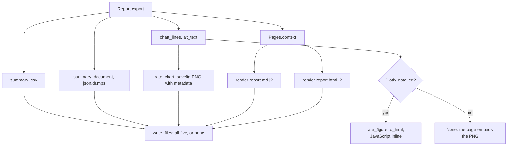

`export` makes everything in memory first, so a failure while drawing or rendering writes nothing;
`write_files` then replaces the five files together.

### `policy_rate_monitor.web`

[API reference](../../reference.md#policy_rate_monitor.web.app). Needs the `web` extra; nothing
below it imports it. Decision [0014](../../adr/0014-http-api.md).

| Symbol | Inputs | What it does | Returns or raises |
|---|---|---|---|
| `DEFAULT_OUT_DIR` | - | `Path("out")`, the default `out_dir` of `create_app` and `serve` | - |
| `create_app(config, provider, out_dir=DEFAULT_OUT_DIR)` | configuration, provider, where `report` jobs write | builds the FastAPI app: the error handlers, the read routes, the job routes, a lifespan that waits for the running job; `app.state.jobs` is the `JobRunner` | `FastAPI` |
| `serve(config, provider, *, host, port, out_dir=DEFAULT_OUT_DIR)` | as above, address and port | binds the socket, then runs uvicorn on it until stopped; a host with a colon is IPv6 | `None`; `ListenError` |
| `ListenError` | - | the address and port cannot be bound | - |
| `ReportRequest` | `countries` (at least one), `start` | the body of `POST /jobs/report` | - |
| `JobRunner` | - | `submit(kind, work)`, `get(job_id)`, `wait(job_id, timeout)`, `shutdown()` | `submit`: `Job`, `ApiError` (409, 503); `wait`: `KeyError`, `TimeoutError` |
| `Job`, `JobStatus`, `KEEP_FINISHED` | - | the job record; `queued`, `running`, `succeeded`, `failed`; 100 | - |
| `ApiError(status, error, message)`, `ErrorBody` | - | an error a route raises on purpose; the one error body | - |
| `error_body(error)`, `status_for(error)` | an exception | the body and the status for it; a bug is logged with its traceback and named by type only | `ErrorBody`, `HTTPStatus` |
| `add_error_handlers(app)` | the app | one handler per error family | `None` |

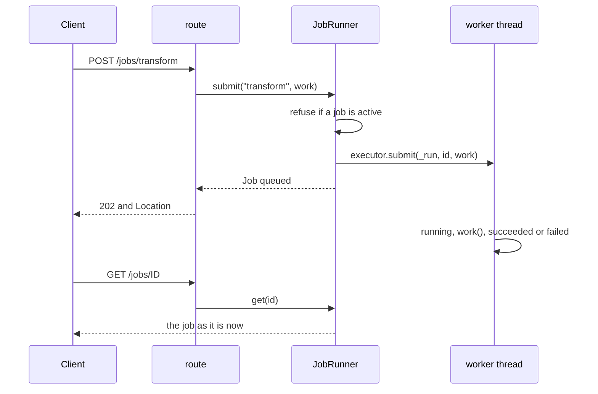

The `JobRunner` handshake. One worker thread runs the jobs one at a time, because they write the
same files; its state is guarded by a `Condition`, so the class is thread-safe. A job that stops
for any reason, `BaseException` included, is marked failed, so a later job is not refused.

### `policy_rate_monitor.cli`

[API reference](../../reference.md#policy_rate_monitor.cli.main). Decision
[0010](../../adr/0010-cli-and-exit-codes.md).

| Symbol | Inputs | What it does | Returns or raises |
|---|---|---|---|
| `cli.main.main(argv=None, environ=None)` | arguments, environment | runs one command, maps errors to exit codes | `int`; `SystemExit` for `--help`, `--version` and an invalid argument |
| `cli.exit_codes.ExitCode` | - | `OK` 0, `NO_RESULT` 1, `USAGE_ERROR` 2, `INTERNAL_ERROR` 3, `CONFIG_ERROR` 4, `MISSING_INPUT` 5, `SOURCE_UNAVAILABLE` 6, `UNEXPECTED_FORMAT` 7, `OUTPUT_ERROR` 8 | `IntEnum` |
| `cli.exit_codes.exit_code_for(error)` | an exception | the code of the first class in its hierarchy that has one, else `INTERNAL_ERROR` | `ExitCode` |

The command functions (`_fetch`, `_transform`, ...) are private: their behaviour is the section of
each command above.

## Tests

Each workflow has tests that use no network: `tests/test_cli.py` (commands, exit codes, messages),
`tests/test_fetch.py`, `tests/test_transform.py`, `tests/test_snapshot.py`,
`tests/test_analytics.py`, `tests/test_report.py`, `tests/test_service.py`, `tests/web/`,
`tests/chart/`, `tests/config/`, `tests/core/` and `tests/providers/`. Docstring examples under
`src/` run as part of the suite.

## See also

- [Upstreams](upstreams.md), [Downstreams](downstreams.md) and the
  [runbooks](runbooks.md) that use these commands.
- [How it works](../../how-it-works.md) for the same steps with the problem each one solves.
- [API reference](../../reference.md).
