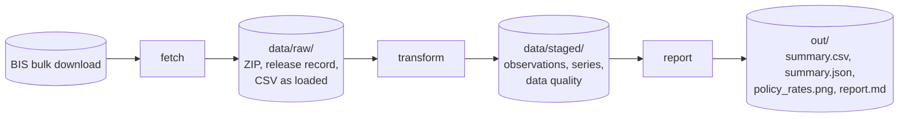
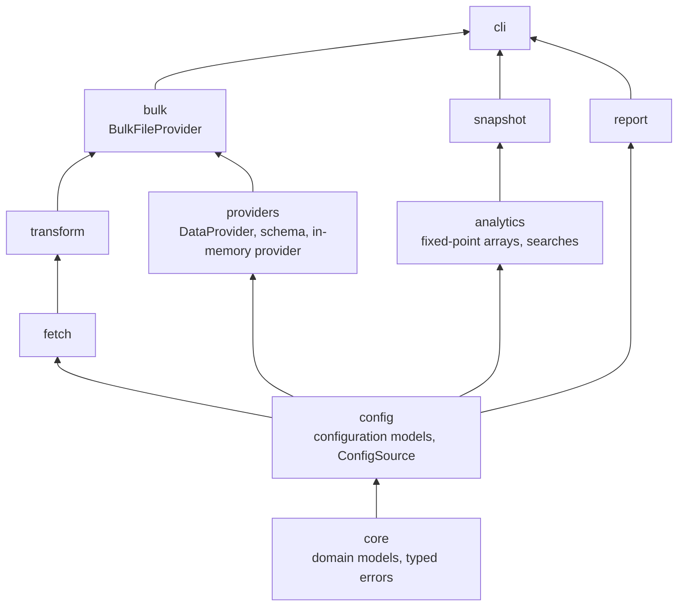

# Architecture

How the package is organised, which part does what, and how one run flows through it. The reasons
for each choice are in the [decision records](adr/index.md).

## A pipeline of three commands

`fetch`, `transform` and `report` each do one step and write files the next one reads, so a step can
be rerun on its own, and a scheduler can run them one after the other
([decision 0010](adr/0010-cli-and-exit-codes.md)).



The files of each layer are described in [Data model](data-model.md).

## The modules and their layers

Each module may import only the modules below it. An arrow means "is imported by". tach checks the
rule on every commit and in CI (`tach.toml`), so a module cannot quietly start depending on one
above it.



| Module | What it does | Reads or writes |
|---|---|---|
| `core` | The domain models (`SeriesMetadata`, `DataSnapshot`, `DataQualityIssue`, `SourceRelease`) and the typed errors | nothing |
| `config` | The configuration models, their checks, the JSON Schema, and `ConfigSource` with its file implementation | the configuration file |
| `fetch` | Finds, downloads, checks and caches the source ZIP, with its release record | `data/raw/` |
| `transform` | Loads the CSV into the raw layer, then stages the observations, the series metadata and the data-quality findings | `data/raw/`, `data/staged/` |
| `providers` | The `DataProvider` interface, the canonical observations schema, and `InMemoryProvider` | nothing |
| `bulk` | `BulkFileProvider`: the provider over the bulk-download file, built on `fetch` and `transform` | through `fetch` and `transform` |
| `analytics` | The staged observations as fixed-point NumPy arrays, and the searches on them: the snapshot at any date, the change history, the rate moves | nothing |
| `snapshot` | `compute_snapshots`: one `DataSnapshot` per requested area | nothing |
| `report` | Writes the summary files, the chart and the Markdown report from the snapshots it is given | `out/` |
| `cli` | The `bis-prates` command: parses the arguments, calls the pieces above, prints, returns an exit code | nothing directly |

Three rules keep the design testable:

- **Only `fetch`, `transform` and `report` touch files.** `analytics` and `snapshot` are pure
  functions over tables, tested on small hand-made data; `config` reads only through a
  `ConfigSource`.
- **Everything else reads data through the provider.** The `report` command asks the provider for
  the observations, the series, the findings and the release, and never opens `data/staged/` itself
  ([decision 0008](adr/0008-provider-interface.md)).
- **Errors are typed in `core` and translated at the edge.** A module raises `MissingInputError`,
  `SourceUnavailableError` and so on; `cli` turns them into exit codes, and the HTTP API will turn
  them into HTTP statuses.

## One run of `report`

```mermaid
sequenceDiagram
    participant User
    participant CLI as cli
    participant Config as FileConfigSource
    participant Provider as BulkFileProvider
    participant Snapshot as compute_snapshots
    participant Analytics as analytics
    participant Report

    User->>CLI: bis-prates report --countries US,EA
    CLI->>Config: load()
    Config-->>CLI: DatasetConfig (validated)
    CLI->>Provider: observations(), series_metadata(), data_quality_issues(), source_release()
    Provider-->>CLI: Arrow table, SeriesMetadata, findings, SourceRelease
    CLI->>Snapshot: SnapshotArgs(observations, series, requested codes, settings, aliases)
    Snapshot->>Analytics: rate_history(), snapshot_at()
    Analytics-->>Snapshot: latest and prior index per series
    Snapshot-->>CLI: one DataSnapshot per requested code
    CLI->>Report: export(ReportArgs)
    Report-->>CLI: paths of the four files
    CLI-->>User: the paths; a warning for an unknown code; exit code
```

## Where the tool can grow

| To add | What changes | What stays |
|---|---|---|
| A new dataset of the same shape | A new configuration file | The code ([decision 0007](adr/0007-config-driven-design.md)) |
| A new source (a query engine, another API) | A new `DataProvider`, passing the contract tests | The snapshot, the report, the CLI |
| A configuration served by a service | A new `ConfigSource` | The configuration models and their checks |
| The HTTP API | A new adapter beside `cli`, calling the same pieces | Everything below `cli` ([decision 0003](adr/0003-web-extension-stack.md)) |
| A data-quality rule | Its code in `transform`, and its entry in the configuration | The findings format and the report |

The parts that need more than the base install come as optional extras: `fast` (Numba) today, and
later `interactive` (Plotly) and `web` (FastAPI, uvicorn). Nothing in the base layers imports
them.
