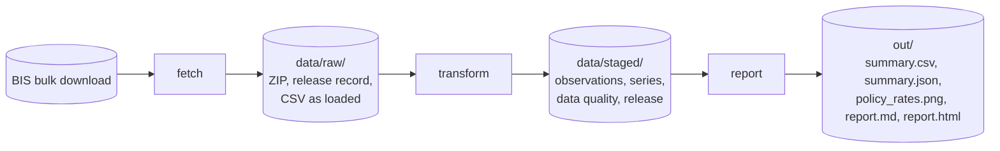
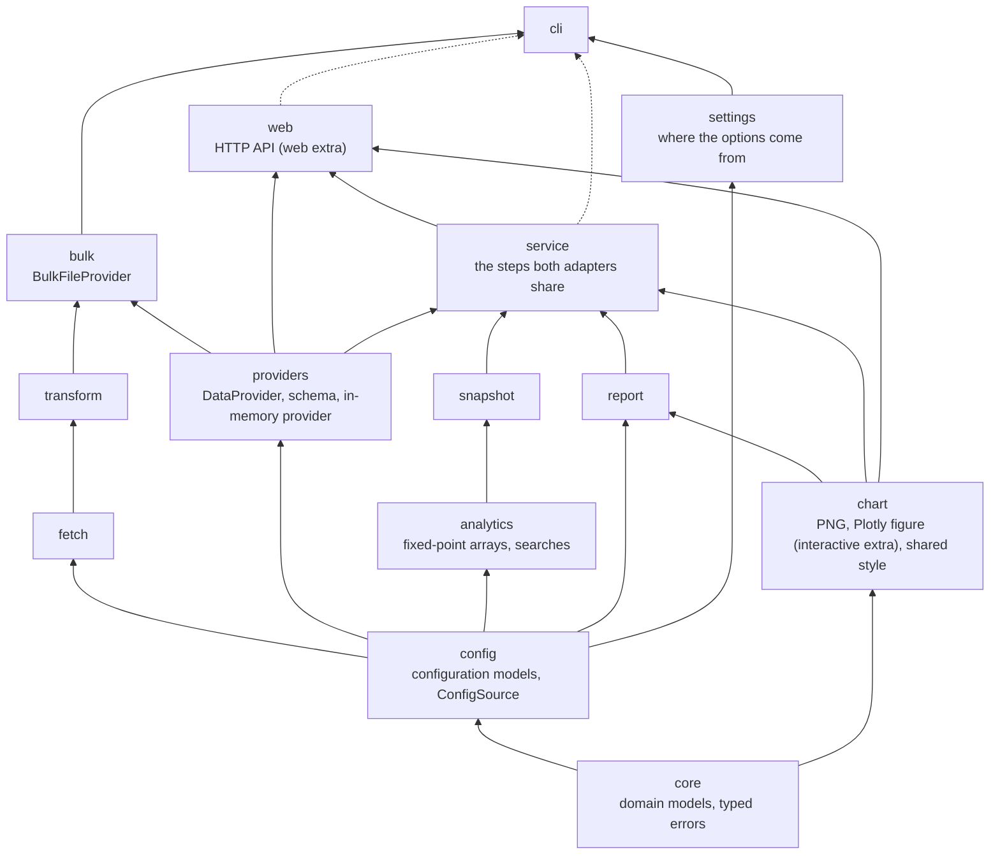

# Architecture

How the package is organised, which part does what, and how one run flows through it. The reasons
for each choice are in the [decision records](adr/index.md).

## A pipeline of three commands

`fetch`, `transform` and `report` each do one step and write files the next one reads, so a step can
be rerun on its own, and a scheduler can run them one after the other
([decision 0010](adr/0010-cli-and-exit-codes.md)).



The files of each layer are described in [Data model](data-model.md).

## The modules and their layers

Each module may import only the modules below it. An arrow means "is imported by". tach checks the
rule before every push and in CI (`tach.toml`), so a module cannot quietly start depending on one
above it.



The dotted arrows are lazy imports: `cli` imports `web` only inside `serve`, and `service` (with
matplotlib and Jinja) only inside `report`, so `--version`, `fetch` and `transform` start without
them. In the same way,
`report` imports `chart.interactive` only when Plotly is installed, so the base install never
loads FastAPI or Plotly. The diagram shows the main arrows; the full list of allowed imports of each
module is in `tach.toml`.

| Module | What it does | Reads or writes |
|---|---|---|
| `core` | The domain models (`SeriesMetadata`, `DataSnapshot`, `DataQualityIssue`, `SourceRelease`, `TransformSummary`), the typed errors, and `files.write_files`, which writes a set of files to temporary names and then renames them into place | the files it is given |
| `config` | The configuration models, their checks, the JSON Schema, and `ConfigSource` with its file implementation | the configuration file |
| `fetch` | Finds, downloads, checks and caches the source ZIP, with its release record | `data/raw/` |
| `transform` | Loads the CSV into the raw layer, then stages the observations, the series metadata, the data-quality findings and the release they were built from (`release.json`, written last) | `data/raw/`, `data/staged/` |
| `providers` | The `DataProvider` interface, the canonical observations schema, and `InMemoryProvider` | nothing |
| `bulk` | `BulkFileProvider`: the provider over the bulk-download file, built on `fetch` and `transform` | through `fetch` and `transform` |
| `analytics` | The staged observations as fixed-point NumPy arrays, and the searches on them: the snapshot at any date, the change history, the rate moves | nothing |
| `snapshot` | `compute_snapshots`: one `DataSnapshot` per requested country or area | nothing |
| `chart` | The two charts and what they share: `lines` (which series get a line, and their valid rows), `style` (the colour-blind palette, the dash patterns, the line labels, the text alternative and the "No data to plot" message, with no plotting library), `static` (the PNG, matplotlib) and `interactive` (`rate_figure`, the Plotly figure; needs the `interactive` extra). Imports `core` | nothing |
| `report` | Writes the five output files: `export` (`Report`, `ReportArgs`), `summary` (`summary.csv`, `summary.json`) and `pages` (`report.md` and `report.html`, from the templates in `report/templates/`). Imports `chart`, `config` and `core`; imports `chart.interactive` only inside the function that draws the HTML chart, when Plotly is installed | `out/` |
| `service` | The steps the CLI and the HTTP API share: `load_staged`, `ref_areas`, `summary`, `timeseries` and `write_report`. Imports `report`, `chart`, `snapshot`, `providers`, `config` and `core` | `out/`, through `report` |
| `web` | The HTTP API (FastAPI): routes, background jobs, error bodies. An adapter beside `cli`. Imports `service`, `chart`, `report`, `providers`, `config` and `core`; needs the `web` extra | `data/raw/` and `data/staged/` through the provider (the `fetch` and `transform` jobs); `out/` for `report` jobs |
| `settings` | Where the configuration file and the data directory come from: the command line, an environment variable, the configuration or a default; shared by the CLI and the HTTP API | nothing |
| `cli` | The `bis-prates` command: parses and checks the arguments (the codes against the code pattern, the port), calls `service` and the provider, prints, returns an exit code; `report` imports `service` and `serve` imports `web` only when they run | nothing directly |

Four rules keep the design testable:

- **Only `fetch`, `transform` and `report` touch files.** They write through
  `core.files.write_files`, so a reader never finds a half-written file
  ([decision 0017](adr/0017-bad-input-failures-and-writes.md)). `analytics` and `snapshot` are
  pure functions over tables, tested on small hand-made data; `config` reads only through a
  `ConfigSource`.
- **Everything else reads data through the provider.** `service` asks the provider for
  the observations, the series, the findings and the release, and never opens `data/staged/` itself
  ([decision 0008](adr/0008-provider-interface.md)).
- **Errors are typed in `core` and translated at the edge.** A module raises `MissingInputError`,
  `SourceUnavailableError` and so on; `cli` turns them into exit codes, and `web` turns them into
  HTTP statuses ([decision 0014](adr/0014-http-api.md)). A `MissingInputError` names the step to
  run, and each adapter words it: `bis-prates transform` on the command line,
  `POST /jobs/transform` over HTTP.
- **The adapters share one service.** `cli` and `web` call `service` and keep only their own
  concerns, so the numbers are the same on both sides.

## One run of `report`

```mermaid
sequenceDiagram
    participant User
    participant CLI as cli
    participant Service as service
    participant Config as FileConfigSource
    participant Provider as BulkFileProvider
    participant Snapshot as compute_snapshots
    participant Analytics as analytics
    participant Report

    User->>CLI: bis-prates report --countries US,EA
    CLI->>Config: load()
    Config-->>CLI: DatasetConfig (validated)
    CLI->>Service: load_staged(provider)
    Service->>Provider: observations(), series_metadata(), data_quality_issues(), source_release()
    Provider-->>Service: Arrow table, SeriesMetadata, findings, SourceRelease
    CLI->>Service: summary(config, data, codes)
    Service->>Snapshot: SnapshotArgs(observations, series, requested codes, settings, aliases)
    Snapshot->>Analytics: rate_history(), snapshot_at()
    Analytics-->>Snapshot: latest and prior index per series
    Snapshot-->>Service: one DataSnapshot per requested code
    Service-->>CLI: the snapshots
    CLI->>Service: write_report(config, data, snapshots, out, start)
    Service->>Report: export(ReportArgs)
    Report-->>Service: paths of the five files
    Service-->>CLI: the paths
    CLI-->>User: the paths; a warning for an unknown code; exit code
```

## Where the tool can grow

| To add | What changes | What stays |
|---|---|---|
| A new dataset of the same shape | A new configuration file | The code ([decision 0007](adr/0007-config-driven-design.md)) |
| A new source (a query engine, another API) | A new `DataProvider`, passing the contract tests | The snapshot, the report, the CLI |
| A configuration served by a service | A new `ConfigSource` | The configuration models and their checks |
| Another way to call the tool (a queue worker, a notebook service) | A new adapter beside `cli` and `web`, calling `service` | Everything below the adapters |
| A front end | A page that calls the [HTTP API](api.md), which exists ([decision 0014](adr/0014-http-api.md)); the React front end is M8 ([decision 0003](adr/0003-web-extension-stack.md)) | The API and everything below it |
| A data-quality rule | Its code in `transform`, and its entry in the configuration | The findings format and the report |

### A new source

A provider implements the seven methods of `DataProvider`. `observations()` must return exactly the
canonical schema, `observation_schema(config.structure)`, so the snapshot and the report work
unchanged:

```python
from collections.abc import Sequence

import pyarrow as pa

from policy_rate_monitor.config import DatasetConfig
from policy_rate_monitor.core.models import (
    DataQualityIssue,
    SeriesMetadata,
    SourceRelease,
    TransformSummary,
)
from policy_rate_monitor.providers import DataProvider, observation_schema


class WarehouseProvider(DataProvider):
    """Serves the policy rates from a data warehouse."""

    def __init__(self, config: DatasetConfig, connection: object) -> None:
        self.schema = observation_schema(config.structure)
        self.connection = connection

    def fetch(self) -> SourceRelease: ...  # record which version of the data is read
    def transform(self) -> TransformSummary: ...  # the counts; little to do if already clean
    def list_series(self) -> list[str]: ...
    def series_metadata(self, series_key: str) -> SeriesMetadata: ...
    def observations(self, series_keys: Sequence[str] | None = None) -> pa.Table: ...
    def data_quality_issues(self) -> list[DataQualityIssue]: ...
    def source_release(self) -> SourceRelease | None: ...
```

Its test module runs the shared contract tests (`tests/providers/contract.py`) by subclassing
`ProviderContract` and supplying two fixtures:

```python
import pytest
from pyarrow import Schema

from policy_rate_monitor.providers import observation_schema
from tests.providers.contract import ProviderContract


@pytest.fixture
def provider(config, connection) -> WarehouseProvider:
    return WarehouseProvider(config, connection)


@pytest.fixture
def schema(config) -> Schema:
    return observation_schema(config.structure)


class TestWarehouseProvider(ProviderContract):
    pass
```

### A configuration from a service

A `ConfigSource` only fetches the document; `parse_config` validates it, so every source gives the
same checks and messages:

```python
from urllib.request import urlopen

from policy_rate_monitor.config import ConfigSource, DatasetConfig, parse_config


class ServiceConfigSource(ConfigSource):
    """Reads the configuration from a URL, for example a configuration service."""

    def __init__(self, url: str) -> None:
        self.url = url

    def load(self) -> DatasetConfig:
        with urlopen(self.url, timeout=10) as response:
            document = response.read()
        return parse_config(document, origin=self.url)
```

### Optional extras

The parts that need more than the base install come as optional extras: `fast` (Numba),
`interactive` (Plotly, for `chart.interactive`) and `web` (FastAPI, Starlette, uvicorn, and `interactive`, for `web`).
Nothing in the base layers imports them; `bis-prates serve` imports `web` only when it runs, and
prints a message naming the extra when it is missing.
