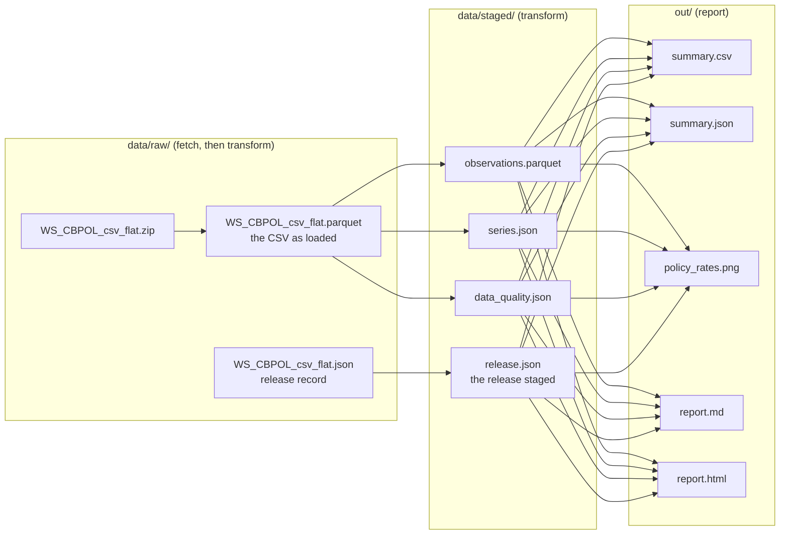

# Data model and assumptions

What the tool stores, in which file, with which columns; the facts about the BIS file that shaped
the design; and the assumptions the calculation makes. Figures are from the release recorded in
`out/summary.json` (SHA-256 `79f614ab…`, first retrieved on 19 November 2026; `out/` was regenerated from the same
file, retrieved again unchanged, on 22 November 2026). The invariants the code
enforces on this data, and how a rate stays exact to the outputs, are in the
[implementation design](advanced/implementation_design/data_model.md); what a consumer of each output
can rely on is in [Downstreams](advanced/operations/downstreams.md).

## The layers



Tables are stored as parquet, a compact file format for tables that keeps each column's type. The
raw layer keeps the source as it came; the staged layer is the canonical data every consumer
reads, through the provider ([decision 0012](adr/0012-elt-raw-and-staged-layers.md)).

### Raw

| File | Content |
|---|---|
| `WS_CBPOL_csv_flat.zip` | The download, as received: 4.1 MB, holding one CSV of 477 MB |
| `WS_CBPOL_csv_flat.json` | The release record: `location` (the address it came from), `retrieved_at` (UTC), `checksum_sha256` |
| `WS_CBPOL_csv_flat.parquet` | Every row and column of the CSV, as text, exactly as loaded: 735,156 rows |

### Staged

`observations.parquet`, one row per series and date, sorted by series and date (709,984 rows for
49 daily series, of which 639,926 are valid):

| Column | Type | Content |
|---|---|---|
| `series_key` | string | the dimension codes joined with `.`, e.g. `D.US` |
| `freq`, `ref_area` | string | the dimension codes (the code part of `US: United States`) |
| `date` | `date32` | the observation date |
| `value` | `decimal128(15, 6)` | the rate in per cent, exact, with the unit multiplier applied; empty when it is missing, not a plain number, or its `UNIT_MULT` is not a whole number |
| `obs_status` | string | the BIS observation status code, e.g. `A` (normal), `M` (missing) |
| `is_valid` | bool | true when there is a value and the status is not an invalid one (`M`) |

A value is read only as a plain ASCII number: an optional sign, digits, an optional decimal point
and exponent, with ASCII spaces around it ignored (`3.75`, `-0.5`, `1e-2`). It must convert to a
decimal exactly and fit the configured precision and scale; it is never rounded. Anything else
(`1_5`, digits of another script, `Infinity`, a non-breaking space around it, a value with more
digits than the type holds) leaves
the row with no value, not valid, and is reported as a `non_numeric_value` finding
([decision 0017](adr/0017-bad-input-failures-and-writes.md)). So is a row whose `UNIT_MULT` is
blank or not a whole number: without the multiplier the value cannot be computed.

The column names of the dimensions and attributes come from the configuration; `series_key`,
`date`, `value` and `is_valid` are fixed. The schema is built from the configuration by
`observation_schema`, and every provider must return exactly it
([decision 0008](adr/0008-provider-interface.md)).

`series.json`, one record per series (`SeriesMetadata`): `series_key`, `ref_area`,
`ref_area_name`, `frequency`, `title`, `unit`, `decimals`, and `attributes` with every other series
attribute as published, for example `COMPILATION` (how the series is compiled) and `SOURCE_REF`
(the publishing central bank).

`data_quality.json`, one record per finding (`DataQualityIssue`): the `rule`, its `severity`, the
`series_key` (or none for a finding about the whole file), the number of rows concerned (`count`;
the number of columns or differences for the rules about the whole file, and 0 for an SDMX rule
that was not evaluated) and a
`detail` saying what was done ([Data quality](data-quality.md#2-what-a-finding-is)).

`release.json`, the release the staged data was built from (`SourceRelease`): a copy of the record
next to the ZIP, made only when its SHA-256 is that of the ZIP `transform` read. The outputs read
the release from here, so a later `fetch` cannot change the release a report names. It is absent
when no record matches; the release is then unknown, never wrong.

`transform` writes every file of a run to a temporary name first and renames them into place only
once all are written, `release.json` last, so a run that fails while writing leaves the previous
staged files as they were; `report` writes its five files the same way. With no release to stage,
the old `release.json` is removed first, so the previous files are then of unknown release. A
reader in another process can still pair files of two runs while the renames run.

### Outputs

`summary.csv`, one row per requested country or area, in the order requested:

| Column | Content |
|---|---|
| `requested_ref_area`, `ref_area` | the code as requested (`EA`) and the code used (`XM`) |
| `series_key`, `ref_area_name`, `title`, `unit`, `decimals` | the series fields chosen in the configuration (`output.metadata_fields`) |
| `latest_date`, `latest_value` | the latest valid observation |
| `prior_date`, `prior_value` | the last valid observation on or before the target date |
| `change_bps` | `(latest_value − prior_value) × 100`, exact |
| `status`, `flags` | the outcome, and the warnings separated by `;` |

`summary.json` holds the same snapshots with the full series record nested in each, the target
date, the dataset, the source release and the generation time. A snapshot with the status
`unknown_ref_area` also has `ref_area_name`, the official name of a code the SDMX code list has but
the data does not, and `suggestions`, the codes of the list to offer for one it does not have;
otherwise they are `null` and `[]`. `summary.csv` has neither. Rates are JSON numbers, not
strings. Python's `json` reads them as floats, which brings back the rounding the tool avoids;
read them as decimals instead:

```python
import json
from decimal import Decimal

with open("out/summary.json") as file:
    summary = json.load(file, parse_float=Decimal)

for snapshot in summary["snapshots"]:
    print(snapshot["ref_area"], snapshot["latest_value"], snapshot["change_bps"])
```

## Facts about the BIS file that shaped the design

| Fact | What the tool does |
|---|---|
| The file is linked from `https://data.bis.org/bulkdownload` as `WS_CBPOL_csv_flat.zip`, next to similar files (`_csv_col`, SDMX formats) | Looks for that exact file name among the page's links |
| Headers look like `FREQ:Frequency`, coded values like `D: Daily` | Splits code and label with the configured separators; keeps the code in the data and the label as the name |
| 709,984 daily (`D`) and 25,172 monthly (`M`) rows; 49 daily series | Keeps the code `D`, from the configuration |
| Missing values are the text `NaN` with the status `M`: 70,058 daily rows | Marks them invalid; a value is valid only if it is a number and its status is not `M` |
| The euro area is `XM`; `EA` does not exist in the file | `EA` is an alias of `XM` in the configuration |
| Series cover days differently: some include weekends, others publish business days only | Takes the last valid rate on or before the target date, never an exact date |
| Series end on different dates; ten euro-area members stopped when they joined the euro, Argentina in July 2025 | Evaluates each series at its own latest date, and flags a stale one |
| Each daily series has one `UNIT_MULT` (0), `DECIMALS` (4) and unit (per cent per year) | Stores them once per series. `DECIMALS` is used only for display: the rates of the report's summary table are padded to it, never rounded, and the interactive chart's hover shows the rate with that many decimals. A blank, non-whole or negative `DECIMALS` leaves the decimals unknown, with a warning in the log |
| `ACTION`, `OBS_CONF`, `OBS_PRE_BREAK` and `UNIT_MEASURE` hold the same value on every row | Checks the four against the expected values (`unexpected_value`), so a change in a future file is noticed. `ACTION` is checked too, although it is not kept in the staged data |
| The current file has no duplicate (series, date) | Duplicate handling is still built and tested on hand-made files |

What each of these means for a reader of the report is in the README, under
"Known Issues of the BIS Data".

## Assumptions

- Only daily series are used, and each series keeps its own latest date.
- An observation is valid when its value is a plain number that the stored type holds exactly, its
  `UNIT_MULT` is a whole number, and its status is not `M`. Missing values are kept, marked
  invalid, and never filled in.
- The prior rate is the most recent valid observation on or before the same calendar date 12
  months before the latest date; a date that does not exist (29 February) becomes the last day of
  the month.
- The change in basis points is `(latest − prior) × 100`, computed exactly
  ([decision 0005](adr/0005-exact-decimal-rates.md)).
- Of two different values for the same series and date, the last one in the file is kept
  (configurable); exact duplicates are dropped.
- A latest rate more than 30 days behind the newest date in the data, or a prior rate more than 7
  days before the target date, is flagged stale. Both thresholds are in the configuration.
