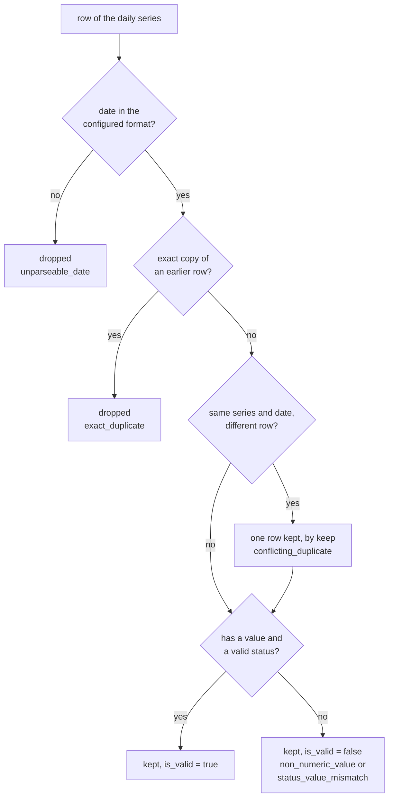
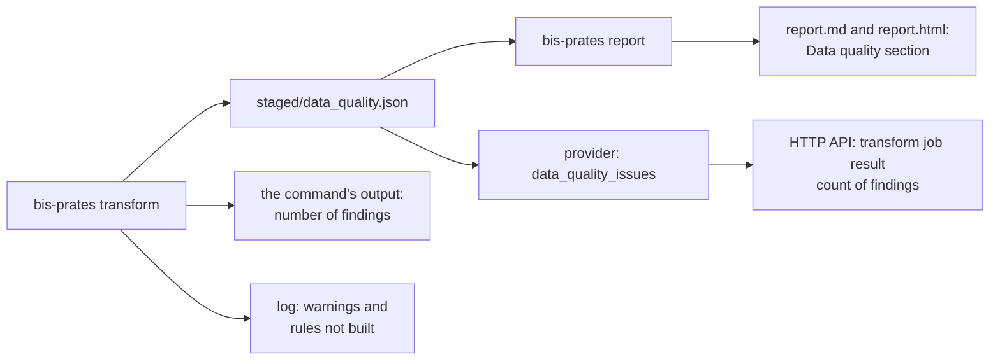

# Data quality

This page explains how the tool deals with the flaws of a real data source, for the people who
read the report and the people who run the tool: what is checked, what a finding means, what
happens to the rows concerned, where the findings are written, and what to do about them. It
follows the layout of [How it works](how-it-works.md): the problem, how it is solved, what can go
wrong, and how it is checked. The technical decisions are in
[decision 0011](adr/0011-data-quality-rules.md) (the rules),
[0005](adr/0005-exact-decimal-rates.md) (exact numbers) and
[0017](adr/0017-bad-input-failures-and-writes.md) (bad input and failures), and
[0009](adr/0009-sdmx-validation.md) with [0018](adr/0018-sdmx-reference-and-not-evaluated.md) (the
checks against the BIS structural metadata); the words used here
are in the [glossary](glossary.md).

---

## 1. The problem

The BIS file is a real source, with the usual flaws. About one daily row in ten has no rate
(`NaN`, with the status `M`, "missing"). Rows can be repeated, or two rows can give different
rates for the same series and day. A date or a value may not be readable. A column may be added,
or an attribute may change, without notice. And a few series hold implausible values (Brazil
reached 790,799 %, Argentina 557 %; [decision 0011](adr/0011-data-quality-rules.md)). A careless tool would treat a missing rate as zero,
round a value to make it fit, delete rows without a word, or stop on the first odd cell and give
no report at all.

The tool follows three rules instead ([decision 0011](adr/0011-data-quality-rules.md)):

- **Nothing is fixed or deleted without a trace.** A row that cannot be used as a rate is kept
  and marked not valid, or dropped and counted when its rule is enabled (section 3). The raw layer keeps every row as loaded
  ([decision 0012](adr/0012-elt-raw-and-staged-layers.md)).
- **Nothing is rounded or invented.** A value that is not an exact number of the configured size
  has no value, never a rounded one ([decision 0005](adr/0005-exact-decimal-rates.md)).
- **One odd observation does not stop the run.** What the data-quality rules can handle is
  reported. Only a file that is not shaped as the configuration says ends the run, and so does a
  series whose row does not make valid series metadata, such as a blank country or area code
  (section 6).

## 2. What a finding is

A **finding** is one result of one data-quality rule, a
[`DataQualityIssue`](reference.md#policy_rate_monitor.core.models.DataQualityIssue)
(`core/models.py`; [data model](data-model.md)). It has five fields:

| Field | Meaning |
|---|---|
| `rule` | The name of the rule, as in the configuration (`exact_duplicate`) |
| `severity` | `info`, `warning` or `error`, as the configuration sets it for the rule (section 4) |
| `series_key` | The series concerned (`D.US`), or none for a finding about the whole file; the report shows "all" |
| `count` | The number of observations (rows) concerned; for `unexpected_column` the number of columns, and for `dataflow_mismatch` the number of differences. 0 for an SDMX rule that could not be evaluated (section 3); at least 1 otherwise (`transform._rename_columns`, `_add_issues`, `_check_reference`) |
| `detail` | A sentence that says what was found and what was done. For the per-series rules it starts with the count (`transform._add_issues`); for `unexpected_column` it lists the columns: "columns not in the configuration, ignored: ..." (`transform._rename_columns`); for an SDMX rule that could not be evaluated it reads "not evaluated: " and the reason |

For example, a finding of the rule `exact_duplicate` for the series `D.US`, with a count of 3,
reads "3 rows repeated exactly; the copies were dropped" (`transform._add_issues`).

**How findings are counted.** A rule gives one finding per series, with the number of rows
concerned in that series: a hundred bad rows in one series are one finding with a count of 100,
not a hundred findings. A rule that detects two different cases gives one finding for each case
(`non_numeric_value` for a bad value and for a bad unit multiplier; `status_value_mismatch` for
both directions), and `unexpected_value` gives one per series and per column. Findings are
listed in this order: `unexpected_column`, `unparseable_date`, `non_numeric_value`,
`status_value_mismatch`, `unexpected_value`, `exact_duplicate`, `conflicting_duplicate`,
`ref_area_not_in_code_list`, `dataflow_mismatch`. Within a
rule they are listed case by case (or column by column, in the order of `params.expected`, for
`unexpected_value`), then by series key (`transform._stage_observations`; `_add_issues` sorts by
key). So within `non_numeric_value`, for example, `D.XM` for a bad value comes before `D.US` for a
bad multiplier. The counts of the value, status and attribute rules are made on every row
of the configured selection (the daily series), before the rows with an unreadable date, the
copies and the conflicts are dropped, so a dropped row can also be counted there; the date and
duplicate rules count what they drop. For `conflicting_duplicate` that is the rows dropped, not
the days: three different rows for one day give a count of 2, and the detail reads "2 rows dropped for
dates with more than one different observation; kept the last one"
(`transform._drop_conflicting`).

## 3. The rules

Each rule is named in the `rules` section of the configuration
([configuration](configuration.md#the-data-quality-rules)). The code implements them; the
configuration selects them, sets their severity and their parameters. [`IMPLEMENTED_RULES`](reference.md#policy_rate_monitor.transform.IMPLEMENTED_RULES)
in `transform.py` lists the built ones.

### The rules that are built

| Rule | What it detects | What happens to the rows |
|---|---|---|
| `unexpected_column` | A column in the file that the configuration names nowhere (in `structure` or `columns.unmapped`). One finding for the whole file; its count is the number of such columns | Nothing: the column is ignored in the staged data and kept in the raw layer |
| `unparseable_date` | A date that is not in the configured format (`date_format`), including a date written in the digits of another script | Dropped from the staged observations, and counted |
| `exact_duplicate` | A row that repeats another one in every column | The copies are dropped; one row stays |
| `conflicting_duplicate` | Two or more rows for the same series and date that differ in at least one column | One row stays: the last in the file, or the first with `keep: first`. The finding says which |
| `non_numeric_value` | A value that is not a number, and a unit multiplier that is blank or not a whole number | Kept as not valid, with no value; never rounded (see "The number format" below) |
| `status_value_mismatch` | A status that contradicts the value: an invalid status (`M`) with a value, or a valid status with a missing value | Kept as not valid. A value that is not a number is not counted here but under `non_numeric_value`, so such a row is counted by one of the two rules, not both |
| `unexpected_value` | A row whose code in a column differs from the one expected for it (`params.expected`), for example `OBS_CONF` other than `F` | Nothing: the row is kept; the finding names the column and the expected code ("N observations whose OBS_CONF is not 'F'", `transform._check_expected_values`); what it may mean is in section 8 |
| `ref_area_not_in_code_list` | A row whose country or area code is not in the official code list. The code is the one of the concept bound to `structure.series_metadata.ref_area`, without its label, compared with the code list as BIS publishes it, before any alias. One finding per series, counting its rows; the series key shows the code | Nothing: the row is kept |
| `dataflow_mismatch` | A difference between the configuration's `structure` and the dataflow definition (next subsection). One finding for the whole dataset; its count is the number of differences, and its detail names each one | None affected |

How a row ends up in `staged/observations.parquet`:



A row without a finding but not valid exists too: the expected missing row (`NaN` with status
`M`) is the normal case, about one daily row in ten, and is not a finding
([README](https://github.com/andrea-dm/policy-rate-monitor#known-issues-of-the-bis-data)). It is
kept, marked not valid, and skipped when the latest and prior rates are looked up.

A rule decides what is **reported**, not whether the data is cleaned. The staged data always
obeys the provider's contract of one row per series and date: with a rule switched off, its rows
are still dropped or kept as above, and only its finding is missing. `conflicting_duplicate`'s
`keep` still decides which row stays when the rule is off (`last` when absent).

### The checks against the BIS structural metadata

The last two rules check the data against the publisher's own definition of it, the SDMX
structural metadata ([decision 0009](adr/0009-sdmx-validation.md),
[decision 0018](adr/0018-sdmx-reference-and-not-evaluated.md)). The `reference` section of the
configuration names the BIS SDMX API, the dataflow and the code list
([configuration](configuration.md#the-sdmx-reference)). During `transform`, after the file is read
and its selection has rows, each enabled rule asks the API once: `ref_area_not_in_code_list` for
the code list, `dataflow_mismatch` for the dataflow and then the structure it points to. That is
up to three requests per run, through `pysdmx` (the `sdmx` extra). Nothing is kept between runs, so the
next `transform` asks again.

`dataflow_mismatch` compares the configuration, not the file, with the definition: the file is
already held to the configuration (a required column that is missing stops the run, and an extra
one is an `unexpected_column` finding), so the two checks together cover the data. It reports:

- a component that `structure` declares and the definition does not have;
- a component of the definition that `structure` does not declare and `columns.unmapped` does not
  list;
- a different role (dimension, measure or attribute) or a different `coded`;
- a country or area dimension coded by a code list other than the configured one.

It does not compare the time dimension, because `pysdmx` cannot read it from BIS's answer; nor the
level an attribute is attached at (BIS attaches `UNIT_MEASURE` and `UNIT_MULT` to the dataflow, the
configuration treats them as series attributes, which for this data means the same); nor whether a
mandatory attribute has values (`TIME_FORMAT` is empty on every row today).

**"Not evaluated".** When the reference cannot be obtained, each enabled SDMX rule gives one
finding for the whole dataset ("all" in the report), with a count of 0, the rule's severity and a
detail such as:

- "not evaluated: the SDMX API at https://stats.bis.org/api/v2 could not be reached";
- "not evaluated: the SDMX API has no dataflow BIS:WS_CBPOL(1.0)";
- "not evaluated: the sdmx extra is not installed: install policy-rate-monitor[sdmx]".

`transform` also logs a warning for each reason, naming the rules it applies to, and ends with exit
code 0: the
other rules ran, and the staged data is the same as without the SDMX rules. A rule that was not
evaluated never counts as a pass. There is one attempt, with no retry: the next `transform` asks
again.

### The rules that are configured and not built

| Rule | What it will detect | Parameters |
|---|---|---|
| `excess_decimals` | A value with more decimals than its series' `DECIMALS` | none |
| `series_attribute_not_constant` | A series attribute that changes within a series | `resolve` (`most_frequent`) |
| `plausible_range` | A value outside a plausible range | `min`, `max` (-5 and 200 in `bis_cbpol.json`) |

`bis_cbpol.json` lists all three, but `transform` has no code for them. They were set aside on
2026-11-19 to deliver a working tool by the deadline: the rules the brief asks about (missing
values, duplicates, inconsistent data) were built first, and these three stayed configured, to be
built later ([decision 0011](adr/0011-data-quality-rules.md), "How it evolved"). Nothing has
replaced them: the SDMX rules check other things. On the release of 19 November 2026 they would
change no number: no value has more decimals than its series' `DECIMALS`, every series attribute
is constant within its series, and the 2,074 daily rows outside -5 to 200 are six historical
episodes (Brazil 1987-94, Croatia 1993, Russia 1993-94, Argentina 2001, Sweden 1992, New Zealand
1985), real rates that the rule would flag and keep. So they were left unbuilt on 2026-11-22. At each run, a listed and
enabled rule that is not built is logged ("data-quality rule ... is not implemented yet") and
skipped; it produces no finding, so **an empty list of findings does not mean these checks
passed**: for example, the implausible values of section 1 are staged as valid and drawn on the
chart with no finding, since a row is valid when it has a value and a status that is not one of
the configured invalid codes (`transform._stage_observations`) and no range is checked. Until `series_attribute_not_constant` is built, the series metadata is taken from the
last row of each series, which assumes its attributes are constant within a series
(`transform._series_metadata`). A rule name that the code does not know at all (a typo, say) is
treated the same way. The README lists the three under its limitations.

### The number format

A value is read only as a plain ASCII number: an optional sign, digits, an optional decimal point
and exponent, with ASCII spaces around it ignored. It must convert exactly, and fit the stored
type: 15 digits, 6 of them after the point for the BIS file (`decimal128(15, 6)`), after the unit
multiplier is applied. Everything else is not a number: `1_5`, digits of another script,
`Infinity`, a value with more digits than the type holds, a non-breaking space around it. Such a
row is kept as not valid with no value and a `non_numeric_value` finding. The empty text and the
configured missing values (`NaN`) are not `non_numeric_value` findings: they mean "no value"
(with a valid status they are a `status_value_mismatch` finding).

The unit multiplier (`UNIT_MULT`) is read the same way, as a whole number. A row whose multiplier
is blank or not a whole number cannot have its value computed, so that row alone is not valid,
with a `non_numeric_value` finding when it has a value (a row with no value is treated as any
missing value); the other rows are staged as usual. A bad `DECIMALS` is not a
finding: it only formats the rates for display, so the series' decimals become unknown, a warning
goes to the log, and the rates stay valid ([decision 0017](adr/0017-bad-input-failures-and-writes.md)).

### The invalid status codes

An observation is valid when it has a value and its status is not one of the observation
attribute's `invalid_codes`. In `bis_cbpol.json` that is `OBS_STATUS`, with the single code `M`.
A row with an invalid status is never used for a rate, even when it has a value; the
`status_value_mismatch` finding says so.

## 4. Severity

The severity says how much attention a finding deserves. The configuration sets it for each rule,
and the code copies it to the finding ([`DataQualitySeverity`](reference.md#policy_rate_monitor.core.models.DataQualitySeverity),
`core/models.py`):

| Severity | Meaning in the code | In `bis_cbpol.json` |
|---|---|---|
| `info` | Expected and handled, such as exact copies dropped | `exact_duplicate` |
| `warning` | Handled, but worth a look, such as a value that is not a number | every other rule |
| `error` | The data cannot be used as it is | none |

The severity changes nothing else: no severity changes how a row is treated, the exit code of
`transform`, or the report's other sections. `transform` ends with code 0 whatever the findings
(`cli/main.py`, `_transform`). The report shows the severity with an emoji beside its name
(`info`, `warning` and `error`; the name is always written too). No rule is built to report
`error` by itself; a configuration may give it to a rule it considers serious. The cases the
`error` description names, such as a missing required column, are not findings but errors
(section 6).

## 5. Configuring a rule

A rule is an object in the `rules` list of the configuration:

```json
{ "name": "conflicting_duplicate", "severity": "warning", "params": { "keep": "last" } }
```

| Key | Meaning |
|---|---|
| `name` | The rule's name, in snake case; names are unique in the list |
| `severity` | `info`, `warning` or `error`; required |
| `enabled` | `true` by default; `false` switches the rule off and keeps its settings |
| `params` | The rule's parameters (an object) |

A rule runs only if it is listed and enabled; the order does not matter. A rule that is not
listed produces no finding, although its effect on the rows (drops, keeping one row) remains.

**What is checked when the configuration loads** (`bis-prates config validate`, and `fetch`,
`transform`, `report` and `serve`, which load it first; an error ends with exit code 4 and a message naming the entry,
[CLI reference](cli.md#bis-prates-config-validate)). The checks are made whether the rule is on or
off:

- the rule names are unique;
- `conflicting_duplicate`'s `keep` is `first` or `last`;
- `unexpected_value`'s `params.expected` is an object; every column in it is a column of the
  configuration (in `structure` or in `columns.unmapped`), with a "did you mean" hint when it looks
  like a typo; and every code is a text;
- an SDMX rule (`ref_area_not_in_code_list`, `dataflow_mismatch`) needs the `reference` section,
  whose ids are not empty and whose timeout is more than 0. The SDMX rules take no parameters.

A column of the configuration that the file happens not to have is skipped when `unexpected_value`
runs. The parameters of the rules not built (`resolve`, `min`, `max`) are not checked yet. The
full table is in [Configuration](configuration.md#the-data-quality-rules); a second dataset needs
its own `expected` codes (step 3 there).

## 6. What is an error, not a finding

A finding is about rows the tool can still handle. When the file as a whole is not shaped as the
configuration says, no meaningful dataset can be built, and a finding would hide it: the command
stops with exit code 7, "look at the source: its format changed" (and retrying would not help;
[decision 0010](adr/0010-cli-and-exit-codes.md), [CLI reference](cli.md)). The staged files of
the last good run stay as they were. The cases (`transform`, `fetch`; table in
[How it works](how-it-works.md#1-get-the-latest-data-11-the-ingestion-process)):

- the download is not a ZIP, is corrupt or encrypted, or holds more or less than one CSV;
- the CSV cannot be parsed or decoded, or holds no rows;
- a required column is missing (the message names it); a missing optional column is only a
  warning in the log;
- no row has the configured selection, such as `FREQ = D`;
- a series row does not make valid series metadata, such as a blank country or area code (the
  message names the series).

Two other stops are not about the data: no cached file, or staged data built with another
configuration, is exit 5 ("run the earlier step"), and a configuration that does not load is exit
4. The line between the two is the one [decision 0017](adr/0017-bad-input-failures-and-writes.md)
draws: bad input that touches some rows is a finding; bad input that makes the whole file
unusable is an error with its own exit code.

## 7. Where the findings go



- **`staged/data_quality.json`**: the full list, one object per finding, with the five fields. It
  is rewritten whole by each `transform` that succeeds, so it describes the last successful run
  (a run stopped by bad input, section 6, or by a failed write leaves it as it was; a failure
  while the files are renamed into place can leave it new,
  [decision 0017](adr/0017-bad-input-failures-and-writes.md); [data model](data-model.md)).
[`load_data_quality`](reference.md#policy_rate_monitor.transform.load_data_quality) and the provider's `data_quality_issues()`
  read it.
- **The output of `transform`**: only the number, for example
  `709984 observations of 49 series kept, 0 data-quality findings`, which is the result on the
  release of 19 November 2026 ([CLI reference](cli.md#bis-prates-transform)).
- **`report.md` and `report.html`**: a "Data quality" section with a table of every finding (rule,
  severity, series, count, detail), or "No findings". The report lists findings and does not name
  the rules that are not built.
- **The HTTP API**: the `transform` job's result has the count (`findings`); there is no endpoint
  that lists the findings, and `summary.json` and `summary.csv` do not carry them. Read
  `data_quality.json` or call the provider ([HTTP API](api.md)).
- **The log**: the warnings that are not findings (a bad `DECIMALS`, a missing optional column, a
  release record that does not match the ZIP), the SDMX rules that were not evaluated, with the
  reason, and the rules not built.

## 8. What to do with the findings

| You see | What it tells you | What to do |
|---|---|---|
| No findings | None of the built rules that are enabled found anything, and none was "not evaluated" | Nothing. The three rules not built did not run, and a built rule that is switched off (`enabled: false`) or not listed gives no finding either (`transform.transform` keeps only the enabled rules) |
| `exact_duplicate` (`info`) | The file repeated rows | Nothing; the copies add nothing |
| `conflicting_duplicate` | The source gave two versions of a day | The report says which was kept; check the source if it matters for a country or area you read |
| `non_numeric_value`, `status_value_mismatch` | Some observations have no usable rate; they are skipped | Check whether the series you request is affected: its latest or prior rate may be older than expected (flags `stale_latest`, `stale_prior`) |
| `unparseable_date` | Some rows were dropped | The source may have changed its date format |
| `unexpected_column`, `unexpected_value` | The source may have changed | Compare with the BIS documentation; update the configuration if the change is intended |
| `ref_area_not_in_code_list` | The data has a country or area code that BIS's code list does not | The source or the code list changed; the series key shows the code. Its rows are reported as usual |
| `dataflow_mismatch` | The configuration and BIS's definition of the dataflow disagree | Read the differences in the detail and correct the configuration's `structure`, or `columns.unmapped` |
| A count of 0 and "not evaluated" | The SDMX rule did not run: the reason says why | Nothing was checked against the BIS reference in this run. Fix the reason (network, an id in `reference`, the extra) and run `transform` again |

The operator's side, with a script that lists the findings, is in the
[runbooks](advanced/operations/runbooks.md#read-data_qualityjson).

A **reader of the report** reads the "Data quality" table before relying on a figure: the series
column says whether a series they requested is concerned. An **operator** checks that
`bis-prates config validate` passes after any change to the configuration, watches the number of
findings that `transform` prints (a new nonzero count after a run with none means the source
changed), and reads `data_quality.json` for the detail.

## 9. What is planned

- **The three rules not built** (section 3) are left for a later release
  ([decision 0011](adr/0011-data-quality-rules.md); [milestones](milestones.md)).
- **The rest of the SDMX validation (milestone M7, [decision 0009](adr/0009-sdmx-validation.md)).**
  The checks of the data are built (section 3). Still to come: checking the requested codes
  against the same code list, with suggestions (`GBR → GB`, `USA → US`), in the CLI and the API,
  and the official country or area names in the report. Until then, requested codes are only
  matched against the codes the data has.
- A second data source would need to run the same checks itself until a shared layer exists
  ([decision 0011](adr/0011-data-quality-rules.md), "Consequences").

## 10. How it is checked

??? info "Checked by"

    `tests/test_transform.py`: `test_missing_values_are_kept_and_marked_invalid`,
    `test_duplicates_are_dropped_and_reported`, `test_unparseable_dates_are_dropped_and_reported`,
    `test_a_date_in_digits_of_another_script_is_not_a_date`,
    `test_unexpected_columns_are_reported`, `test_unexpected_values_are_reported_per_series`,
    `test_the_configured_keep_applies_whether_the_rule_is_on_or_not`,
    `test_values_that_are_not_plain_numbers_are_read_as_decimal_reads_them`,
    `test_only_a_plain_ascii_number_that_converts_exactly_is_a_value`,
    `test_a_value_with_more_decimals_than_the_type_is_never_rounded`,
    `test_a_value_with_many_digits_that_fits_is_kept`,
    `test_a_bad_unit_multiplier_makes_its_rows_invalid_not_the_run_fail`,
    `test_a_bad_decimals_leaves_the_decimals_unknown_with_a_warning`,
    `test_a_value_that_is_not_a_number_is_one_finding_not_two`,
    `test_missing_required_column_is_named`,
    `test_a_source_file_that_cannot_be_read_is_an_unexpected_format`,
    `test_a_series_row_with_no_ref_area_code_is_an_unexpected_format`;
    `tests/config/test_models.py`: `test_rule_parameters_are_checked_even_when_the_rule_is_off`,
    `test_conflict_keep_applies_whether_the_rule_is_on_or_not`;
    `tests/providers/contract.py`: `test_data_quality_issues_are_core_models`;
    `tests/test_report.py`: `test_report_md_matches_the_expected_page` (the findings table) and
    `test_text_from_the_data_is_escaped_in_report_html` (a finding's text is shown as text);
    `tests/test_cli.py`: the count printed by `transform`, and
    `test_transform_without_the_sdmx_extra_reports_not_evaluated_and_exits_0`.

    The SDMX rules: `tests/test_transform_sdmx.py`, through a fake reference source
    (`test_a_matching_reference_gives_no_finding_also_for_labelled_codes`,
    `test_a_code_not_in_the_code_list_is_one_finding_per_series`,
    `test_each_structure_difference_is_one_dataset_finding_naming_it`,
    `test_an_unmapped_column_and_the_time_dimension_are_not_differences`,
    `test_an_unavailable_reference_gives_one_not_evaluated_finding_per_rule`,
    `test_rules_that_are_off_never_ask_the_reference`,
    `test_a_missing_zip_ends_before_the_reference_is_asked`); `tests/test_sdmx.py`, the `pysdmx`
    source on BIS answers recorded on 2026-11-22; `tests/config/test_models.py`:
    `test_an_sdmx_rule_needs_the_reference_section_even_when_off`,
    `test_a_bad_reference_field_is_rejected`. `tests/integration/test_sdmx_api.py` checks the
    committed configuration against the live API; it runs only with `pytest -m integration`.

    The count of 0 findings on the release of 19 November 2026 is the one printed in the
    [CLI reference](cli.md#bis-prates-transform); it is not asserted by a test.
