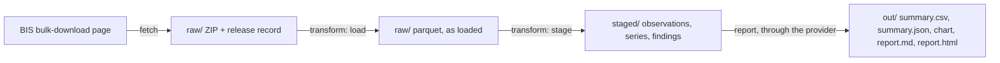

# How it works

This page takes each task of the brief in turn and explains, in plain words, the business problem
behind it, how the tool solves it, what can go wrong, and which tests check it. Section numbers
refer to the brief. The technical decisions behind the solutions are in the
[decision records](adr/index.md); the words used here are defined in the [glossary](glossary.md).

The whole run, from the BIS site to the report:

---

## 1. Get the latest data (§1.1): the ingestion process

**The problem.** The BIS publishes the policy rates of about 50 central banks as one ZIP file on its
bulk-download page, and updates it regularly. The file's address can change, so a fixed link would
break one day without warning.

**How it is solved.** `bis-prates fetch` goes through these steps. Every address, name, number of
attempts and timeout comes from the `source` section of the configuration.

1. **Is there a recent copy?** If a copy was downloaded less than 24 hours ago (`cache_ttl_hours`),
   it is used and nothing is requested (see section 2).
2. **Find the file.** Download the bulk-download page (`discovery_url`) and look through its links
   for the one whose last part is the configured file name (`WS_CBPOL_csv_flat.zip`). If the page
   cannot be reached, or has no such link, use the configured `fallback_url`, with a warning.
3. **Download it**, with a timeout to connect and one for each read (10 s and 60 s in
   `bis_cbpol.json`: `connect_timeout_seconds`, `read_timeout_seconds`), in at most
   `max_attempts` attempts (3, the first one included), waiting 1 s and then 2 s between them.
   Only a temporary failure is tried again: no connection, a timeout, or an answer of 5xx (a
   server error), 408 or 429 (too many requests). Any other answer but 200, such as 404 (not
   found), means the source has changed, and retrying would not help. Up to five redirects are
   followed, for a file that has moved.
4. **Check it.** The download must be a ZIP that is not corrupt and holds exactly one CSV file.
5. **Record the release:** where the file came from, when it was retrieved, and its SHA-256
   fingerprint (`raw/WS_CBPOL_csv_flat.json`). Every report says which release it was built from.
6. **Store it safely.** The ZIP and its record are written under temporary names and then
   renamed, so a failure never leaves a half-written file in place of a good one.

`bis-prates transform` then continues the ingestion:

7. **Load the CSV as it is** into `raw/WS_CBPOL_csv_flat.parquet` (parquet is a compact file
   format for tables that keeps each column's type): every row and every column, as text. Nothing is selected, cleaned or dropped at this point
   ([decision 0012](adr/0012-elt-raw-and-staged-layers.md)).
8. **Stage it** into `staged/` (section 3).

**What can go wrong, and what happens.**

| Situation | What the tool does |
|---|---|
| The page cannot be reached, answers with an error, or has no link to the file | Uses the configured fallback address, with a warning |
| The site is slow, does not answer, or answers with a temporary error (5xx, 408, 429) | Gives up after the timeout and tries again, up to `max_attempts` attempts in all (3) |
| The site answers 404, 403 or another status that is not temporary, or redirects more than five times | Stops at once with exit code 7, with no retry: the address or the source has changed |
| The site is down and a copy was downloaded before | Uses that copy, with a warning naming its date |
| The site is down and there is no copy | Stops with exit code 6: "try again later" |
| The download is not a ZIP, is corrupt or encrypted, or holds more or less than one CSV | Stops with exit code 7, and keeps the previous good copy |
| A required column is missing from the CSV | `transform` stops with exit code 7 and names the column |
| The cached ZIP is corrupt, or its CSV cannot be parsed or decoded (a truncated row, the wrong encoding), or has no row of the configured selection (no daily row) | `transform` stops with exit code 7 and names the file; the staged files of the last run stay |

??? info "Checked by"

    `tests/test_fetch.py`, with a fake web server (`FakeWeb`); no test uses the
    network. `test_fallback_url_is_used_when_the_page_has_no_link`,
    `test_unexpected_download_fails_and_keeps_the_cached_copy`,
    `test_network_down_uses_an_old_cached_copy_with_a_warning`,
    `test_network_down_without_a_cached_copy_fails`,
    `test_a_temporary_failure_is_retried_after_growing_pauses`,
    `test_a_temporary_answer_is_retried_then_the_source_is_unavailable`,
    `test_an_answer_that_is_not_temporary_fails_at_once`,
    `test_up_to_five_redirects_are_followed`, `test_a_sixth_redirect_is_refused`,
    `test_a_failed_discovery_page_falls_back_to_the_configured_url`;
    `tests/test_transform.py`: `test_missing_required_column_is_named`,
    `test_a_source_file_that_cannot_be_read_is_an_unexpected_format`.

## 2. Do not download the same file again and again (§1.1): the caching process

**The problem.** The file is about 4 MB and changes at most daily. Downloading it on every run
wastes time and load on the BIS site; and when the site is down, the tool should still work with
the copy it has.

**How it is solved.**

- **Freshness.** The age of a copy is measured from the retrieval time in its release record, not
  from the file's date on disk. A copy younger than `cache_ttl_hours` (24 in `bis_cbpol.json`) is used as it is: a
  second `fetch` within that time makes no request at all. With `cache_ttl_hours: 0`, every `fetch`
  downloads again.
- **A failed download never replaces a good copy.** The new file is checked before it is stored,
  and stored by renaming a complete temporary file.
- **Offline fallback.** When the site cannot be reached and an older copy exists, that copy is used,
  and the warning gives its retrieval time, so nobody mistakes it for fresh data.
- **A broken record is no record.** A release record that cannot be read (not UTF-8, or not a
  valid record) counts as missing, so the next `fetch` downloads the file again.

??? info "Checked by"

    `tests/test_fetch.py`: `test_second_fetch_within_the_cache_lifetime_makes_no_request`,
    `test_the_cache_lifetime_is_measured_on_the_given_clock`,
    `test_an_unreadable_release_record_is_ignored`; and the tests of section 1 for the failures.

## 3. Turn the file into a dataset ready for analysis (§1.2)

**The problem.** The file mixes daily and monthly series, writes every code together with its label
(`US: United States`), and repeats each series' description (title, unit, number of decimals) on
every row. An analyst needs one clean table: one row per series and day, with typed dates and
exact numbers.

**How it is solved.** After loading the raw layer (section 1, step 7), `bis-prates transform` keeps
the daily series only (`FREQ = D`, from the configuration) and builds four files in `staged/`:

- `observations.parquet`: series key, frequency, reference area, date, rate, status and a validity flag, one
  row per series and date, sorted by date within each series;
- `series.json`: the description of each series (reference area name, title, unit, decimals and the other
  attributes), once per series;
- `data_quality.json`: the findings (section 4);
- `release.json`: the release the data was built from (address, retrieval time, fingerprint),
  copied from the record next to the ZIP when its fingerprint is that of the ZIP read. The report
  takes the release from here, so a `fetch` of a newer file without a `transform` cannot make the
  report name a release it was not built from.

Rates are read as exact decimal numbers, with the unit multiplier applied (a rate given in
hundreds is multiplied by 100). A value is accepted only as a plain number in ASCII digits (a
sign, digits, a decimal point, an exponent) that converts exactly: text such as `1_5`, digits of
another script or a value with more digits than the stored type holds is not a number, never a
rounded one (section 4). Plain numbers are converted in one go; anything else goes through an
exact parser, so the result is the same either way. Every column name, code and rule comes from
the configuration, not from the code ([decision 0007](adr/0007-config-driven-design.md)).

The five files of a run (`raw/<zip>.parquet` and the four staged files) are first written under
temporary names, and renamed into place only once all of them are written, `release.json` last.
A run that fails while writing (a full disk, say) leaves the files of the previous run as they
were, and a reader never finds a half-written file. With no release to stage, the old
`release.json` is removed first, so the previous files are then of unknown release. The renames
are not one step, though: a `report` that reads the staged files while a `transform` from the
command line renames them can pair files of two runs. That gap is left open for now (#35;
[decision 0017](adr/0017-bad-input-failures-and-writes.md)).

??? info "Checked by"

    `tests/test_transform.py`: `test_only_the_selected_frequency_is_kept`,
    `test_unit_multiplier_is_applied_exactly`, `test_series_metadata_is_kept`,
    `test_values_that_are_not_plain_numbers_are_read_as_decimal_reads_them`,
    `test_only_a_plain_ascii_number_that_converts_exactly_is_a_value`,
    `test_the_release_of_the_zip_read_is_staged_last`,
    `test_no_release_is_staged_without_a_record_of_the_zip`,
    `test_a_failed_write_leaves_the_staged_files_of_the_last_run`;
    `tests/providers/test_bulk.py`: `test_the_release_is_the_one_staged_not_the_one_fetched_last`,
    `test_a_read_that_overlaps_a_transform_is_read_again`;
    `tests/core/test_files.py`: `test_a_failed_write_replaces_nothing`,
    `test_a_failed_rename_removes_the_whole_set`;
    `tests/test_cli.py::test_a_kill_ends_the_command_with_the_shells_code_for_it`.

## 4. Missing values, duplicates and inconsistent data (§1.2, §3.3)

**The problem.** About one daily row in ten has no rate: the BIS publishes it as `NaN` with the
status "missing". Rows can also be repeated, or two rows can give different rates for the same
series and day. A careless calculation would treat a missing rate as zero, or use the wrong one of
two values.

**How it is solved.**

| Situation | What the tool does |
|---|---|
| A rate is missing (`NaN`, empty, or status `M`) | Keeps the row, marks it not valid, never fills in a value |
| A value is not a plain number, or has more digits than the stored type allows | Keeps the row as not valid and records a finding (`non_numeric_value`); never rounds it |
| A row's unit multiplier (`UNIT_MULT`) is blank or not a whole number | Keeps the row as not valid and records a `non_numeric_value` finding; the other rows are staged as usual |
| A series' `DECIMALS` is blank, not a whole number or negative | Leaves its decimals unknown, with a warning in the log; its rates stay valid, and are shown with only the digits they need |
| A status says "missing" but there is a value, or a valid status has no value | Keeps the row as not valid and records a finding (`status_value_mismatch`); a value that is not a number is counted once, as `non_numeric_value` |
| The same row appears twice | Keeps one copy and records a finding |
| Two different rates for the same series and day | Keeps the last one in the file (configurable, as `keep`, even with the rule switched off) and records a finding; the report says which one is kept |
| An attribute holds another value than the configuration expects (for example the confidentiality status) | Records a finding: the source may have changed |
| A date cannot be read in the configured format (digits of another script included) | Drops the row and records a finding |
| A series row does not make valid series metadata (a blank country or area code, say) | Stops with exit code 7, naming the series: the file is not shaped as the configuration says |

Every finding goes to `data_quality.json` and to the "Data quality" section of the report, with its
rule, severity, series and count. Three more rules are configured but not built yet (more decimals
than the series declares, a plausible range, attributes constant within a series); `transform`
says so in its log ([decision 0011](adr/0011-data-quality-rules.md)). The rule parameters are
checked when the configuration is loaded: a `keep` other than `first` or `last`, or an
`unexpected_value` with no `expected` object, a column under it that the configuration does not
have (in `structure` or in `columns.unmapped`), or a code that is not a text, stops every command
with exit code 4.

??? info "Checked by"

    `tests/test_transform.py`: `test_missing_values_are_kept_and_marked_invalid`,
    `test_duplicates_are_dropped_and_reported`, `test_unparseable_dates_are_dropped_and_reported`,
    `test_a_date_in_digits_of_another_script_is_not_a_date`,
    `test_a_value_with_more_decimals_than_the_type_is_never_rounded`,
    `test_a_value_with_many_digits_that_fits_is_kept`,
    `test_a_bad_unit_multiplier_makes_its_rows_invalid_not_the_run_fail`,
    `test_a_bad_decimals_leaves_the_decimals_unknown_with_a_warning`,
    `test_a_value_that_is_not_a_number_is_one_finding_not_two`,
    `test_unexpected_columns_are_reported`, `test_unexpected_values_are_reported_per_series`,
    `test_the_configured_keep_applies_whether_the_rule_is_on_or_not`,
    `test_a_series_row_with_no_ref_area_code_is_an_unexpected_format`;
    `tests/config/test_models.py::test_rule_parameters_are_checked_even_when_the_rule_is_off`.

## 5. The latest rate of each country or area (§1.3)

**The problem.** The user wants to know the policy rate today for a list of countries. But they do
not publish on the same days: the UK can be a day behind the US, and some series stopped years ago.

**How it is solved.** For each requested country or area, the latest rate is the last valid observation of its
daily series, with its own date. Dates are not forced to a common one, so no value is invented.

??? info "Checked by"

    `tests/test_snapshot.py::test_each_ref_area_looks_back_from_its_own_latest_date`,
    `test_invalid_observations_are_skipped`.

## 6. The rate 12 months earlier (§1.3)

**The problem.** To tell whether a central bank has raised or cut rates over the past year, the
report compares today's rate with the rate a year ago. But "a year ago" often falls on a weekend, a
holiday or a gap in the data, where there is no published rate.

**How it is solved.** From the latest date of each one, the tool goes back 12 calendar months to the
same day (the *target date*). If there is no valid rate that day, it takes the last valid rate
published before it.

Examples from the release of 19 November 2026:

- Latest US rate on 17 November 2026: the target date is 17 November 2025, which has a rate, so
  that rate is used.
- Latest UK rate on 16 November 2026: the target date is 16 November 2025, a Sunday, so the rate of
  Friday 14 November is used.
- From 29 February, the target date is 28 February of the year before, since that year has no 29
  February.

??? note "How the search works (technical detail)"

    The search is a binary search on each series' sorted dates: it halves the range of dates at each
    step, so it needs about 20 steps for 700,000 rows. The dates and rates are first laid out
    as arrays of whole numbers, so one search answers for every requested country or area at once, exactly
    ([decisions 0006](adr/0006-twelve-month-look-back.md) and
    [0013](adr/0013-fast-analytics-numpy-numba.md)).

??? info "Checked by"

    `tests/test_snapshot.py::test_target_on_a_weekend_takes_the_friday_before`,
    `test_29_february_looks_back_to_28_february`, `test_negative_rates`;
    `tests/test_analytics.py::test_snapshot_at_matches_the_bisect_method_at_every_date`, which checks
    the search against the plain method of v0.1.0 at every date of a fixture, dates before 1970
    included.

## 7. The change in basis points (§1.3)

**The problem.** The headline figure is the change over the year, in basis points (1 percentage
point = 100 basis points). Computers usually calculate with binary fractions, which give answers
like 24.999999999999957 instead of 25.

**How it is solved.** The change is `(latest − prior) × 100`, computed exactly, from the file to the
summary files. Only the chart uses approximate numbers, for drawing
([decision 0005](adr/0005-exact-decimal-rates.md)).

??? info "Checked by"

    `tests/test_snapshot.py::test_change_is_exact_in_basis_points`; the five headline
    figures were also checked against an independent calculation on the raw file.

## 8. Countries or areas the tool cannot answer for (§1.3)

**The problem.** A user can ask for a code the data does not have, for one with no valid rate,
or for a series too short to go back 12 months. One bad request must not spoil the whole report, and
a stale figure must not pass for a current one.

**How it is solved.** Each requested country or economic area gets a status, and each one appears in the outputs:

| Status | Meaning |
|---|---|
| `ok` | Latest rate, rate 12 months earlier and change are known |
| `unknown_ref_area` | The data has no series for this code |
| `no_valid_data` | The series exists but has no valid rate |
| `insufficient_history` | There is a latest rate, but nothing on or before the target date |

Flags warn without hiding a value: `stale_latest` when a latest rate is more than 30 days
older than the newest date in the data (for example a series that stopped), and `stale_prior` when
the rate used for 12 months earlier is more than 7 days before the target date. The thresholds are
in the configuration. For an unknown code, `report` prints a warning that lists every code the data
has, with its name. If no requested country or area is `ok`, the command still writes the outputs and ends
with exit code 1.

??? info "Checked by"

    `tests/test_snapshot.py::test_unknown_ref_area_insufficient_history_and_no_valid_data`,
    `test_stale_latest_and_stale_prior_are_flagged`;
    `tests/test_cli.py::test_an_unknown_code_lists_the_codes_the_data_has`.

## 9. Countries or areas named the way people name them (§1.3)

**The problem.** The brief asks for `EA` (euro area), but the BIS file calls it `XM`. Users also
type codes in lower case, with spaces, or twice.

**How it is solved.** Requested codes are matched without regard to spaces and case, and a code
asked for twice is kept once; `EA` is translated to `XM` through `ref_area_aliases` in the
configuration. The outputs show both the code as the user typed it and the BIS code. A code may
hold only letters, digits and `_ @ $ -`, as the codes of the configuration do; anything else (a
formula such as `=HYPERLINK(...)`, or HTML) is refused with exit code 2, and so is a list with no
code at all. With no `=`, `+`, bracket, quote or `<`, no spreadsheet function, link or HTML can be
built from a code; a leading `-` or `@` is still allowed, because the configuration's codes allow
it.

??? info "Checked by"

    `tests/test_snapshot.py::test_ea_is_read_as_the_euro_area_code`,
    `test_requested_codes_are_cleaned_and_deduplicated`;
    `tests/test_cli.py`: `test_report_refuses_a_code_outside_the_code_pattern`,
    `test_report_refuses_a_list_with_no_code_and_writes_nothing`.

## 10. A report for someone who has not seen the code (§1.4, §3.2)

**The problem.** The figures are only useful if a reader can trust them and understand where they
come from, without reading code.

**How it is solved.** `bis-prates report` writes five files to `out/`:

- `summary.csv` and `summary.json`: one row per requested country or area, with its status, flags and the
  series fields chosen in the configuration; the JSON also nests the full series description and
  records the source release the staged data was built from (address, retrieval time,
  fingerprint);
- `policy_rates.png`: the daily rates of the requested countries or areas from the start date, drawn as steps,
  because policy rates change in steps;
- `report.md` and `report.html`: the same report as two pages, the first for reading in Git or a
  text editor, the second for a web browser. Each has the summary table, the chart, a description
  of the source, the method and its assumptions, the data-quality findings and the limitations, in
  plain English. A status, a flag or a finding's severity has an emoji beside its name (✅ ok,
  ❓ unknown code, 🚫 no valid data, ⚠️ insufficient history or a warning, ⏳ a stale rate), so
  the rows that need a look stand out. The summary table shows each rate with at least its
  series' decimals and never rounds it, so the two rates of a row always add up to its change
  (4.125 and 3.00 next to 112.5 basis points, not 4.12).

The five files are written under temporary names and renamed into place once all are written: a
run that fails while making or writing the files leaves the previous report whole.

Both charts, the PNG and the interactive one, can be read by someone with a colour vision
deficiency, which about one man in twelve has. They draw each line the same way:

- in a colour from matplotlib's colour-blind palette (`tableau-colorblind10`): blue, dark orange,
  mid grey and dark grey, the four of its colours that stand out against the white background and
  stay apart for the common deficiencies;
- from the fifth line on, also with a dash pattern (dashed, dotted, dash-dot, …), so a line never
  depends on its colour alone; the first 24 lines all look different;
- with its name written at its right end, next to its latest rate, as well as in the legend;
- with a text that says what the chart shows, for a screen reader or when the image does not load.

The legend and the text name only the lines actually drawn. With nothing to draw (a start date
after all the data, say), both charts say "No data to plot" and name no line
([decision 0016](adr/0016-accessible-charts.md)).

The two pages are filled from the same values, so they cannot disagree: the code works out the
figures and the texts once, and a template for each page lays them out.

`report.html` is a single file that works without a network: it can be opened from a folder,
attached to an email or moved on its own. With the `interactive` extra installed, its chart can be
zoomed and hovered for the exact dates; without it, the page shows the PNG chart instead. The page
follows the accessibility guidelines for the web (WCAG 2.2, level AA): its tables can be read by a
screen reader cell by cell with their headers, it can be used with the keyboard alone, and its text
contrast is high ([decision 0015](adr/0015-report-templates-and-html.md)).

**What can go wrong, and what happens.**

| Situation | What the tool does |
|---|---|
| The `interactive` extra is not installed | `report.html` shows the PNG chart, embedded in the page |
| The page is opened without a network | It works: Plotly's code is inside the page, which loads nothing else |
| A name or a finding in the data holds text that looks like HTML | It is shown as text in `report.html`, never run as code |
| No requested country or area has a rate to draw | Both charts say "No data to plot" and name no line; the table still lists every request |
| `--start` is after all the data of a country or area | It gets no line, and neither the legend nor the text alternative names it |
| A rate has more digits than its series' `DECIMALS` | The table shows every digit; it never rounds a rate |
| A `fetch` downloaded a newer file, but `transform` was not run | The report still names the release it was built from, read from `staged/release.json` |
| Writing a file fails halfway (a full disk) | The previous files stay as they were; the command ends with exit code 8 |
| More than 24 lines on one chart | From the 25th line, colour and dash pairs repeat; the names at the line ends and the table still tell them apart |
| The emoji do not show (an old system, or a screen reader) | The name is always written beside them, and the HTML page hides them from screen readers |

??? info "Checked by"

    `tests/test_report.py`: `test_report_writes_the_five_files`, which writes the five
    files from hand-made inputs and checks the values in the CSV and JSON;
    `test_report_md_matches_the_expected_page`,
    `test_report_html_has_the_sections_of_report_md`,
    `test_report_html_shows_the_interactive_chart_and_loads_nothing`,
    `test_without_plotly_report_html_embeds_the_png`,
    `test_text_from_the_data_is_escaped_in_report_html`,
    `test_report_html_hides_its_emoji_from_screen_readers`,
    `test_the_png_draws_the_n_th_line_with_the_n_th_line_style`,
    `test_the_png_names_each_line_at_its_end`, `test_an_empty_png_says_so`,
    `test_the_chart_carries_its_text_alternative`, `test_the_png_names_only_the_lines_it_draws`,
    `test_a_start_after_all_the_data_draws_no_line_and_names_none`,
    `test_the_summary_table_pads_a_rate_but_never_rounds_it`,
    `test_a_failed_report_leaves_the_previous_files_as_they_were`,
    `test_the_report_says_which_conflicting_row_is_kept_even_with_the_rule_off`,
    `test_the_emoji_map_is_read_only`;
    `tests/chart/test_interactive.py`:
    `test_the_n_th_line_has_the_n_th_line_style`, `test_each_line_is_named_at_its_end`,
    `test_a_chart_with_no_line_says_so`, `test_only_the_lines_drawn_are_named`,
    `test_a_start_after_all_the_data_draws_no_line_and_names_none`;
    `tests/chart/test_style.py`:
    `test_every_line_colour_has_3_to_1_on_white`,
    `test_the_colours_stay_apart_with_a_colour_vision_deficiency`,
    `test_the_first_24_lines_all_differ_then_the_styles_repeat`.

## 11. Run it from a script or a scheduler (§2)

**The problem.** The tool should run unattended, for example every morning. A scheduler cannot read
error messages; it needs to know whether to retry, alert someone, or run an earlier step.

**How it is solved.** Three commands, `fetch`, `transform` and `report`, each doing one step and
writing files the next one reads. Every kind of failure has its own exit code, and only code 6
(source unavailable) means "try again later". The full table is in the [CLI reference](cli.md)
([decisions 0010](adr/0010-cli-and-exit-codes.md) and
[0017](adr/0017-bad-input-failures-and-writes.md)).

**What can go wrong, and what happens.**

| Situation | Exit code |
|---|---|
| The BIS site is down or answers with a temporary error, after the retries, and nothing is cached | 6: try again later |
| The BIS site answers 404 or another status that is not temporary; the file is corrupt or cannot be parsed | 7: look at the source; retrying would not help |
| `report` before `transform`, or staged data built with another configuration | 5, with the step to run: "run `bis-prates transform` first" |
| A requested code with other characters than the code pattern's, a `--port` outside 1 to 65535, or a port `serve` cannot listen on | 2: fix the command line |
| A bad `keep`, or a missing or bad `expected`, in the configuration | 4: fix the configuration |
| A file cannot be read or written | 8 |
| Anything else, that is a bug | 3, with the traceback in the log |

??? info "Checked by"

    `tests/test_cli.py`: `test_an_error_maps_to_its_exit_code`,
    `test_a_bug_ends_with_the_internal_error_code`,
    `test_a_missing_input_gives_a_one_line_error_naming_the_step`,
    `test_an_output_folder_that_is_a_file_exits_8`,
    `test_serve_refuses_a_port_outside_1_to_65535`,
    `test_serve_on_a_busy_port_exits_2_naming_the_host_and_port`;
    `tests/providers/test_bulk.py::test_staged_data_of_another_configuration_says_to_transform_again`.

## 12. Anyone can rebuild the results (§3.1)

**The problem.** A reviewer must be able to get the same outputs on their own machine, with no
undocumented step.

**How it is solved.** The README lists the installation commands and the three commands to run.
The committed `out/` records the BIS release it was built from, with its fingerprint. Run on the
same release, the commands give the same `summary.csv` and `summary.json`; only the generation time
changes.

## 13. Ready for a second data source

This is not asked by the brief, but it keeps the tool open to change. Today the data comes from the
BIS bulk download; tomorrow it could come from a database or another API. The snapshot, the report
and the command line read the data only through one interface (`DataProvider`), so a new source is
one new class, with no change to the calculation or the report. Every source must pass the same
tests of the interface's promises (the contract tests): the same columns and types, one row per series and day, dates in order
([decision 0008](adr/0008-provider-interface.md)).

??? info "Checked by"

    `tests/providers/`: the shared suite in `contract.py`, run against both providers.

## 14. The same answers over HTTP (§2, Option B)

**The problem.** A web page, or another program, cannot run a command line and read its files: it
needs the figures over HTTP. The steps are slow (a download, a transform) and write the same files,
so two running at once could mix them; and the web answers must give the same numbers as the
report, or one of them is wrong.

**How it is solved.** `bis-prates serve` (with the `web` extra) runs an HTTP API over the same
steps as the command line ([HTTP API](api.md), [decision 0014](adr/0014-http-api.md)):

- **Read endpoints.** `GET /ref-areas` lists the countries and economic areas the data has;
  `/summary` returns the same document as `summary.json`; `/timeseries` the valid rates of one
  country or area, exactly; `/chart` the Plotly figure of the interactive chart, the same lines as
  the PNG. The staged data is read once, kept in memory, and replaced after a `transform` job.
- **The steps as jobs.** `POST /jobs/fetch`, `/jobs/transform` and `/jobs/report` answer at once
  with a job to poll (`GET /jobs/{id}`), which goes from `queued` to `running`, then `succeeded`
  with its result or `failed` with its error. One worker runs them one at a time, so they never
  write the same files at once.
- **One service for both.** The command line and the API call the same `service` module, so on the
  same data `GET /summary` and `summary.json` hold the same numbers.
- **One error body.** Every failure answers `{"error": kind, "message": ...}`, with a status per
  kind that mirrors the command line's exit codes, and never a traceback.

**What can go wrong, and what happens.**

| Situation | What the API does |
|---|---|
| A read before anything is staged, or with staged data of another configuration | `409` `missing_input`, saying which job to run: "run POST /jobs/transform first" |
| A `POST` while a job is queued or running | `409` `job_running`, naming the job to wait for |
| A blank code, or one with other characters than letters, digits and `_ @ $ -` | `422` `invalid_request`; no function, link or HTML can reach the outputs |
| A code the data does not have | `/summary`: the status `unknown_ref_area`; `/timeseries`: `404` `not_found` |
| A job fails, whatever stops it | The job is marked `failed`, with the same error body; the next job is accepted |
| Many jobs over a long run | Only the last 100 finished jobs are kept; an older id gets `404` |
| A read during a `transform` job | Gets the previous data, never a mix of old and new |
| A bug | `500` `internal_error`, naming only the error's type; the traceback goes to the log |
| Ctrl+C during a job | New jobs get `503` `shutting_down`; the running job finishes its files first |
| The port is already in use | `serve` prints a message naming the address and the port, and ends with exit code 2 |

??? info "Checked by"

    `tests/web/test_app.py`: `test_summary_gives_the_same_snapshots_as_the_cli`,
    `test_timeseries_gives_the_valid_rates_exactly`,
    `test_chart_has_one_line_per_ref_area_with_a_latest_rate`,
    `test_with_nothing_staged_the_read_endpoints_say_to_run_transform`,
    `test_a_code_outside_the_code_pattern_gets_422`, `test_a_bug_gets_500_without_its_traceback`,
    `test_serve_on_a_busy_port_raises_a_listen_error`; `tests/web/test_jobs.py`:
    `test_a_fetch_job_goes_from_queued_to_succeeded`,
    `test_a_second_job_while_one_runs_is_refused`,
    `test_a_transform_job_replaces_data_that_was_already_served`,
    `test_a_job_stopped_by_a_base_exception_is_failed_and_the_next_one_runs`,
    `test_a_job_whose_end_cannot_be_recorded_as_is_is_still_failed`,
    `test_a_report_job_refuses_a_code_outside_the_code_pattern`,
    `test_the_runner_keeps_the_last_finished_jobs_and_the_running_one`;
    `tests/test_service.py::test_summaries_computed_at_once_from_the_same_data_agree`.
