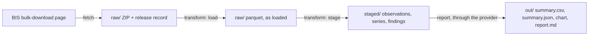

# How it works

This page takes each task of the brief in turn and explains, in plain words, the business problem
behind it, how the tool solves it, what can go wrong, and which tests check it. Section numbers
refer to the brief. The technical decisions behind the solutions are in the
[decision records](adr/index.md); the words used here are defined in the [glossary](glossary.md).

The whole run, from the BIS site to the report:

---

## 1. Get the latest data (§1.1): the ingestion process

**The problem.** The BIS publishes the policy rates of about 50 central banks as one ZIP file on its
bulk-download page, and updates it regularly. The file's address can change, so a fixed link would
break one day without warning.

**How it is solved.** `bis-prates fetch` goes through these steps. Every address, name, number of
attempts and timeout comes from the `source` section of the configuration.

1. **Is there a recent copy?** If a copy was downloaded less than 24 hours ago (`cache_ttl_hours`),
   it is used and nothing is requested (see section 2).
2. **Find the file.** Download the bulk-download page (`discovery_url`) and look through its links
   for the one whose last part is the configured file name (`WS_CBPOL_csv_flat.zip`). If the page
   cannot be reached, or has no such link, use the configured `fallback_url`, with a warning.
3. **Download it**, with a timeout of 10 s to connect and 60 s for each read, in at most 3
   attempts (`max_attempts`, the first one included), waiting 1 s and then 2 s between them.
4. **Check it.** The download must be a ZIP that is not corrupt and holds exactly one CSV file.
5. **Record the release:** where the file came from, when it was retrieved, and its SHA-256
   fingerprint (`raw/WS_CBPOL_csv_flat.json`). Every report says which release it was built from.
6. **Store it safely.** The ZIP is written under a temporary name and then renamed, so a failure
   never leaves a half-written file in place of a good one.

`bis-prates transform` then continues the ingestion:

7. **Load the CSV as it is** into `raw/WS_CBPOL_csv_flat.parquet`: every row and every column, as
   text. Nothing is selected, cleaned or dropped at this point
   ([decision 0012](adr/0012-elt-raw-and-staged-layers.md)).
8. **Stage it** into `staged/` (section 3).

**What can go wrong, and what happens.**

| Situation | What the tool does |
|---|---|
| The page cannot be reached, or has no link to the file | Uses the configured fallback address, with a warning |
| The site is slow or does not answer | Gives up after the timeout and tries again, 3 attempts in all |
| The site is down and a copy was downloaded before | Uses that copy, with a warning naming its date |
| The site is down and there is no copy | Stops with exit code 6: "try again later" |
| The download is not a ZIP, is corrupt, or holds more or less than one CSV | Stops with exit code 7, and keeps the previous good copy |
| A required column is missing from the CSV | `transform` stops with exit code 7 and names the column |

**Checked by:** `tests/test_fetch.py`, with a stand-in for the web (`FakeWeb`); no test uses the
network. `test_fallback_url_is_used_when_the_page_has_no_link`,
`test_unexpected_download_fails_and_keeps_the_cached_copy`,
`test_network_down_uses_an_old_cached_copy_with_a_warning`,
`test_network_down_without_a_cached_copy_fails`;
`tests/test_transform.py::test_missing_required_column_is_named`.

## 2. Do not download the same file again and again (§1.1): the caching process

**The problem.** The file is about 4 MB and changes at most daily. Downloading it on every run
wastes time and load on the BIS site; and when the site is down, the tool should still work with
the copy it has.

**How it is solved.**

- **Freshness.** The age of a copy is measured from the retrieval time in its release record, not
  from the file's date on disk. A copy younger than `cache_ttl_hours` (24) is used as it is: a
  second `fetch` within that time makes no request at all. With `cache_ttl_hours: 0`, every `fetch`
  downloads again.
- **A failed download never replaces a good copy.** The new file is checked before it is stored,
  and stored by renaming a complete temporary file.
- **Offline fallback.** When the site cannot be reached and an older copy exists, that copy is used,
  and the warning gives its retrieval time, so nobody mistakes it for fresh data.

**Checked by:** `tests/test_fetch.py::test_second_fetch_within_the_cache_lifetime_makes_no_request`,
and the tests of section 1 for the failures.

## 3. Turn the file into a dataset ready for analysis (§1.2)

**The problem.** The file mixes daily and monthly series, writes every code together with its label
(`US: United States`), and repeats each series' description (title, unit, number of decimals) on
every row. An analyst needs one clean table: one row per series and day, with typed dates and
exact numbers.

**How it is solved.** After loading the raw layer (section 1, step 7), `bis-prates transform` keeps
the daily series only (`FREQ = D`, from the configuration) and builds three files in `staged/`:

- `observations.parquet`: series key, frequency, area, date, rate, status and a validity flag, one
  row per series and date, sorted by date within each series;
- `series.json`: the description of each series (area name, title, unit, decimals and the other
  attributes), once per series;
- `data_quality.json`: the findings (section 4).

Rates are read as exact decimal numbers, with the unit multiplier applied (a rate given in
hundreds is multiplied by 100). Plain numbers are converted in one go; anything else goes through
an exact parser, so the result is the same either way. Every column name, code and rule comes from
the configuration, not from the code ([decision 0007](adr/0007-config-driven-design.md)).

**Checked by:** `tests/test_transform.py`: `test_only_the_selected_frequency_is_kept`,
`test_unit_multiplier_is_applied_exactly`, `test_series_metadata_is_kept`,
`test_values_that_are_not_plain_numbers_are_read_as_decimal_reads_them`.

## 4. Missing values, duplicates and inconsistent data (§1.2, §3.3)

**The problem.** About one daily row in ten has no rate: the BIS publishes it as `NaN` with the
status "missing". Rows can also be repeated, or two rows can give different rates for the same
series and day. A careless calculation would treat a missing rate as zero, or use the wrong one of
two values.

**How it is solved.**

| Situation | What the tool does |
|---|---|
| A rate is missing (`NaN`, empty, or status `M`) | Keeps the row, marks it not valid, never fills in a value |
| A value is not a number, or has more decimals than the stored type allows | Keeps the row as not valid and records a finding; never rounds it |
| A status says "missing" but there is a value, or the reverse | Keeps the row as not valid and records a finding |
| The same row appears twice | Keeps one copy and records a finding |
| Two different rates for the same series and day | Keeps the last one in the file (configurable) and records a finding |
| An attribute holds another value than the configuration expects (for example the confidentiality status) | Records a finding: the source may have changed |
| A date cannot be read | Drops the row and records a finding |

Every finding goes to `data_quality.json` and to the "Data quality" section of the report, with its
rule, severity, series and count. Three more rules are configured but not built yet (more decimals
than the series declares, a plausible range, attributes constant within a series); `transform`
says so in its log ([decision 0011](adr/0011-data-quality-rules.md)).

**Checked by:** `tests/test_transform.py`: `test_missing_values_are_kept_and_marked_invalid`,
`test_duplicates_are_dropped_and_reported`, `test_unparseable_dates_are_dropped_and_reported`,
`test_a_value_with_more_decimals_than_the_type_is_never_rounded`.

## 5. The latest rate of each area (§1.3)

**The problem.** The user wants to know the policy rate today for a list of countries. But areas do
not publish on the same days: the UK can be a day behind the US, and some series stopped years ago.

**How it is solved.** For each requested area, the latest rate is the last valid observation of its
daily series, with its own date. Areas are not forced to a common date, so no area is shown with an
invented value.

**Checked by:** `tests/test_snapshot.py::test_each_area_looks_back_from_its_own_latest_date`,
`test_invalid_observations_are_skipped`.

## 6. The rate 12 months earlier (§1.3)

**The problem.** To tell whether a central bank has raised or cut rates over the past year, the
report compares today's rate with the rate a year ago. But "a year ago" often falls on a weekend, a
holiday or a gap in the data, where there is no published rate.

**How it is solved.** From each area's latest date, the tool goes back 12 calendar months to the
same day (the *target date*). If there is no valid rate that day, it takes the last valid rate
published before it.

- Latest US rate on 17 November 2026: the target date is 17 November 2025, which has a rate, so
  that rate is used.
- Latest UK rate on 16 November 2026: the target date is 16 November 2025, a Sunday, so the rate of
  Friday 14 November is used.
- From 29 February, the target date is 28 February of the year before, since that year has no 29
  February.

The search is a binary search on each series' sorted dates. The dates and rates are first laid out
as arrays of whole numbers, so one search answers for every requested area at once, exactly
([decisions 0006](adr/0006-twelve-month-look-back.md) and
[0013](adr/0013-fast-analytics-numpy-numba.md)).

**Checked by:** `tests/test_snapshot.py::test_target_on_a_weekend_takes_the_friday_before`,
`test_29_february_looks_back_to_28_february`, `test_negative_rates`;
`tests/test_analytics.py::test_snapshot_at_matches_the_bisect_method_at_every_date`, which checks
the search against the plain method of v0.1.0 at every date of a fixture, dates before 1970
included.

## 7. The change in basis points (§1.3)

**The problem.** The headline figure is the change over the year, in basis points (1 percentage
point = 100 basis points). Computers usually calculate with binary fractions, which give answers
like 24.999999999999957 instead of 25.

**How it is solved.** The change is `(latest − prior) × 100`, computed exactly, from the file to the
summary files. Only the chart uses approximate numbers, for drawing
([decision 0005](adr/0005-exact-decimal-rates.md)).

**Checked by:** `tests/test_snapshot.py::test_change_is_exact_in_basis_points`; the five headline
figures were also checked against an independent calculation on the raw file.

## 8. Areas the tool cannot answer for (§1.3)

**The problem.** A user can ask for a code the data does not have, for an area with no valid rate,
or for a series too short to go back 12 months. One bad request must not spoil the whole report, and
a stale figure must not pass for a current one.

**How it is solved.** Each requested area gets a status, and every area appears in the outputs:

| Status | Meaning |
|---|---|
| `ok` | Latest rate, rate 12 months earlier and change are known |
| `unknown_area` | The data has no series for this code |
| `no_valid_data` | The series exists but has no valid rate |
| `insufficient_history` | There is a latest rate, but nothing on or before the target date |

Flags warn without hiding a value: `stale_latest` when an area's latest rate is more than 30 days
older than the newest date in the data (for example a series that stopped), and `stale_prior` when
the rate used for 12 months earlier is more than 7 days before the target date. The thresholds are
in the configuration. For an unknown code, `report` prints a warning that lists every code the data
has, with its name. If no requested area is `ok`, the command still writes the outputs and ends
with exit code 1.

**Checked by:** `tests/test_snapshot.py::test_unknown_area_insufficient_history_and_no_valid_data`,
`test_stale_latest_and_stale_prior_are_flagged`;
`tests/test_cli.py::test_an_unknown_code_lists_the_codes_the_data_has`.

## 9. Areas named the way people name them (§1.3)

**The problem.** The brief asks for `EA` (euro area), but the BIS file calls it `XM`. Users also
type codes in lower case, with spaces, or twice.

**How it is solved.** Requested codes are trimmed, upper-cased and de-duplicated; `EA` is
translated to `XM` through `area_aliases` in the configuration. The outputs show both the code the
user asked for and the BIS code.

**Checked by:** `tests/test_snapshot.py::test_ea_is_read_as_the_euro_area_code`,
`test_requested_codes_are_cleaned_and_deduplicated`.

## 10. A report for someone who has not seen the code (§1.4, §3.2)

**The problem.** The figures are only useful if a reader can trust them and understand where they
come from, without reading code.

**How it is solved.** `bis-prates report` writes four files to `out/`:

- `summary.csv` and `summary.json`: one row per requested area, with its status, flags and the
  series fields chosen in the configuration; the JSON also nests the full series description and
  records the source release (address, retrieval time, fingerprint);
- `policy_rates.png`: the daily rates of the requested areas from the start date, drawn as steps,
  because policy rates change in steps;
- `report.md`: the summary table, the chart, a description of the source, the method and its
  assumptions, the data-quality findings and the limitations, in plain English.

**Checked by:** `tests/test_report.py::test_report_writes_the_four_files`, which writes the four
files from hand-made inputs and checks the values in the CSV and JSON.

## 11. Run it from a script or a scheduler (§2)

**The problem.** The tool should run unattended, for example every morning. A scheduler cannot read
error messages; it needs to know whether to retry, alert someone, or run an earlier step.

**How it is solved.** Three commands, `fetch`, `transform` and `report`, each doing one step and
writing files the next one reads. Every kind of failure has its own exit code, and only code 6
(source unavailable) means "try again later". The full table is in the [CLI reference](cli.md)
([decision 0010](adr/0010-cli-and-exit-codes.md)).

**Checked by:** `tests/test_cli.py`: `test_an_error_maps_to_its_exit_code`,
`test_a_bug_ends_with_the_internal_error_code`,
`test_report_before_transform_gives_a_one_line_error`.

## 12. Anyone can rebuild the results (§3.1)

**The problem.** A reviewer must be able to get the same outputs on their own machine, with no
undocumented step.

**How it is solved.** The README lists the installation commands and the three commands to run.
The committed `out/` records the BIS release it was built from, with its fingerprint. Run on the
same release, the commands give the same `summary.csv` and `summary.json`; only the generation time
changes.

## 13. Ready for a second data source

This is not asked by the brief, but it keeps the tool open to change. Today the data comes from the
BIS bulk download; tomorrow it could come from a database or another API. The snapshot, the report
and the command line read the data only through one interface (`DataProvider`), so a new source is
one new class, with no change to the calculation or the report. Every source must pass the same
contract tests: the same columns and types, one row per series and day, dates in order
([decision 0008](adr/0008-provider-interface.md)).

**Checked by:** `tests/providers/`: the shared suite in `contract.py`, run against both providers.
