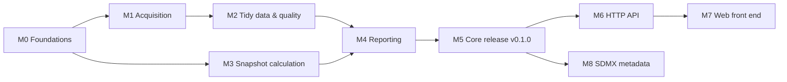

# Milestones

This page describes how the BIS Policy Rate Monitor is built, step by step. Each milestone has a
goal, a scope and the condition that marks it as done. The page also explains why the work is cut
this way.

## How the milestones were chosen

Four principles shaped the split:

1. **Correctness before breadth.** The core tool is fetch, transform, snapshot and report. It is
   finished, tested and documented before any optional extension starts. The core alone is a
   complete, submittable solution. Nothing in it depends on the extensions.
2. **One milestone per risk.** Each milestone isolates one kind of problem:
   - fetch: network and source failures
   - transform: messy data
   - snapshot: calculation correctness
   - report: presentation and reproducibility

   That way a failure points to one place, and each milestone gets the tests its risk calls for.
3. **Follow the data flow.** The milestones follow the pipeline. Each one produces the input the
   next one needs (a cached ZIP, then tidy tables, then snapshot rows, then output files). Each
   handoff is a stable contract.
4. **Every milestone is verifiable on its own.** Each one ends with a working CLI command or
   function, tests that run without the network, and every repository check passing (ruff,
   pyright, deptry, tach, pytest). Each milestone is one issue, one branch and one pull request.

M3 depends only on M0. It is a pure calculation over in-memory data, so it can be built and tested
on synthetic series in parallel with M1 and M2.

## Overview

| Milestone | Delivers | Brief requirement | Track |
|---|---|---|---|
| M0 Foundations | Domain model, errors, configuration, CLI entry point | §2 Option A | Core |
| M1 Acquisition | `bis-prates fetch` with discovery, cache and failure handling | §1.1 | Core |
| M2 Tidy data & quality | `bis-prates transform`: daily observations, series metadata, data-quality report | §1.2 | Core |
| M3 Snapshot calculation | Latest rate, rate 12 months earlier, change in basis points | §1.3 | Core |
| M4 Reporting | `bis-prates report`: the four output files | §1.4, §3.2 | Core |
| M5 Core release | README, AI-usage note, documentation, verified outputs, tag `v0.1.0` | §3.1, §3.3, §3.4 | Core |
| M6 HTTP API | FastAPI endpoints over the same service layer | §2 Option B, Ext. 1 | Extension |
| M7 Web front end | React interface driving the workflow | Ext. 1 | Extension |
| M8 SDMX metadata | Country-code validation and suggestions | Ext. 2 | Extension |

---

## M0 — Foundations

**Goal.** Fix the shared vocabulary and contracts before any feature code depends on them.

**Scope.**

- Domain models in `core`:
  - series metadata
  - snapshot row
  - snapshot status values: `OK`, `UNKNOWN_AREA`, `NO_VALID_DATA`, `INSUFFICIENT_HISTORY`
  - data-quality issue
- Typed errors and the CLI exit-code convention
- Settings in `config`: paths, source URLs, cache lifetime, default countries
- Area alias table, for example `EA → XM`. The BIS file codes the euro area as `XM`.
- The `bis-prates` entry point with the three subcommands stubbed
- A `tach` module entry for each new subpackage

**Done when.** `bis-prates --help` lists `fetch`, `transform` and `report`, and all checks pass.

**Why it is its own milestone.** The later milestones all exchange these types. Settling them first
avoids rework. It also lets the module layering be enforced from the first line of feature code,
instead of being added afterwards.

---

## M1 — Acquisition (`fetch`)

**Goal.** Reliably obtain the latest "Central bank policy rates (CSV, flat)" ZIP, and download it
again only when it has changed.

**Scope.**

- Find the download link on the BIS bulk-download page, with a configured fallback URL.
- Local cache plus a metadata sidecar holding the URL, `ETag`, `Last-Modified`, checksum and fetch
  time.
- A cache lifetime, then conditional requests: a `304 Not Modified` response means no download.
- Download to a temporary file, validate it (a real ZIP with exactly one CSV), then replace the
  cached copy atomically.
- Bounded retries on transient errors, and explicit timeouts.
- Clear errors for an unavailable source and for an unexpected format. If the network fails but a
  cached copy exists, use it and print a warning.

**Done when.**

- A second `fetch` makes no download.
- Every failure mode has a defined outcome, covered by tests against a mocked HTTP layer: server
  error, HTML returned instead of a ZIP, truncated archive, network down.

**Why it is its own milestone.** This is the only component that talks to the outside world, so its
failure modes are different in kind from the rest. Building it first also gives every later
milestone a fast, offline, repeatable input.

---

## M2 — Tidy data and data quality (`transform`)

**Goal.** Turn the raw file into a tidy, validated dataset of daily policy rates, with the series
metadata kept.

**Scope.**

- Read only the needed columns and keep daily series only (`FREQ = D`), filtering on the code.
- Parse the BIS flat-CSV conventions: headers like `CODE:Label` and coded values like
  `code: label`.
- Two tables:
  - **observations**: series, area, date, value, status, validity flag
  - **series**: title, unit, unit multiplier, decimals, source, notes on breaks, coverage dates
- Missing values. The source encodes them as `NaN` with status `M`. A value counts only when the
  status is not `M` **and** the number is finite.
- Duplicates. Exact repeats are dropped. Conflicting repeats are resolved by a documented rule and
  recorded.
- Validation rules:
  - required columns
  - parseable dates and numbers
  - metadata constant within a series
  - plausible ranges
  - unexpected changes in the source
- Every rule result is written to a machine-readable data-quality report.

**Done when.**

- Running on the real file produces both tables and the data-quality report.
- Unit tests on small synthetic files cover missing values, duplicates, invalid values and a
  changed schema.

**Why it is its own milestone.** The brief ranks data correctness first, and nearly every quirk of
the source data surfaces here. Keeping the transform separate makes its output tables a stable,
inspectable contract that the calculation and the report can trust.

---

## M3 — Snapshot calculation

**Goal.** For each requested area, compute the latest valid rate, the rate 12 months earlier and the
change in basis points.

**Scope.**

- Normalise the requested codes: case, whitespace, aliases, duplicates.
- Latest **valid** observation per series. Each series uses its own latest date, since areas do not
  share one.
- Target date = the latest date minus 12 calendar months. The prior rate is the most recent valid
  observation on or before the target date. This covers weekends, holidays and series that only
  have business days.
- The change in basis points is computed in decimal arithmetic, so a move from `3.75` to `4.00` is
  exactly `25` bp.
- Unknown areas, series with no valid data and series with too little history each return a status.
  They are not errors and do not stop the other areas.
- Flags for a stale latest observation and for a prior observation well before the target date.

**Done when.** Unit tests and property-based tests pass for these cases:

- the target date falls on a weekend
- 29 February
- negative rates
- different latest dates per area
- insufficient history
- unknown area
- the euro-area alias

**Why it is its own milestone.** This is the headline calculation, and an error here would be the
most visible. Written as a pure function with no I/O, it can be tested exhaustively on its own and
in parallel with M1 and M2.

---

## M4 — Reporting (`report`)

**Goal.** Produce the required outputs for a chosen set of countries and start date.

**Scope.**

- `out/summary.csv` and `out/summary.json`. Every requested area gets a row, including failed ones
  with their status. Rows carry series metadata references. The JSON adds provenance: source URL,
  file version, download time and generation time.
- `out/policy_rates.png`: daily rate levels over the requested period, drawn with matplotlib as
  step lines, because policy rates change in discrete steps.
- `out/report.html`:
  - summary table
  - interactive Plotly chart (the same figure the web front end shows)
  - description of the source data
  - method and assumptions
  - data-quality findings
  - limitations

  It is written for a reader who has not seen the code.

**Done when.**

- `bis-prates report --countries "US,EA,GB,JP,CH" --start 2015-01-01` produces all four files.
- An end-to-end test, from a fixture ZIP to the output files, passes.

**Why it is its own milestone.** The report is what users actually read. Its concerns are wording,
formatting precision, chart readability and reproducible provenance, which are separate from
computing the numbers.

---

## M5 — Core release (`v0.1.0`)

**Goal.** Make the core solution complete, reproducible and explained. This is the submittable
checkpoint.

**Scope.**

- README:
  - installation
  - the three commands
  - reproducing `out/` from a clean clone
  - running the tests
  - assumptions and limitations
- AI-usage note. It covers which assistants were used, what was generated versus written, how the
  code was validated, and concrete issues found.
- Documentation pages: architecture, data model and assumptions, CLI reference.
- Manual check of a few computed values against the BIS Data Portal, recorded in the docs.
- Committed outputs in `out/` and a `v0.1.0` tag.

**Done when.** A fresh clone, following only the README, reproduces `out/`, and every deliverable
in brief §3 is ticked.

**Why it is its own milestone.** Documentation and verification are deliverables in their own
right, not cleanup. Closing the core with a tagged release also marks a clear line before any
optional work begins.

---

## M6 — HTTP API (extension)

**Goal.** Expose the same functionality over HTTP for the web front end.

**Scope.**

- Endpoints:
  - available areas
  - summary for a list of countries
  - time series for one country
  - starting fetch and transform as background jobs, with a job-status endpoint
  - the policy-rate chart as Plotly figure JSON, built by the same code as the HTML report
- Endpoints call the same service layer as the CLI. No logic is duplicated.

**Done when.** API tests pass and the endpoints return the same numbers as the CLI outputs.

**Why it is its own milestone.** It proves the core has a clean service boundary. It is also useful
without a UI, and it has to be in place before the front end can be built.

---

## M7 — Web front end (extension)

**Goal.** A small React interface for the workflow.

**Scope.**

- React with Vite, kept to a few small components.
- Country selection.
- Buttons to run retrieval, transformation and report generation, with processing status and
  readable error messages.
- A table of latest rates.
- An interactive history chart, rendered with `react-plotly.js` from figure JSON that the API sends.
- The front end computes nothing and talks only to the M6 API.

**Done when.** One documented command starts the API and the UI, and the full workflow can be run
from the browser.

**Why it is its own milestone.** It is a separate technology stack with its own build and tests.
Separating it from M6 keeps the concerns apart: the API is the contract, and the UI only consumes it.

---

## M8 — SDMX metadata (extension)

**Goal.** Validate requested country codes against BIS structural metadata.

**Scope.**

- Retrieve the policy-rate dataflow and the reference-area code list through the BIS SDMX API
  (`pysdmx`), and cache them.
- Report unknown codes with suggestions, for example `GBR → GB` and `EU → XM`. Suggestions also
  work offline, using the areas present in the dataset.
- Use official area names in the report.

**Done when.** Invalid codes produce suggestions in both the CLI and the API, and the tests cover
the online and offline paths.

**Why it is its own milestone.** It adds a second external source with its own failure modes. The
core already handles unknown codes safely through statuses, so this improves the user experience
without being needed for correctness.

---

## Alternatives considered

- **Thin end-to-end slice first.** This means wiring all three commands with placeholder logic, then
  deepening each. It was not chosen. The stages already communicate through files, so each can be
  tested alone from fixtures, and a placeholder pipeline would add little confidence.
- **Merging transform and snapshot.** Rejected. Data cleaning and the calculation fail in different
  ways and need different tests. Keeping them apart also keeps the calculation a pure function.
- **One milestone for the whole web extension.** Rejected. Splitting the API (M6) from the UI (M7)
  keeps each pull request reviewable. It also makes the backend/frontend boundary explicit, which
  is the part of the extension that matters most.

## Tracking

Each milestone maps to one GitHub issue and one branch from `develop`. A milestone is closed when
its pull request merges with all checks passing. Status:

| Milestone | Status |
|---|---|
| M0 Foundations | Not started (project scaffold in place) |
| M1 Acquisition | Not started |
| M2 Tidy data & quality | Not started |
| M3 Snapshot calculation | Not started |
| M4 Reporting | Not started |
| M5 Core release | Not started |
| M6 HTTP API | Not started |
| M7 Web front end | Not started |
| M8 SDMX metadata | Not started |
