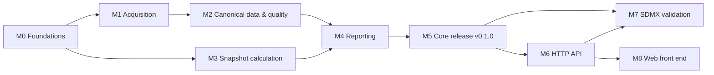

# Milestones

This page describes how the BIS Policy Rate Monitor is built, step by step. Each milestone has a
goal, a scope and the condition that marks it as done. The page also explains why the work is cut
this way.

## Design principles behind every milestone

Two architectural principles apply to all milestones. They are set up in M0 and respected
everywhere after.

- **Config-driven.** Everything specific to a dataset, a source or an environment is declared in
  configuration, not written into the code. That covers the source location, column roles,
  encodings, validity rules, data-quality rules, thresholds, reference-area aliases and output fields. The
  configuration is nested JSON. It is read through a `ConfigSource` interface: today from a JSON
  file in `configs/`, outside the package, and potentially from a REST service or a NoSQL store
  later. Pydantic models validate it when it is loaded. Rule *implementations* are Python code; the
  configuration only selects them and sets their parameters.
- **Source-agnostic.** Every source yields the same **canonical data**: one observations table
  with a schema derived from the configuration, plus series metadata, data-quality findings and
  provenance. The first release reads the BIS bulk download and stores the canonical data as
  parquet, which the snapshot and the report read. M5 puts a `DataProvider` interface in front of
  it, so that other providers can be added without changing analytics, reporting or the API: a
  query engine such as DuckDB or Spark, or another REST API such as the BIS SDMX data API.

The `DataProvider` interface (M5) has two kinds of methods:

| Kind | Methods | Purpose |
|---|---|---|
| Lifecycle | `fetch`, `transform` | Prepare the data. They change state (download, write the store) and map to the CLI commands. Each provider decides what they mean for its source. |
| Query | `list_series`, `series_metadata`, `observations`, `data_quality_issues`, `source_release` | Read the data, its findings and its provenance. Read-only, and the only way the rest of the backend sees data. |

## How the milestones were chosen

Four principles shaped the split:

1. **Correctness before breadth.** The core tool is fetch, transform, snapshot and report. It is
   finished, tested and documented before any optional extension starts. The core alone is a
   complete, submittable solution. Nothing in it depends on the extensions.
2. **One milestone per risk.** Each milestone isolates one kind of problem:
   - foundations: contracts that everything else depends on
   - fetch: network and source failures
   - transform: messy data
   - snapshot: calculation correctness
   - report: presentation and reproducibility

   That way a failure points to one place, and each milestone gets the tests its risk calls for.
3. **Follow the data flow.** The core milestones M1 to M4 follow the pipeline stages: a cached
   source file, then canonical data, then snapshots, then output files. Each handoff is a stable
   contract, so a stage can also be built against a fake of the stage before it (M3 is tested on
   small hand-made observation tables).
4. **Every milestone is verifiable on its own.** Each one ends with a working CLI command or
   function, tests that run without the network, and every repository check passing (ruff,
   pyright, deptry, tach, pytest).

M3 depends only on M0. Its input is canonical data, so it can be built and tested on small
hand-made observation tables, in parallel with M1 and M2.

## Overview

Section numbers refer to the interview exercise brief. Ext. 1 (web front end) and Ext. 2 (BIS SDMX
API metadata) are the two optional extensions in its §5.

| Milestone | Delivers | Brief requirement | Track |
|---|---|---|---|
| M0 Foundations | Contracts: domain and configuration models, `ConfigSource` | §2 Option A | Core |
| M1 Acquisition | The `bis-prates` entry point; `bis-prates fetch`: discovery, cache and failure handling | §1.1 | Core |
| M2 Canonical data & quality | `bis-prates transform`: canonical daily observations, series metadata, configurable data-quality rules | §1.2, §3.3 (missing values, duplicates) | Core |
| M3 Snapshot calculation | Latest rate, rate 12 months earlier, change in basis points | §1.3, §3.3 (12-month change) | Core |
| M4 Reporting | `bis-prates report`: the four output files | §1.4, §3.2 | Core |
| M5 Core release | README (with the AI-usage note), documentation, verified outputs, `DataProvider` interface, tag `v0.1.0` | §3.1, §3.4 | Core |
| M6 HTTP API | FastAPI endpoints over the same service layer | §2 Option B, Ext. 1 | Extension |
| M7 SDMX validation | Data-quality rules and country-code checks against BIS structural metadata | Ext. 2 | Extension |
| M8 Web front end | React interface driving the workflow | Ext. 1 | Extension |

---

## M0 — Foundations

**Goal.** Fix the shared vocabulary, the configuration model and the interfaces before any feature
code depends on them.

**Scope.**

- Domain models in `core` (pydantic):
  - `SeriesMetadata`
  - `DataSnapshot`, with `SnapshotStatus` (`OK`, `UNKNOWN_REF_AREA`, `NO_VALID_DATA`,
    `INSUFFICIENT_HISTORY`) and `SnapshotFlag` (`STALE_LATEST`, `STALE_PRIOR`)
  - `DataQualityIssue` and `DataQualitySeverity`
  - `SourceRelease`, which identifies a version of the source: its location, a version identifier
    and the retrieval time (for the BIS bulk download: URL, checksum, fetch time)
- Configuration models (dataset, source, structure, columns, rules, snapshot parameters, output
  fields), validated when they are loaded.
- The `ConfigSource` interface, plus a file implementation. The policy-rate dataset's JSON
  configuration lives in `configs/`, outside the package: the package holds only the models
  that validate it, and a JSON Schema generated from them.
- Typed errors in `core`.
- A `tach` module entry for each subpackage, enforcing the layering.

**Done when.**

- The configuration in `configs/` loads and validates. A malformed or missing configuration
  fails with a clear message.
- All checks pass.

**Why it is its own milestone.** Every later milestone exchanges these types and depends on these
interfaces. Settling them first avoids rework, and lets the layering and the config-driven
approach be enforced from the first line of feature code instead of being retrofitted.

---

## M1 — Acquisition (`fetch`)

**Goal.** Reliably obtain the latest "Central bank policy rates (CSV, flat)" ZIP, and download it
again only when the cached copy is older than the cache lifetime.

**Scope.**

- Every source detail (discovery page, link pattern, fallback URL, cache lifetime) comes from the
  configuration.
- Find the download link on the BIS bulk-download page, with the configured fallback URL.
- Local cache plus a sidecar file holding the URL, checksum and fetch time.
- A cache lifetime: within it, no request is made.
- Download to a temporary file, validate it (a real ZIP with exactly one CSV), then replace the
  cached copy atomically.
- Bounded retries on transient errors, and explicit timeouts.
- Clear errors for an unavailable source and for an unexpected format. If the network fails but a
  cached copy exists, use it and print a warning.
- The `bis-prates` entry point (the `cli` package) with `fetch`, `transform` and `report`.
  `--config` selects the configuration and `--data-dir` where the data is stored. Each typed error
  of `core` has its own documented exit code (`ExitCode`).

**Done when.**

- `bis-prates --help` lists `fetch`, `transform` and `report`.
- A second `fetch` within the cache lifetime makes no request.
- Each of these failure modes has a defined outcome, covered by tests against a stand-in for HTTP:
  a response that is not a ZIP holding exactly one CSV, discovery link not found (fallback URL
  used), and network down with and without a cached copy.

**Why it is its own milestone.** This is the only component that talks to the outside world, so its
failure modes are different in kind from the rest. Building it first also gives transform,
reporting and the end-to-end tests a fast, offline, repeatable input.

---

## M2 — Canonical data & quality (`transform`)

**Goal.** Turn the raw file into validated canonical data, with the series metadata kept, and store
it as parquet for the next stages.

**Scope.**

- Read the columns and their roles from the configuration's structure section (dimensions, time,
  value, observation attributes, series attributes). No column name or code is written into the
  code.
- Apply the configured selection (daily series: `FREQ = D`), filtering on the code.
- Parse the BIS flat-CSV conventions: headers like `CODE:Label` and coded values like
  `code: label`.
- Produce canonical data:
  - **observations**: series key, dimensions, date, value as an exact decimal, status, validity
    flag
  - **series metadata**: title, unit, decimals, and the other series attributes (unit multiplier,
    source, notes on breaks)
- Missing values are kept and marked invalid, using the configured encoding. The source encodes
  them as `NaN` with status `M`. A value is valid only when the status is not `M` **and** the value
  is a valid number.
- **Data-quality rules**, each reporting through the same `DataQualityIssue` model, with the
  severity and parameters set in the configuration:
  - unparseable dates or numbers
  - duplicates: exact repeats dropped, conflicting repeats resolved by the configured rule and
    recorded
  - attribute values that differ from the configured expected values (source drift)

  The other rules named in the configuration (more decimals than the series declares, plausible
  ranges, metadata constant within a series) were planned for M5 and left for a later release
  ([decision 0011](adr/0011-data-quality-rules.md)).
- Every rule result is written to a machine-readable data-quality report.
- The canonical data is stored as parquet: a raw copy of the source file as loaded, then the
  staged daily observations and the series metadata. The observations hold at most one row per
  series and date, sorted by date within each series.

**Done when.**

- Running on the real file produces the canonical data and the data-quality report.
- Unit tests on small synthetic files cover missing values, duplicates, invalid values, the daily
  selection and the series metadata kept.

**Why it is its own milestone.** The brief ranks data correctness first, and nearly every quirk of
the source data surfaces here. The canonical data it produces is the stable contract that the
calculation, the reports and the API rely on.

---

## M3 — Snapshot calculation

**Goal.** For each requested country or economic area, compute the latest valid rate, the rate 12 months earlier and the
change in basis points.

**Scope.**

- The calculation is a pure function, `compute_snapshots(args)`, where `args` is a `SnapshotArgs`
  holding the observations, the requested codes and the settings, returning one
  `DataSnapshot` per requested country or area. The `report` command reads the staged
  observations and passes them in.
- Take the parameters from the configuration: look-back length, staleness thresholds, reference-area aliases.
- Normalise the requested codes: case, whitespace, aliases, duplicates.
- Latest **valid** observation per series. Each series uses its own latest date, since they do not
  necessarily share one.
- Target date = the latest date minus 12 calendar months. The prior rate is the most recent valid
  observation on or before the target date. This covers weekends, holidays and series that only
  have business days.
- The lookup is a binary search on each series' sorted dates, relying on the order of the
  observations that M2 guarantees. Since #13 it is one search over all series
  ([decision 0013](adr/0013-fast-analytics-numpy-numba.md)).
- The change in basis points is computed in decimal arithmetic, so a move from `3.75` to `4.00` is
  exactly `25` bp.
- Unknown codes, series with no valid data and series with too little history each return a status.
  They are not errors and do not stop the others.
- Flags for a stale latest observation and for a prior observation well before the target date.

**Done when.**

- Unit tests pass for these cases:
  - the target date falls on a weekend
  - 29 February
  - negative rates
  - history starting before 1970
  - different latest dates per country or area
  - insufficient history
  - a series with no valid data
  - unknown code
  - the euro-area alias
  - stale latest and stale prior flags
  - requested codes with mixed case, whitespace and duplicates

**Why it is its own milestone.** This is the headline calculation, and an error here would be the
most visible. It is a pure function over canonical observations, so it can be tested exhaustively
on small hand-made observation tables, in parallel with M1 and M2.

---

## M4 — Reporting (`report`)

**Goal.** Produce the required outputs for a chosen set of countries and start date.

**Scope.**

- The metadata fields included in the outputs are chosen by the configuration.
- Data-quality findings and provenance are read through the provider, from the files `fetch` and
  `transform` write.
- `out/summary.csv` and `out/summary.json`. Every requested country or area gets a row, including failed ones
  with their status. Rows carry selected series metadata. The JSON adds the full metadata and the
  provenance from the `SourceRelease` (source location, version identifier, retrieval time),
  plus the generation time.
- `out/policy_rates.png`: daily rate levels over the requested period, drawn with matplotlib as
  step lines, because policy rates change in discrete steps.
- `out/report.md`:
  - summary table
  - the chart of `out/policy_rates.png`
  - description of the source data
  - method and assumptions
  - data-quality findings
  - limitations

  It is written for a reader who has not seen the code.

**Done when.**

- `bis-prates report --countries "US,EA,GB,JP,CH" --start 2015-01-01` produces `summary.csv`,
  `summary.json`, `policy_rates.png` and `report.md`.
- An end-to-end test, from a fixture ZIP to the output files, passes.

**Why it is its own milestone.** The report is what users actually read. Its concerns are wording,
formatting precision, chart readability and reproducible provenance, which are separate from
computing the numbers.

---

## M5 — Core release (`v0.1.0`)

**Goal.** Make the core solution complete, reproducible and explained. This is the submittable
checkpoint.

**Scope.**

- README:
  - installation
  - the three commands
  - reproducing `out/` from a clean clone
  - running the tests
  - assumptions and limitations
  - an AI-usage note (1–2 paragraphs, brief §3.4): which assistants were used, what was generated
    versus written, how the code was validated, and concrete issues found
- Documentation pages: architecture, configuration reference, data model and assumptions, CLI
  reference.
- A check of the headline figures against an independent calculation on the raw CSV.
- The `DataProvider` interface in front of the canonical data, an in-memory **fake provider** for
  tests, and shared interface tests that every provider passes: at most one row per series and
  date, sorted by date within each series, with the validity flag set.
- The remaining data-quality rules of M2. Left for a later release
  ([decision 0011](adr/0011-data-quality-rules.md)): three configured rules are not built yet.
- Committed outputs in `out/` and a `v0.1.0` tag.

**Done when.** A fresh clone, following only the README, reproduces `out/`, and every deliverable
in brief §3 is ticked.

**Why it is its own milestone.** Documentation and verification are deliverables in their own
right, not cleanup. Closing the core with a tagged release also marks a clear line before any
optional work begins.

---

## M6 — HTTP API (extension)

**Goal.** Expose the same functionality over HTTP for the web front end.

**Scope.**

- Endpoints:
  - available countries or areas
  - summary for a list of countries
  - time series for one country
  - starting fetch and transform as background jobs, with a job-status endpoint
  - the policy-rate chart as Plotly figure JSON, built by the same code as the HTML report
- `out/report.html`: the same report as `report.md` with an interactive Plotly chart (the same
  figure the chart endpoint returns and the web front end shows), both pages rendered from
  templates.
- Endpoints call the same service layer as the CLI, which reads data through the provider
  interface. No logic is duplicated.
- The `config validate` and `config schema` commands, and options also read from environment
  variables and the configuration file, so the CLI and the API are configured the same way.
- Follow-ups of the configuration package: clearer messages, earlier checks, less duplicated code.
- Fast, exact analytics for the front end: the 12-month change of every country or area as of any date, the
  change history and every rate move, on NumPy arrays, with Numba as an optional extra. The
  report's snapshot uses the same search.

**Done when.** API tests pass against the fake provider, and on the same canonical data the
endpoints return the same numbers as `bis-prates report`.

**Why it is its own milestone.** It proves the core has a clean service boundary. It is also useful
without a UI, and it has to be in place before the front end can be built.

---

## M7 — SDMX validation (extension)

**Goal.** Validate the data, and the requested country codes, against BIS structural metadata.

**Scope.**

- Retrieve the dataflow definition and the reference-area code list named in the configuration from
  the BIS SDMX REST API, using `pysdmx`. The data-quality rules read this reference through an
  interface, so tests can replace it with a fake reference source.
- New data-quality rules, enabled through the configuration like all others. For example: every
  reference area in the data exists in the official code list, and the data's dimensions and
  attributes match the dataflow definition.
- The same code list validates the requested country codes in the CLI (and in the API, when M6 is
  in place), and suggests corrections, for example `GBR → GB` or `USA → US`.
- Official country or area names in the report.
- The reference data comes **only** from BIS structural metadata. It is never derived from the data
  being validated, because data that has not yet been validated cannot be its own reference.
- The reference is **not cached**. When the BIS SDMX API cannot be reached, the affected rules
  report "not evaluated" as an explicit data-quality finding instead of passing. Requested codes get
  the core behaviour only: aliases are applied, a code with no series gets the `UNKNOWN_REF_AREA`
  status, and no suggestions are made.
- **Known limitation**, documented in the README and the report: SDMX validation depends on the
  availability of the BIS SDMX API at run time. A run without it is not SDMX-validated, and says so.

**Done when.** The new rules run as part of `transform`, invalid codes produce suggestions in the
CLI and in the API, tests cover a reachable, an unreachable and a mismatching
reference using a fake reference source, and the known limitation is documented.

**Why it is its own milestone.** It adds a second external source with its own failure modes. The
core already handles unknown codes safely through statuses, so this strengthens validation and
the user experience without being needed for correctness.

---

## M8 — Web front end (extension)

**Goal.** A small React interface for the workflow.

**Scope.**

- React with Vite, kept to a few small components.
- Country selection.
- Buttons to run retrieval, transformation and report generation, with processing status and
  readable error messages.
- A table of latest rates.
- An interactive history chart, rendered with `react-plotly.js` from figure JSON that the API sends.
- The front end computes nothing and talks only to the M6 API.

**Done when.** One documented command starts the API and the UI, and the full workflow can be run
from the browser.

**Why it is its own milestone.** It is a separate technology stack with its own build and tests.
Separating it from M6 keeps the concerns apart: the API is the contract, and the UI only consumes it.

---

## Alternatives considered

- **Thin end-to-end slice first.** This means wiring all three commands with placeholder logic, then
  deepening each. It was not chosen. M0 provides the contracts, so each stage
  can be built and tested alone, and a placeholder pipeline would add little confidence.
- **Merging transform and snapshot.** Rejected. Data cleaning and the calculation fail in different
  ways and need different tests. Keeping them apart also keeps the calculation a pure function.
- **One milestone for the whole web extension.** Rejected. Splitting the API (M6) from the UI (M8)
  keeps each pull request reviewable. It also makes the backend/frontend boundary explicit, which
  is the part of the extension that matters most.
- **Building an SDMX data provider up front.** Rejected: with only one real source, the provider
  interface would be guessed before a second implementation exists. The interface is defined in M5,
  once the BIS bulk download works, and proven by the bulk provider and the fake provider. An SDMX
  data provider is one possible later provider, alongside a query engine or another REST API, and
  could be added without changing the rest of the backend.

## Tracking

Each milestone is a GitHub milestone. Its work is tracked in issues and done on branches from
`develop`. A milestone is closed when its pull requests merge with all checks passing. Status:

| Milestone | Status |
|---|---|
| M0 Foundations | Done |
| M1 Acquisition | Done |
| M2 Canonical data & quality | Done, together with M1 |
| M3 Snapshot calculation | Done |
| M4 Reporting | Done, together with M3 |
| M5 Core release | Done, released as `v0.1.0`; three data-quality rules left for a later release |
| M6 HTTP API | Started: the fast analytics are done (#13) |
| M7 SDMX validation | Not started |
| M8 Web front end | Not started |
